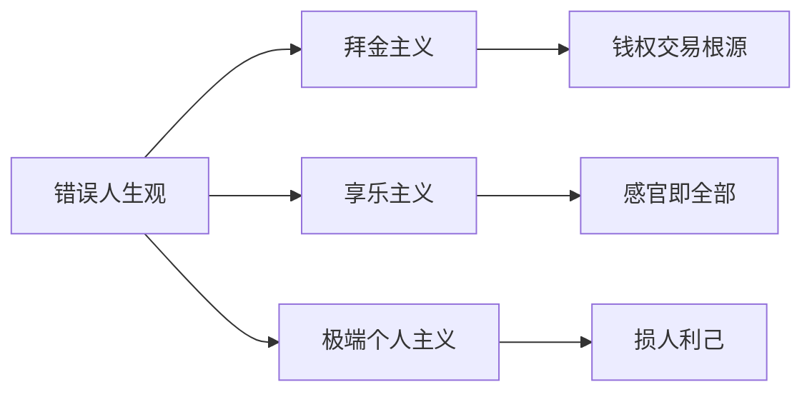

# 反对错误的人生观（拜金主义、享乐主义、极端个人主义）

## 它是什么

在《思想道德与法治》第一章里，科学高尚的人生观是 ==为人民服务==；与之相对，教材明确要求我们 **反对错误的人生观**，它们集中表现为三种：

- 拜金主义
- 享乐主义
- 极端个人主义

先看一个判断题轮廓：如果一个人认为“有钱就有一切”，另一个人认为“人生就是及时行乐”，第三个人认为“只要我好，别人和社会都是工具”——他们分别掉进了哪一种坑？

## 为什么需要反对

错误人生观会扭曲人生目的，把人引向歧路。其中：

> [!IMPORTANT]
> ==拜金主义是引发钱权交易、行贿受贿、贪赃枉法等丑恶现象的重要思想根源==

这不是说所有钱都有错，而是把金钱当“圣物”、当唯一标准时，实践上就会出问题。

## 三种人生观对比

| 类型 | 核心主张 | 主要问题 |
|---|---|---|
| 拜金主义 | 金钱主宰一切，追求金钱是至高目的 | 衡量价值只看钱，易生腐败 |
| 享乐主义 | 人生唯一目的是感官快乐 | 把合理享受变成唯一目的 |
| 极端个人主义 | 个人是目的，社会他人是手段 | 损人利己、狭隘功利 |

## 怎么做：分别反对它们

**反对拜金主义**：不把金钱神秘化、神圣化，不把获取金钱当成生活全部意义。

**反对享乐主义**：辛勤劳作后享受生活是正当的；但若把感官享乐作为“主义”去解释全部人生，就是褊狭理解人的需要。

**反对极端个人主义**：个人主义把个人利益放集体利益之上；极端个人主义更表现为 ==极端利己主义和狭隘功利主义==。我们应旗帜鲜明反对，尤其是极端形态。

> [!WARNING]
> 易错坑：享乐主义不是“不准享乐”，而是“唯一目的化”；个人主义也不是“不重视个人”，而是“他人与社会仅成手段”。

## 一个算对了的例子

简答：“错误的人生观有哪些？”

标准答法不是只写“个人主义”，而要写全三项：

> 错误的人生观包括：拜金主义、享乐主义、极端个人主义。

若再问“大学生如何防止错误人生观”，就从上面三点逐一反对来答，既扣住课件，也不漏项。
