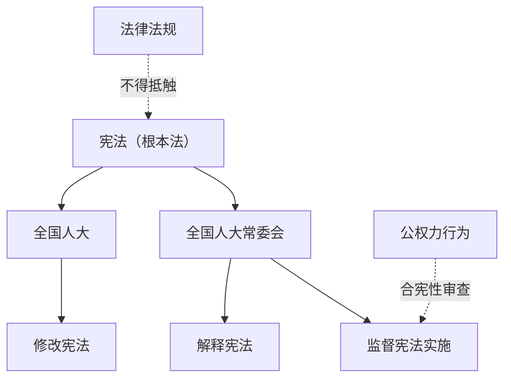

# 完善宪法监督制度，维护宪法权威
宪法是国家的==根本法==，具有最高的法律地位、法律权威和法律效力。维护宪法权威，关键在于建立和完善有效的宪法监督制度。在我国，宪法监督并非由普通法院行使，而是由==国家权力机关==主导的特定机制。

> [!IMPORTANT]
> 核心结论：我国宪法监督的主体是**全国人民代表大会及其常务委员会**。全国人大常委会行使==宪法解释权==，这是宪法监督的重要形式。

### 为什么需要宪法监督？

如果宪法缺乏监督，就会成为“没有牙齿的老虎”。宪法监督旨在确保一切法律、行政法规和地方性法规都不得同宪法相抵触，确保国家机关及其工作人员的行为符合宪法规定。它是保障公民权利的前提和基础，也是维护社会主义法制统一的关键。

### 怎么做：宪法监督的主要机制

1.  **事前审查与事后审查结合**：在立法过程中进行合宪性控制，同时对已生效的规范性文件进行备案审查。
2.  **宪法解释**：根据教学要点17，全国人大常委会依照宪法精神，对宪法规定的内容、含义和界限作出解释。这不仅是理解宪法的工具，更是解决宪法争议、完善宪法监督的重要手段。
3.  **备案审查制度**：下级机关制定的规范性文件需报送上级机关备案，接受合宪性与合法性审查。

### 常见误区与辨析

| 概念 | 主体 | 性质 |
| :--- | :--- | :--- |
| **宪法监督** | 全国人大及其常委会 | 政治性与法律性结合，最高层级 |
| **法律监督** | 人民检察院 | 司法机关的专门活动（要点10） |
| **司法审判** | 人民法院 | 解决具体案件纠纷（要点10） |

> [!WARNING]
> 易错坑：**法院不享有宪法解释权或违宪审查权**。在我国，人民法院行使审判权，但不能直接依据宪法宣告法律无效。宪法司法化不是我国当前的制度安排。

### 真题演练

**题目**：本次宪法修改了哪些内容？（简答）

**解析思路**：
虽然本题直接考察2018年修宪具体内容（如设立监察委员会、调整国家主席任期等），但其底层逻辑是**宪法修改程序**与**宪法权威**的关系。
*   **谁有权改？** 只有全国人民代表大会（要点3）。
*   **怎么改？** 严格遵循法定程序，体现党和人民意志（要点4）。
*   **意义何在？** 通过修改完善宪法，使其适应新时代要求，恰恰是为了更好地==维护宪法权威==，而非削弱它。

> [!TIP]
> 记忆口诀：人大修宪常委释，检察监督法院判。宪法至上不可违，备案审查保统一。

完善宪法监督制度，最终目的是让宪法“长牙”、“带电”，确保==党的领导==、==人民当家作主==和==依法治国==有机统一，为全面依法治国提供根本保障。
