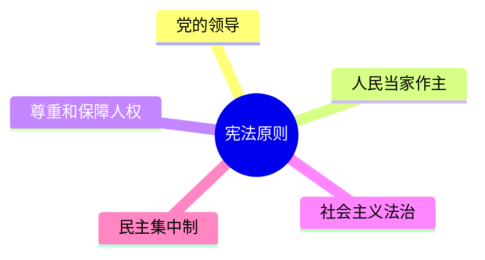

# 我国宪法的地位和基本原则（含宪法修正案）

## 宪法的地位：为什么它是“根本法”

我国宪法是==国家的根本法，是治国安邦的总章程，是党和人民意志的集中体现==。所谓“根本”，不是因为它条文最多，而是因为它规定国家最根本、最重要的问题，并为整个法律体系提供依据。

其至上地位主要体现在：

| 方面 | 核心内容 | 理解要点 |
|---|---|---|
| 内容根本 | 规定国家性质、根本制度、根本任务、公民基本权利和义务、国家机构等 | 解决国家制度的根本问题 |
| 效力最高 | 是其他法律的立法基础和立法依据 | 其他法律不得同宪法相抵触 |
| 程序严格 | 宪法的制定和修改程序比普通法律更严格 | 不能由普通立法程序随意改变 |

因此，普通法律与宪法不是“并列但分工不同”的关系，而是==宪法居于最高法律地位，普通法律依据宪法制定==。

> [!NOTE]
> 宪法保障是公民权利保障的前提和基础；司法保障则是公民权利保障的最后防线。二者所处环节不同，不能互换。

## 宪法的基本原则

教材要求掌握的基本原则可概括为：

- **党的领导原则**：中国共产党领导是中国特色社会主义最本质的特征。宪法确认党的领导地位，保证国家发展的正确方向。
- **人民当家作主原则**：国家的一切权力属于人民。人民通过人民代表大会制度等途径和形式管理国家事务、经济文化事业和社会事务。
- **尊重和保障人权原则**：宪法对公民基本权利和自由作出全面规定，依法保障公民的生存权、发展权等权利。
- **社会主义法治原则**：坚持依法治国，维护宪法法律权威，任何组织和个人都不得有超越宪法和法律的特权。
- **民主集中制原则**：国家机构实行民主集中制，把充分发扬民主与正确实行集中结合起来，实现科学决策、民主决策并保证国家机构协调高效运转。

> [!WARNING]
> 部分复习提纲只列“党的领导、尊重和保障人权、社会主义法治、民主集中制”四项，答题时容易漏掉==人民当家作主原则==。应以任课教师使用的教材版本为准，完整作答并分别解释。

## 宪法修正案：稳定与发展的统一

宪法保持根本法的权威和稳定，并不意味着永远不变。随着党和国家事业发展，可以通过法定程序对宪法部分内容进行修改，形成**宪法修正案**。修正案是现行宪法的组成部分，而不是另一部宪法，也不等于全面重新制定宪法。

理解其意义，可抓住两点：一是把实践发展形成的重要成果和制度要求及时确认下来；二是通过严格修改程序维护宪法的连续性、稳定性和权威性。

## 相近原则不要混答

| 规范领域 | 典型基本原则 |
|---|---|
| 宪法 | 党的领导、人民当家作主、尊重和保障人权、社会主义法治、民主集中制 |
| 刑法 | 罪刑法定、法律面前人人平等、罪刑相适应 |
| 仲裁 | 自愿、仲裁独立、一裁终局 |

> [!TIP]
> 简答题先写“根本法、总章程、集中体现”，再从内容、效力、程序说明至上地位；原则题采用“原则名称＋一句解释”。例如：“尊重和保障人权原则——宪法全面规定公民基本权利和自由，依法保障公民生存权和发展权。”不要把“罪刑法定”等刑法原则写入宪法原则。
