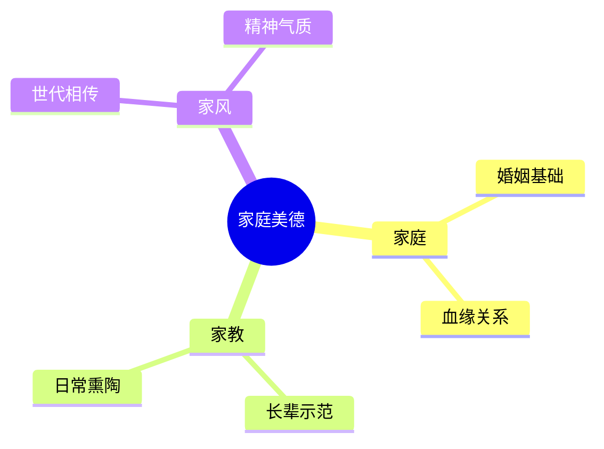
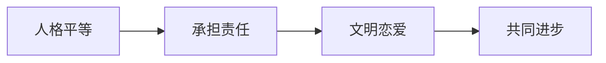
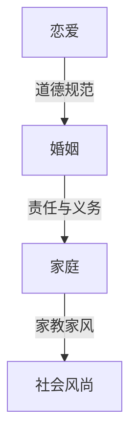

# 弘扬家庭美德（注重家庭家教家风、恋爱婚姻家庭中的道德规范、正确的恋爱观与婚姻观）

## 家庭、家教、家风：家庭美德的三块基石

家庭美德涵盖家庭、家教、家风三个层面。家庭是社会的"细胞"——在 ==婚姻关系、血缘关系或收养关系基础上产生的亲属之间所构成的社会生活单位==。家教是长辈对晚辈的教育熏陶，家风则是一个家庭世代相传的精神气质与行为风格。三者由小到大、由内向外，共同构成社会公德在私人领域的延伸。

> [!NOTE]
> 社会公德处理人与人、人与社会、人与自然的关系；==家庭美德则主要处理夫妻、长幼、邻里之间的关系==，是道德规范在私人领域的具体化。

## 恋爱中的道德规范

恋爱不是纯粹的私人感受，而是涉及两个人的道德实践。主要规范有三条：

| 规范 | 含义 | 易错点 |
|---|---|---|
| ==尊重人格平等== | 双方人格独立、关系平等 | 不等于"对等付出每一分钱" |
| ==自觉承担责任== | 自愿为对方承担责任，是==爱情本质的体现== | 不是口头承诺而是持续行动 |
| 文明相亲相爱 | 举止得体、相互尊重 | 亲密≠公序良俗可以被突破 |

> [!IMPORTANT]
> 在恋爱的道德规范中，==自觉承担责任是爱情的本质==，是选择题与简答题的高频采分点。

大学生处理恋爱关系时，还应摆正 ==恋爱与学业、工作的关系==：以学业事业为重，使爱情成为进步的动力而非阻力；同时处理好恋爱与集体生活的关系，不因二人世界疏离同学与集体。

## 校园爱情三问

恋爱观是指人们对于恋爱问题的总看法和根本观点。正确的恋爱观应当做到：==把共同理想作为爱情的内核==，而不是把外貌、金钱、消费能力当成唯一标准。问自己一句：如果没有这些外部条件，你们还有话说吗？

> [!TIP]
> 简答"恋爱道德规范"时口诀：**"平、责、文"**——人格平等、承担责任、文明相爱；再补一句"正确处理恋爱与学业工作的关系"，即可覆盖全部采分点。

## 正确的婚姻观与家庭美德

婚姻观是人们对婚姻家庭问题的根本看法。正确的婚姻观强调爱情与责任的统一、权利与义务的统一，主张男女平等、夫妻和睦、勤俭持家、邻里团结，反对把婚姻当作交易或逃避责任的工具。

> [!WARNING]
> 常见坑：把"婚姻自由"理解为"不受任何道德约束"。==婚姻自由≠不承担责任==，法律上的自由与道德上的责任是并行的两条线。

## 与相邻概念的区分

| 概念 | 处理的关系 | 核心要求 |
|---|---|---|
| 社会公德 | 人与人/社会/自然 | 文明礼貌、助人为乐 |
| 职业道德 | 从业人员/服务对象/职业之间 | 爱岗敬业、奉献社会 |
| ==家庭美德== | ==夫妻、长幼、邻里== | 男女平等、勤俭持家 |

> [!CAUTION]
> 千万别把"家庭美德"答成"恋爱道德规范"的同义反复——前者范围更宽，涵盖婚姻家庭与家风，后者只是恋爱阶段的要求。

## 一道简答题长什么样

> ★ 恋爱中应当遵循的主要道德规范？

参考解答：一、==尊重对方的人格和意愿==，平等相待，互敬互爱；二、==自觉承担责任==，对爱情负责，对社会负责；三、文明相亲相爱，言行举止符合社会公德；四、正确处理恋爱与学业、工作的关系，以事业为重，共同进步。
