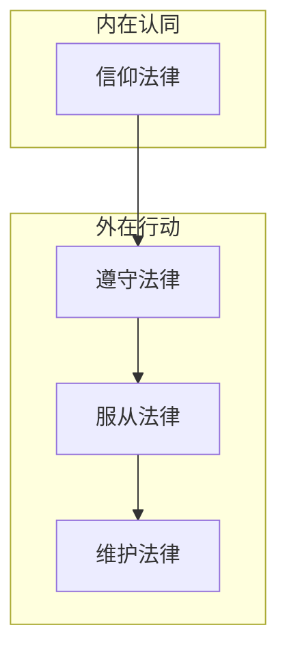

# 尊重和维护法律权威的基本要求

> [!IMPORTANT]
> 保证法律发挥作用的基本前提和要求、保障个人平安幸福的底线和红线是==全体社会成员尊重社会主义法律权威==。

试想：如果一部法律制定出来，却无人敬畏、无人遵守、无人维护，它还能发挥规范作用吗？答案显然是否定的。法律的权威源自人民的内心拥护和真诚信仰，因此我们必须明确如何将其落到实处。

## 是什么与为什么

“尊重和维护法律权威的基本要求”回答的是**如何将法治理念转化为实际行动**。它包含四个层层递进的维度：信仰、遵守、服从、维护。

- **信仰法律**：解决思想根基问题，对法律常怀敬畏之心。
- **遵守法律**：解决行为底线问题，用实际行动捍卫法律尊严。
- **服从法律**：解决利益冲突时的态度问题，接受约束并承担责任。
- **维护法律**：解决社会责任问题，争当公平正义的守护者。

## 怎么做：四项要求详解

| 基本要求 | 核心内涵 | 具体表现 |
| :--- | :--- | :--- |
| **信仰法律** | 树立法律至上观念，内心认同 | 对法律常怀敬畏之心，不视法律为儿戏 |
| **遵守法律** | 严格依法办事，履行法律义务 | 用实际行动捍卫法律尊严，保障法律实施 |
| **服从法律** | 自觉接受法律约束，服从决定 | 拥护法律规定，履行法定义务，承担相应法律责任 |
| **维护法律** | 敢于同违法犯罪行为作斗争 | 争当法律权威的守望者、具有良知的护法者 |

> [!TIP]
> 记忆口诀：“信、遵、服、维”。从内心的“信”，到行为的“遵”，再到受约束时的“服”，最后升华为主动出击的“维”，是一个由内而外、由己及人的过程。

## 相近概念辨析

很多同学容易将“遵守法律”与“服从法律”混淆。

- **遵守法律**侧重于“日常状态”下的主动合规，即不越红线（如不闯红灯、不传播网络谣言）。
- **服从法律**侧重于“特定情境”下（尤其是自身利益受损或面临管理时）的被动接受与配合。例如，依法缴纳个人所得税、适龄男性公民依法被征集服现役，或者在司法程序中接受人民法院的依法判决，这些都属于服从法律的范畴。

> [!NOTE]
> 尊重法律权威不等于盲从。我国宪法确立了“尊重和保障人权原则”与“社会主义法治原则”，法律本身是科学性与先进性的统一，更能尊重和反映社会发展规律。因此，我们信仰的是代表人民意志的社会主义法律。

## 常见易错坑

> [!WARNING]
> 答题时切勿漏掉“维护法律”。不少同学只写到“自己不违法”就结束了，但“维护法律”要求我们不仅独善其身，还要兼济天下——敢于同违法犯罪行为作斗争。

> [!CAUTION]
> 不要把道德领域的“尊重”（如恋爱中尊重人格平等、尊重社会公德）与法律层面的“尊重法律权威”混为一谈。前者属于德治范畴，后者是法治素养的核心要求。法治和德治如车之两轮，缺一不可。

## 真题示例

**【简答题】尊重和维护法律权威的基本要求是什么？**

**标准作答思路：**
1. **信仰法律。** 就要信仰法律，树立法律至上观念，对法律常怀敬畏之心，内心认同法律。
2. **遵守法律。** 就要遵守法律，严格依法办事，用实际行动捍卫法律尊严，保障法律实施，履行法律义务。
3. **服从法律。** 就要服从法律，拥护法律的规定，自觉接受法律约束，服从依法进行的管理，承担相应的法律责任。
4. **维护法律。** 就要维护法律，敢于同违法犯罪行为作斗争，争当法律权威的守望者、公平正义的守护者、具有良知的护法者。
