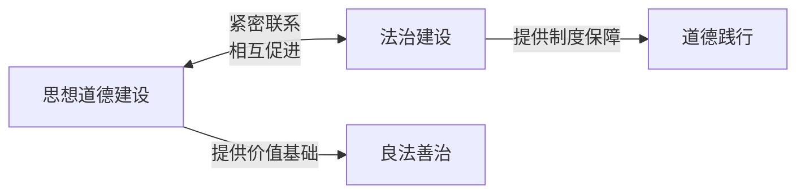

# 思想道德与法律的关系（相互联系、相互补充、相互促进）

> [!IMPORTANT]
> 思想道德与法律是调节人们思想行为、协调人际关系、维护社会秩序的两种重要手段。二者==相互联系、相互补充、相互促进==，共同服务于中国特色社会主义事业。

## 它们分别靠什么起作用？

思考一个问题：如果有人在公交车上不让座，和有人偷了别人的手机，社会分别用什么方式去约束他们？

前者靠舆论谴责和内心愧疚，后者靠警察抓捕和法院判刑。这就引出了二者的核心区别：

| 比较维度 | 思想道德（德治） | 法律（法治） |
| :--- | :--- | :--- |
| **发挥作用依靠** | 社会舆论、传统习俗、内心信念 | 国家强制力保证实施 |
| **侧重方向** | 内在的自我约束和价值引导 | 外在的行为规范 |
| **表现形式** | 道德规范、风俗习惯 | 法律条文、法规制度 |
| **违反后果** | 舆论谴责、良心不安（不一定担责） | 承担法律责任（民事/行政/刑事） |

> [!WARNING]
> 常见误区：认为“不违法就是道德的”。法律只是最低限度的道德，许多失德行为虽不承担法律责任，但会受到社会舆论的严厉谴责。

## 为什么说它们相互促进？

既然约束方式不同，为什么课程总把它们放在一起讲？因为在我国的治理体系中，法治和德治如同车之两轮、鸟之双翼。

具体而言，这种双向互动体现在两个方向：

**1. 思想道德为法律提供价值准则（德治是法治的基础）**
*   **立法环节**：科学立法和民主立法将思想道德有机融入法律体系，使法律具有鲜明道德导向。例如《民法典》将“诚实信用”确立为基本原则，就是把道德要求上升为法律规范。
*   **守法环节**：思想道德能促进人们自觉尊法学法守法用法，提高公民守法自觉性，从而降低执法成本。
*   **弥补不足**：道德调整的范围比法律更广、更灵活，能弥补法律调整的短板。

**2. 法律为思想道德提供制度支撑（法治是德治的保障）**
*   **确认原则**：法律通过对思想道德的基本原则予以确认，为其提供国家强制力保障。
*   **惩恶扬善**：严格执法和公正司法有利于维护公平正义，弘扬真善美，打击假恶丑。
*   **普法教育**：全民普法有助于增强人们信守法律的思想道德水平，引导自觉履行法定义务与社会责任。

> [!TIP]
> 记忆口诀：“**德指法，法保德**”——道德指引法律的方向，法律保障道德的底线。

## 考试怎么答？一个标准例题

遇到简答题“简述法治和德治的相互促进作用”，可以直接按以下逻辑展开：

> [!NOTE]
> **参考解答：**
> 1. **法治是德治的保障**。法律为道德提供制度支撑，通过强制力维护基本道德底线。
> 2. **德治是法治的基础**。道德为法律提供价值支撑，提高公民守法自觉性，降低执法成本。
> 3. **二者相辅相成**，共同促进社会和谐稳定。

> [!CAUTION]
> 答题时切忌只写“两者都很重要”。必须点明==谁为谁提供什么==（如“价值基础”“制度保障”），并使用课件中的规范术语（引领和教化作用 / 规范和强制作用）。
