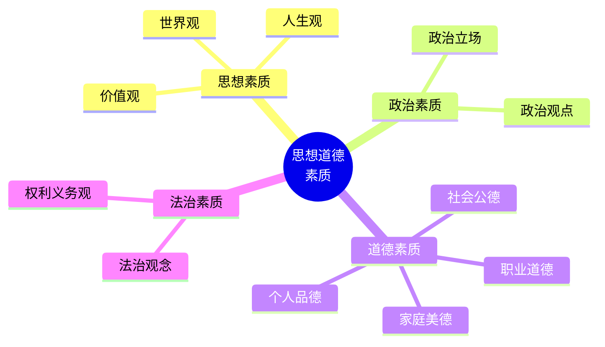

# 思想道德素质的内涵与构成

## 思想道德素质的内涵与构成

在《思想道德与法治》绪论中，**思想道德素质**是时代新人必备的核心素养。它并非单一概念，而是思想观念、政治立场、价值取向、道德情操和行为习惯等方面品质和能力的综合体现。

> [!IMPORTANT]
> ==核心定义==：思想道德素质是人们的思想观念、政治立场、价值取向、道德情操和行为习惯等方面品质和能力的综合体现。

### 为什么需要重视？

作为南邮学子，我们不仅要有精湛的技术（如通信协议、算法设计），更要有正确的方向。思想道德素质决定了你“为谁服务”以及“如何做人”。它是调节个人与社会、个人与他人关系的行为规范总和，主要依靠==社会舆论==、==传统习俗==和==内心信念==来发挥作用。

### 核心构成要素

思想道德素质主要由以下四个维度构成，它们相互联系，共同支撑起一个人的精神骨架：

1.  **思想素质**：核心是树立正确的世界观、人生观和价值观。例如，对“生活理想”的构想，包括对吃穿住用及爱情婚姻的追求，都源于此。
2.  **政治素质**：表现为坚定的政治立场和观点。其中，==中国精神==是重要支撑，它以==爱国主义==为核心的民族精神和以==改革创新==为核心的时代精神为基本内容。
3.  **道德素质**：这是日常行为的准则。
    *   **核心**：为人民服务。
    *   **原则**：集体主义。
    *   **落脚点**：个人品德。
    *   **注意**：在恋爱道德中，==自觉承担责任==是爱情的本质，而非单纯的激情。
4.  **法治素质**：尊法学法守法用法的能力。需明确，家庭不仅是情感单元，也是法律单元，定义为“在婚姻关系、血缘关系或收养关系基础上产生的亲属之间所构成的社会生活单位”。

### 常见误区与辨析

| 概念 | 常见误区 | 正确理解 |
| :--- | :--- | :--- |
| **道德起源** | 源于神启或人性本善 | ==劳动==是人类道德起源的第一个历史前提 |
| **中国精神** | 仅指传统文化精神 | 是民族精神（根基）与时代精神（活力）的统一 |
| **人生价值** | 自我价值高于社会价值 | 自我价值与社会价值是==矛盾统一体==，社会价值是根本尺度 |

> [!WARNING]
> **易错点提醒**：不要混淆“犯罪构成”与“思想道德素质”。前者是刑法概念（主体、主观、客体、客观四要件），后者是德育概念。虽然两者都涉及“主观方面”（如故意/过失 vs 内心信念），但评价标准完全不同：法律看行为危害性，道德看善恶评价。

### 典型例题解析

**题目**：人类道德起源的第一个历史前提是？
A. 意识的发展
B. 语言的产生
C. 劳动
D. 社会分工

**解析**：根据马克思主义道德观，==劳动==创造了人本身，也创造了道德产生的主客观条件。因此选 **C**。这提醒我们，道德不是空中楼阁，而是植根于社会实践（劳动）之中的。
