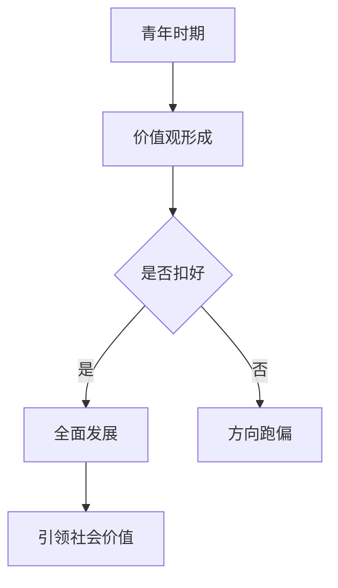
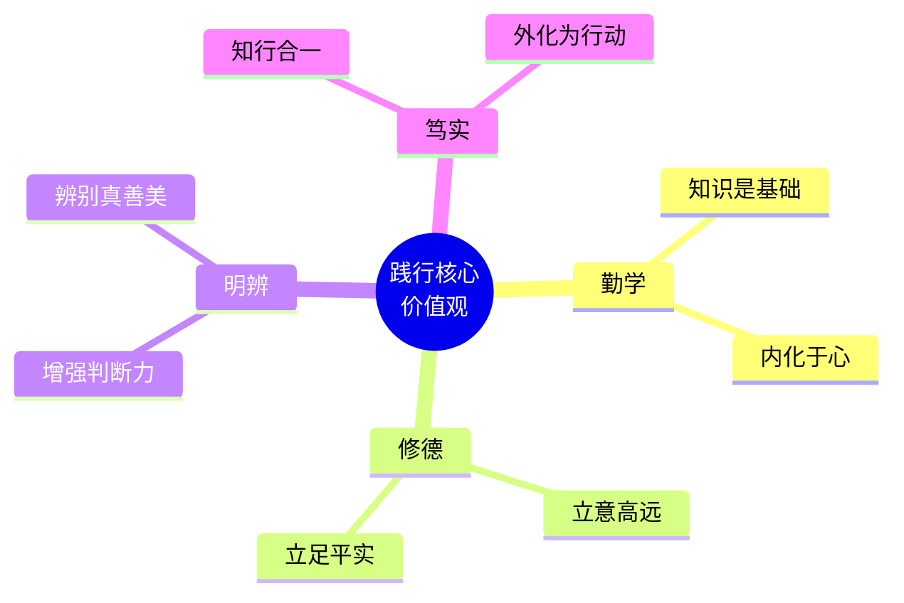

# 扣好人生的扣子（青年时期价值观养成的重要性）

> [!IMPORTANT]
> “扣好人生的扣子”是指==青年时期价值观养成的重要性==。青年的价值取向决定了未来整个社会的价值取向，而青年又处在价值观形成和确立的重要时期，抓好这一时期的价值观养成十分重要。

## 为什么需要“扣好第一粒扣子”

试想：如果衬衫的第一粒扣子扣错了，后面的会怎样？必然全盘皆错。人生也是如此。大学生正处在拔节孕穗期，核心价值观的养成绝非一日之功。如果没有正确价值观的引领，成长成才和全面发展就会失去方向。

## 怎么做：从理念到行动

大学生的成长成才离不开正确价值观的引领，但如何把宏大的要求落地？关键在于将核心价值观的要求变为日常行为准则，具体路径就是“勤学、修德、明辨、笃实”。

> [!TIP]
> 记忆口诀：“学德辨实”。**勤学**打基础，**修德**立根本，**明辨**定方向，**笃实**见真功。

- **勤学**：把学习作为一种精神追求、一种生活方式，注重把所学知识内化于心。
- **修德**：既要立意高远、立志报效祖国服务人民，又要立足平实、从做好小事管好小节起步。
- **明辨**：增强价值判断力和道德责任感，学会辨别真善美和假恶丑。
- **笃实**：于实处用力，从知行合一上下功夫，使核心价值观内化为精神追求，外化为自觉行动。

## 易混辨析与常见坑

> [!WARNING]
> 常见误区：认为“扣好扣子”只是一句口号，或者将其与第五章“明大德守公德严私德”的具体道德规范完全等同。前者是==总领性的价值观养成隐喻==，后者是具体的道德实践领域。

| 维度 | 扣好人生的扣子（第四章） | 明大德守公德严私德（第五章） |
| :--- | :--- | :--- |
| **侧重点** | 价值观养成的时机与总体路径 | 道德修养的具体层次与规范 |
| **核心逻辑** | 强调“早”与“基”，防微杜渐 | 强调“全”与“细”，分层落实 |
| **实践抓手** | 勤学、修德、明辨、笃实 | 个人品德、社会公德等建设 |

> [!CAUTION]
> 考试极易踩坑点：答“大学生如何践行社会主义核心价值观”时，只写“勤学修德明辨笃实”四个词而不展开。必须结合课件原话，指出“核心价值观的养成绝非一日之功”，并落实到“变为日常行为准则”。

## 典型例题解析

**题目**：大学生应当如何自觉践行社会主义核心价值观？

**满分答题思路**：
1. **破题（是什么+为什么）**：首先要扣好人生的扣子。指出青年的价值取向决定未来整个社会的价值，青年处在价值观形成和确立的重要时期，大学生成长成才离不开正确价值观引领。
2. **展开（怎么做）**：分点论述“勤学、修德、明辨、笃实”。例如写“修德”时，必须体现辩证思维——既写出“立意高远，立志报效祖国”，又写出“立足平实，从做好小事起步”。
3. **落脚（目标）**：强调于实处用力，做到知行合一，最终实现核心价值观内化为精神追求、外化为自觉行动。

> [!NOTE]
> 这道题本质考查的是“认知—情感—意志—行为”的统一。答题时切忌空谈理论，一定要把“勤学修德明辨笃实”作为得分骨架，用课件中的标准表述去填充血肉。
