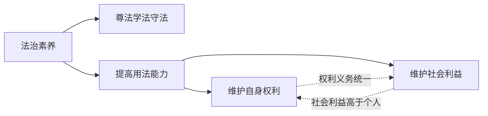

# 不断提升法治素养（尊法学法守法用法、提高用法能力、维护自身权利与社会利益）

## 不断提升法治素养的内涵与逻辑

法治素养并非抽象概念，而是==尊法学法守法用法==的有机统一。在思考“如何提升”之前，不妨先问自己：当个人权益受损时，除了情绪宣泄，能否第一时间想到法律途径？当目睹社会不公时，是否敢于且善于运用法律武器？这两个问题直指法治素养的核心——**提高用法能力**。它要求我们将法律知识转化为维护自身权利与社会利益的实际行动，实现从“知法”到“用法”的跨越。

> [!IMPORTANT]
> 思想道德为法律提供思想指引和价值基础，促进人们自觉尊法学法守法用法；而提高用法能力则是法治素养的==实践落脚点==，包含维护自身权利与维护社会利益两个不可分割的维度。

## 提高用法能力的双重维度

提升法治素养不能停留在口号上，必须落实到具体的用法实践中。这主要体现在以下两个方面：

### 维护自身权利

依法维权是法治素养的基础体现。大学生应熟悉《民法典》等法律中关于财产权、人身权的规定，遇事找法、解决问题靠法。例如，面对兼职欠薪或消费欺诈，应通过协商、调解、仲裁或诉讼等正当程序解决，而非采取极端手段。

### 维护社会利益

个人利益与社会利益本质上是统一的。维护社会公共利益不仅是道德要求，更是法律规范。对违法犯罪行为要敢于揭露、勇于抵制，消除袖手旁观的恐惧心理和遇事回避的惧法现象。见义勇为、帮扶弱者等行为受《民法典》《未成年人保护法》等法律保护，是践行法律、弘扬正气的具体表现。

## 易混淆概念辨析与避坑指南

许多同学容易将“法治素养”等同于“背诵法条”，或在维权时陷入误区。下表梳理了关键区别：

| 对比维度 | 正确理解（法治素养） | 常见误区 |
| :--- | :--- | :--- |
| **知行关系** | 理论学习与实践养成相统一 | 只背条文，遇事不会用、不敢用 |
| **利益取向** | 个人利益与社会利益相统一 | 只讲个人维权，忽视社会责任 |
| **维权方式** | 遵循正当程序，理性合法 | 以暴制暴、网络暴力或忍气吞声 |
| **德法关系** | 道德滋养法治，法治保障道德 | 将道德与法律割裂对立 |

> [!WARNING]
> 维护社会利益≠无原则牺牲个人利益。社会主义法治强调国家、社会、个人利益的统一，但在特定情境下==社会利益高于个人利益==。同时，见义勇为必须在法律框架内进行，避免因“好心办坏事”承担不必要的法律责任。

## 真题应用示例

回顾简答题“简述法治思维的基本内容”，其标准答案中的“权利保障”与“正当程序”正是提高用法能力的理论支撑。例如，在处理校园侵权纠纷时：

-   **权利保障**对应“维护自身权利”，需明确自身合法权益边界；
-   **正当程序**对应“维护社会利益”中的规则意识，确保维权过程合法合规。

> [!TIP]
> 答题时若涉及“如何做”，务必点出“维护自身权利”与“维护社会利益”两点，并强调思想道德对自觉用法的促进作用，这是教材P249-250的核心得分点。做新时代的守法人、护法人，既要善于用法保护自己，也要敢于用法守护正义。
