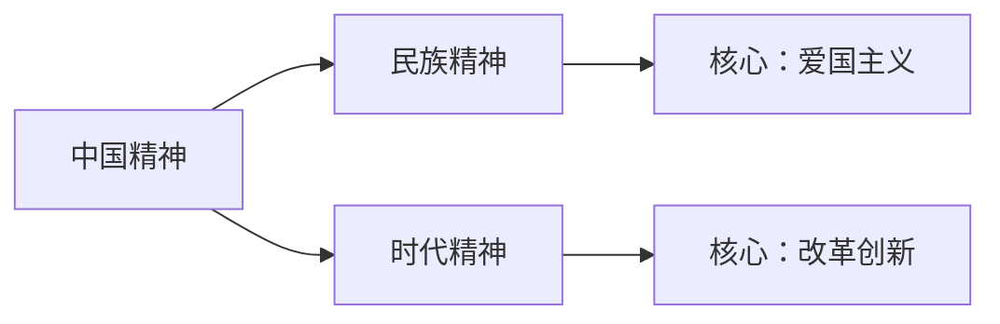

# 改革开放是当代中国的显著特征（让改革开放成为青春远航的动力）

## 改革开放是当代中国的显著特征

要理解“改革开放是当代中国的显著特征”这句话，不妨先想一想：一个国家的“特征”是什么？它往往不是一个临时动作或短期的政策，而是==已经融入这个国家发展基因的长期实践==。

改革开放对于当代中国而言，正是如此。它始于 1978 年，它不是一件“做完就了结”的事，而是一套不断延续、深入、扩展的变革逻辑。从农村到城市，从经济到社会，从国内到国际，这场变革几乎重塑了国家的运行方式和人们的生活面貌。正因为它覆盖了国家发展的每一个阶段、每一个领域，所以我们说它是“显著特征”——它决定了这个时代的底色。

### 为什么需要改革开放

可以从三个层面来理解改革创新的必要性：

1. **对于国家**：==创新始终是推动一个国家、一个民族向前发展的重要力量==。近代以来，大国崛起的背后几乎都伴随着制度、科技或产业上的重大创新。
2. **对于人类社会**：创新也是推动人类社会向前发展的重要力量。从蒸汽机到信息技术，每一次飞跃都源于改革与创新。
3. **对于当下的中国**：当前我国正处于从大国向强国迈进的关键时期，==唯有改革创新，才能破解发展难题，增强发展动力，厚植发展优势==。

这里有一个容易混淆的点需要特别注意：

> [!WARNING]
> **时代精神的核心**
>
> 题目中经常出现一个考点——时代精神的核心是什么？答案是 **改革创新**。
> 注意不要跟“民族精神的核心（爱国主义）”搞混。两者分属不同的精神维度：民族精神侧重历史传承与认同，时代精神侧重当下变革与进步。

下面这张图可以帮助你理清基本关系：

### 怎么让改革开放成为青春远航的动力

对大学生而言，“改革开放”不是只存在于教材里的宏大叙事。可以从三个角度把它变成自己的成长资源：

1. **接受新事物**：时代在变，知识更新的速度前所未有。保持学习的开放性，本身就是一种“开放”。
2. **敢于尝试**：创业、科研、社会实践，都不要因为“以前没做过”就退缩。创新始于行动，而不是空想。
3. **理解国情，找准方向**：只有理解了国家为什么必须走改革开放这条路，我们才能在这个大趋势里找到属于自己的机会。

> [!TIP]
> **记忆口诀**
>
> 时代精神的考点可以这样记：**“封”建守旧是过去，改革创新是核心**。“封”谐音“风”，一吹就想到时代，时代精神的核心就是改革创新。

### 一个高频率的题目

下面这道题是典型的“时代要求”类简答题，理解它比死记硬背更可靠：

**题目**：改革创新是时代要求。

**解析**：这道题问的其实是“为什么说改革创新是时代的要求”。可以从前面三个层面展开，分条写清即可：

- 创新始终是推动一个国家、一个民族向前发展的重要力量。
- 创新也是推动人类社会向前发展的重要力量。
- 当前我国正处于从大国向强国迈进的关键时期，==唯有改革创新，才能破解发展难题，增强发展动力，厚植发展优势==。

把这三条记住，这一类简答题就能灵活应对。
