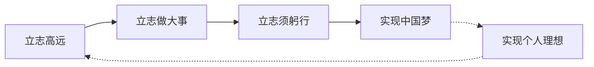

# 在实现中国梦的实践中放飞青春梦想（立志高远、做大事、躬行）

在实现中国梦的实践中放飞青春梦想，核心在于处理好“立志”与“躬行”的关系，将个人理想融入社会理想。这不仅是青年成长的内在要求，也是担当民族复兴大任的必然选择。实现这一要求，需要把握立志高远、做大事、须躬行三个维度。

## 立志当高远：把准人生航向

“志不立，天下无可成之事。”立志当高远，就是要求青年树立远大志向，不局限于眼前的得失与个人的安逸。这里的“高远”，并非好高骛远，而是指志向的境界要超越个人私利，将个人理想融入国家和民族的事业中。

> [!IMPORTANT]
> 立志高远的关键在于==把个人理想与社会理想统一起来==。个人理想只有同国家的前途、民族的命运相结合，才有持久的动力和广阔的空间。

## 立志做大事：确立价值追求

立志做大事，强调的是人生追求的价值导向。青年要==以国家民族的命运为己任，把服务人民、报效祖国作为最大追求==，而不要以个人的荣华富贵为人生理想。

“做大事”不等于“做大官”或追求个人名利，而是指投身于为人民谋幸福、为民族谋复兴的伟大事业。新时代的大学生应把个人命运与国家人民命运结合起来，在为实现社会理想而奋斗的过程中实现个人理想。

> [!WARNING]
> 常见误区：将“做大事”理解为追求个人显赫地位或巨额财富。这是混淆了个人主义价值观与集体主义价值观，偏离了“服务人民、报效祖国”的核心要求。

## 立志须躬行：坚持脚踏实地

“千里之行，始于足下。”崇高理想的实现需要一点一滴地奋斗，立志须躬行就是要求青年脚踏实地，知行合一。

躬行要求把提高道德认识与躬行道德实践统一起来，促进道德要求内化为个人的道德品质，外化为实际的道德行为。对于大学生而言，躬行意味着从学好专业知识、参与社会实践、做好身边小事做起，在实现中国梦的生动实践中放飞青春梦想。

## 相近概念辨析

| 维度 | 立志当高远 | 立志做大事 | 立志须躬行 |
| :--- | :--- | :--- | :--- |
| **核心指向** | 志向的境界与格局 | 志向的内容与价值导向 | 志向的实现路径 |
| **解决问题** | 避免目光短浅、缺乏动力 | 避免个人主义、功利主义 | 避免空谈理想、眼高手低 |
| **实践要求** | 将个人理想融入国家事业 | 以服务人民、报效祖国为追求 | 脚踏实地，知行合一 |

## 答题示例与常见误区

**题目：大学生如何在实现中国梦的实践中放飞自己的青春梦想？**

**参考作答：**
大学生要在实现中国梦的实践中放飞青春梦想，需做到三点：一是立志当高远，树立远大志向，把个人理想融入国家和民族的事业中；二是立志做大事，以国家民族的命运为己任，把服务人民、报效祖国作为最大追求，不以个人荣华富贵为人生理想；三是立志须躬行，脚踏实地，坚持知行合一，在为实现社会理想而奋斗的过程中实现个人理想。

> [!CAUTION]
> 答题时切勿只写“立志高远”而遗漏“做大事”和“须躬行”，三者构成完整的逻辑链条：高远定方向，大事定价值，躬行定路径。同时，要避免将“躬行”简单等同于“努力学习”，应强调道德实践与社会理想的结合。
