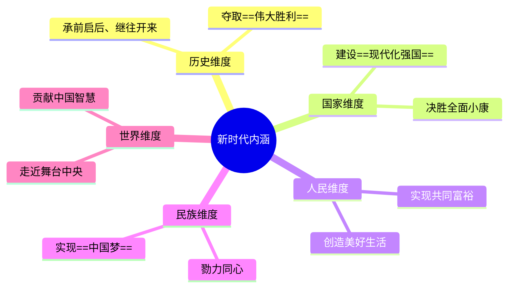

# 我们处在中国特色社会主义新时代（历史方位与时代背景）

---

### 为什么需要理解这个“新时代”？

你可能会有疑问：一个时间阶段，为什么要专门拎出来定义，还要放进考试里？这不只是个政治概念，它是对我们“站在哪里、往哪去、怎么走”的根本坐标定位。

只有看准了时代坐标，你才能明白：

*   为什么国家要提“民族复兴”“共同富裕”这些目标？
*   为什么我们这一代青年会的被称作“时代新人”？
*   你个人的学业规划、职业理想，怎样才能不跑偏，并借到时代最大的“势”？

==这是一个关乎目标与路径的根本判断。==

---

### 它到底是什么（核心内涵“五个是”）

课件里“五个是”的表述，精准概括了新时代的内涵。它不是一个口号，而是一张包含了历史、国家、人民、民族、世界五个维度的蓝图。

我们可以将它拆解成一个层次分明的逻辑图：

[!IMPORTANT]
> 这个阶段的核心任务，已经从“有没有”转向了“好不好”，是从“富起来”迈向“强起来”的伟大飞跃。

---

### 怎么理解这个“新”（三个意味着）

仅仅知道内涵还不够，考题里那一道选择题，考的就是我们如何多角度理解这个“新”的深层意义。题干里的错误选项很典型，我们直接用它来辨析：

*   **对中华民族的意义**：从**站起来、富起来到强起来**的伟大飞跃。（选项 D 正确）
*   **对科学社会主义的意义**：在 21 世纪的中国焕发出强大生机活力。（选项 B 正确）
*   **对人类发展的意义**：为那些希望快速发展又希望独立的国家，提供了全新选择，贡献了中国智慧。（选项 A 正确）

[!WARNING] 常见易错点
> 选项 C “意味着中国已经建成社会主义现代化强国”，这是错误的。
> **错在时态。** 我们的战略安排是“两步走”：到 2035 年基本实现现代化；到**本世纪中叶**才建成富强民主文明和谐美丽的社会主义现代化强国。==新时代是我们开启新征程的起点，而不是完成时的终点。==

---

### 这对我们青年意味着什么？（结合考题）

理解了所处的大时代，自然就引出了考题里“青春梦想”的问题。时代方位决定青年的责任，决定了我们怎么做。

*   **立志当高远**
    新时代的目标是民族复兴，你的个人志向如果脱离了国家的“大蓝图”，就成了无源之水。要把个人理想融入国家和民族的事业中。
*   **立志做大事**
    什么是大事？在这个时代，服务人民、报效祖国就是最大的事。这不是一句空话，意味着你在选择专业、职业时，要思考能为这个社会创造什么价值。
*   **立志须躬行**
    前面说的都是顶层设计，落到你身上就是“脚踏实地”四个字。在实验室里踏踏实实做数据，在社区里认认真真做服务，这就是在实现中国梦的实践中，放飞你自己的青春梦想。

[!TIP]
> 记忆口诀：**“一高（志向高远）、一大（做大事）、一躬行”**。这是个人梦想与“中国梦”同频共振的具体路径。

整个绪论乃至整本书，都在帮你解决一个问题：确定了自己身处中国特色社会主义新时代这一历史方位，你该如何成为一个能担当复兴大任的时代新人。这个逻辑，你理顺了吗？
