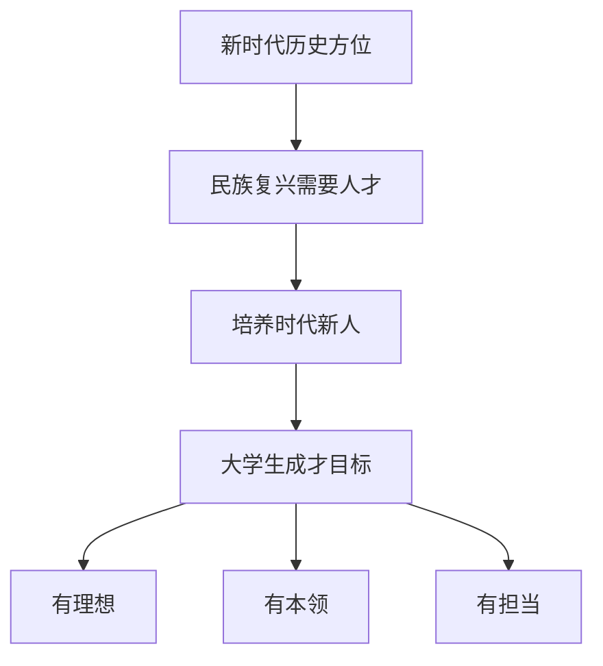

# 新时代呼唤担当民族复兴大任的时代新人（大学生的根本要求与成才目标）

## 为什么需要“时代新人”

想一想：党的十九大提出的战略要求，为什么要落在“人”身上？民族复兴不是抽象口号，最终要靠==一代又一代有理想、有本领、有担当的人==去实现。新时代的历史方位决定了：国家需要的人才，不只是“有学历”，更要能肩负历史责任。因此，==“培养担当民族复兴大任的时代新人”==成为战略要求，而大学生的成才目标也就由此展开。

## 大学生的根本要求

大学生应当以==有理想、有本领、有担当==为根本要求。三者不是并列堆砌，而是层层支撑：理想解决“往哪里去”，本领解决“凭什么去”，担当解决“敢不敢去”。

| 要求 | 回答的问题 | 常见误区 |
|---|---|---|
| 有理想 | 方向与信念 | 把理想等同于个人愿望 |
| 有本领 | 能力与素质 | 把本领等同于分数证书 |
| 有担当 | 责任与行动 | 把担当等同于口头表态 |

> [!IMPORTANT]
> 根本要求就是“有理想、有本领、有担当”。简答题里若问“大学生的根本要求”，直接答这三点，并说明这是担当民族复兴大任的时代新人对大学生的具体要求。

## 与相近说法的区别

“时代新人”容易和“社会主义建设者和接班人”混用。前者更突出==新时代的历史责任==，后者更强调教育的总体培养目标；在南邮这门课的语境里，二者方向一致，但答题时以“担当民族复兴大任的时代新人”作为规范表述。

## 常见坑

- 只背“时代新人”，漏掉前面的“==担当民族复兴大任==”。
- 把“三有”写成“德智体美劳”——那是全面发展目标，不是这里的根本要求。
- 把“有理想、有本领、有担当”理解成可替换词语，写成“有知识、有文化、有道德”。

> [!TIP]
> 记成一句：==复兴大任落在肩，三有要求记心间==。考场上先写战略要求，再写三有，最后补一句“在实践中创造有意义的人生”，层次就完整了。

## 一个答对了的例子

题目：党的十九大提出的一项战略要求是什么？大学生应当具备怎样的根本要求？

参考作答：党的十九大提出“==培养担当民族复兴大任的时代新人==”的战略要求。大学生应当以==有理想、有本领、有担当==为根本要求，把个人成长融入国家和民族事业，在实践中创造有意义的人生，成就出彩人生。
