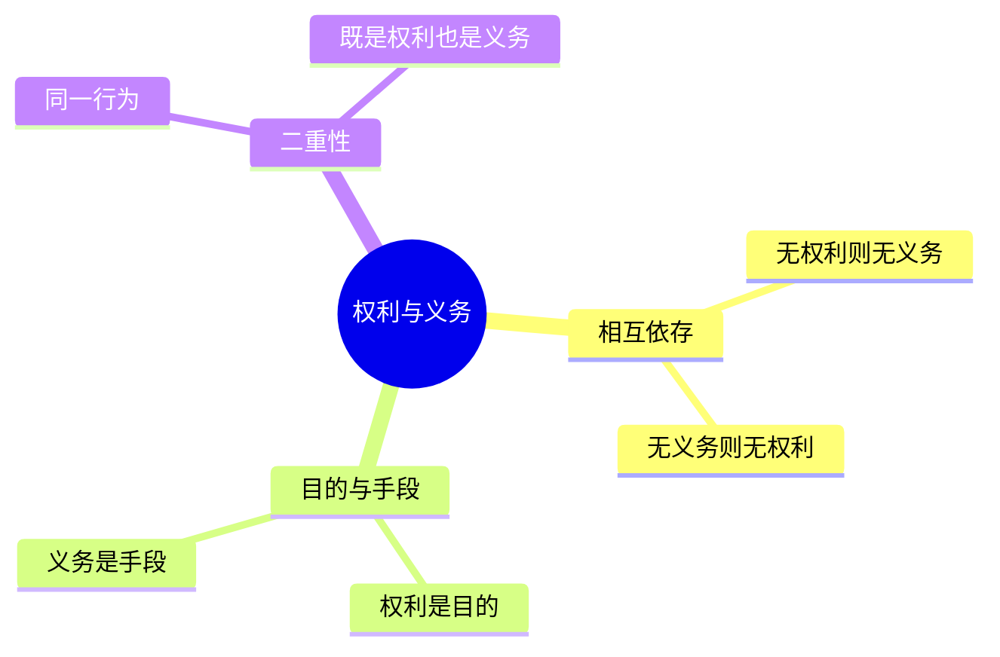

# 法律权利和法律义务的辩证统一关系

> [!IMPORTANT]
> 法律权利与法律义务是==辩证统一==的关系，二者相互依存、目的与手段相统一、具有二重性。

## 它是什么

先思考一个问题：如果世界上只有“权利”没有“义务”，你的权利还能实现吗？

**法律权利**是指反映一定的社会物质生活条件所制约的行为自由，是法律所允许的权利人为了满足自己的利益而采取的、由其他人的法律义务所保证的法律手段。**法律义务**则是保障法律所规定的义务人应该按照权利人要求从事一定行为或不行为以满足权利人利益的法律手段。

两者的辩证统一关系包含三个核心层次：

1. **相互依存**：每个人既是享受各种法律权利的主体，又是承担各种法律义务的主体。法律权利和法律义务平等，无论是行使权利还是履行义务，都是对自己有利的。
2. **目的与手段**：权利是目的，义务是手段。==只有承担法律义务的人履行法律义务，享有法律权利的人才能实现自己的合法权益。==
3. **二重性**：一个行为可以同时是权利行为和义务行为（如受教育、劳动）。

## 为什么需要理解它

在法治社会中，守法不仅包括履行法律义务，也包括行使法律权利。全面把握社会主义法律的本质和运行，必须增进法治意识，养成法治思维，做到尊法学法守法用法。如果不理解二者的统一关系，就容易走向“只享权利不尽义务”或“只尽义务不敢主张权利”的极端。

## 怎么做：依法行使与履行

- **行使权利**：公民在行使法律权利时，不仅要在形式上符合相关法律的规定，也要符合立法意图和精神，不得违反宪法法律确定的基本原则，不得破坏公序良俗。
- **履行义务**：法律义务的履行表现为两种方式：**作为**（积极实施某种行为）和**不作为**（不得实施某种行为）。义务法定，不能随意设定或扩大。

> [!TIP]
> 记忆口诀：“权利靠义务保，义务为权利跑；一人两身份，守法最重要。”

## 相近概念辨析

| 比较维度 | 法律权利 | 法律义务 |
| :--- | :--- | :--- |
| **本质** | 行为自由（满足自身利益） | 社会责任（满足权利人利益） |
| **履行方式** | 依法主动行使 | 作为（如赡养父母）或不作为（如不侵犯隐私） |
| **强制性** | 可放弃（部分基本权利除外） | 不可放弃，违反须承担法律责任 |
| **受何制约** | 均受一定的社会物质生活条件制约 | 均受一定的社会物质生活条件制约 |

## 常见的坑

> [!WARNING]
> **误区一：认为权利和义务可以割裂。**
> 错！法律权利和法律义务人人平等且相一致。不存在脱离义务的绝对权利，也不存在脱离权利的纯粹义务。

> [!CAUTION]
> **误区二：认为行使权利可以不择手段。**
> 错！法律权利必须依法行使，行使权利不得妨碍法律的社会功能和法律价值的实现。

## 典型例题解析

**题目**：如何理解“只有承担法律义务的人履行法律义务，享有法律权利的人才能实现自己的合法权益”？

**解答示范**：
这句话体现了法律权利与法律义务==目的与手段==的辩证统一关系。
1. 法律权利是由其他人的法律义务所保证的法律手段。
2. 例如，债权人享有要求债务人还款的法律权利（目的），但这一权利的实现，依赖于债务人履行还款的法律义务（手段）。
3. 若债务人未履行该义务，根据情节轻重，应当承担相应的民事责任、行政责任甚至刑事责任。
4. 因此，权利的实现以义务的履行为前提，二者相互依存、不可分割。
