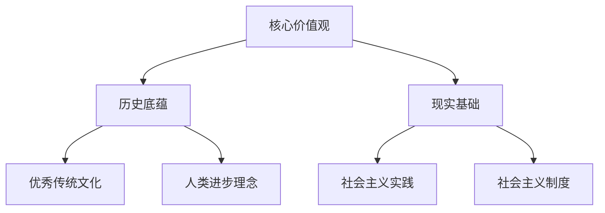

# 社会主义核心价值观的历史底蕴和现实基础

## 是什么：核心价值观的“根”与“土”

社会主义核心价值观不是凭空提出来的口号，它有两条重要支撑：==历史底蕴==与==现实基础==。

- **历史底蕴**：中华优秀传统文化是涵养社会主义核心价值观的==重要源泉==。富强、民主、文明、和谐、自由、平等、公正、法治……这些词背后都有中华文明长期积累的价值追求。
- **现实基础**：中国特色社会主义建设是社会主义核心价值观的==实践根据==；我国社会主义基本制度是它的==内在精神之魂==。

## 三层价值要求：国家、社会、公民

核心价值观把涉及国家、社会、公民的价值要求融为一体，体现社会主义本质要求。想记住它，先问自己一个问题：一个国家要好，社会要好，靠什么？靠每个公民都好。反过来，公民价值追求也要服务于国家与社会。

| 层次 | 内容 | 作用 |
|---|---|---|
| 国家 | 富强、民主、文明、和谐 | 民族复兴的价值追求 |
| 社会 | 自由、平等、公正、法治 | 现代社会活力有序的标志 |
| 公民 | 爱国、敬业、诚信、友善 | 处理个人与他人、国家关系 |

## 和相近概念的区别

不少同学把“社会主义核心价值观”和“社会主义核心价值体系”搞混。简单说：==核心价值体系==是体系（含指导思想、共同理想、民族精神、荣辱观），==核心价值观==是提炼出的 12 个词、三个层面。

> [!WARNING]
> 选择题常见坑：“涵养社会主义核心价值观的重要源泉”是 ==中华优秀传统文化==，不是“社会主义核心价值体系”“时代精神”“国家治理能力现代化”。

> [!NOTE]
> 当今时代，==科技文化==已成为世界各国综合国力竞争的焦点，这也是核心价值观强调“文明”“富强”的现实背景之一。

## 做一道题感受一下

**题目**：（ ）是涵养社会主义核心价值观的重要源泉。

A. 社会主义核心价值体系　B. 国家治理能力现代化　C. 时代精神　D. 中华优秀传统文化

**解析**：问的是“源泉”——来源、根脉。社会主义核心价值体系是“体系层面”的概念；国家治理能力现代化是现实目标；时代精神是精神动力之一。真正提供历史养分的是中华五千年文明积淀下来的==中华优秀传统文化==，因此选 ==D==。

> [!TIP]
> 记忆口诀：**“文化养源，实践定根”**——传统文化是源泉（历史底蕴），社会主义建设与制度是根据和灵魂（现实基础）。
