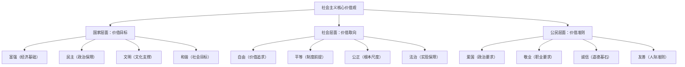

# 社会主义核心价值观的基本内容（国家、社会、公民三个层面）

社会主义核心价值观是当代中国精神的集中体现，凝结着全体人民共同的价值追求。它从国家、社会、公民三个层面回答了我们要建设什么样的国家、建设什么样的社会、培育什么样的公民的重大问题。掌握这24个字，不能靠死记硬背，而要理解每个层面内部的逻辑递进关系，以及三个层面之间的内在贯通。

## 三个层面的基本内容

党的十八大提出，倡导富强、民主、文明、和谐；倡导自由、平等、公正、法治；倡导爱国、敬业、诚信、友善。

| 层面 | 价值内容 | 回答的重大问题 | 逻辑定位 |
|------|----------|----------------|----------|
| **国家层面** | 富强、民主、文明、和谐 | 建设什么样的国家 | 价值目标（目标引领） |
| **社会层面** | 自由、平等、公正、法治 | 建设什么样的社会 | 价值取向（路径保障） |
| **公民层面** | 爱国、敬业、诚信、友善 | 培育什么样的公民 | 价值准则（主体基础） |

## 国家层面：富强、民主、文明、和谐

这一层面着眼于国家发展的总体目标，是一个有机统一的整体。

- **富强**是社会主义现代化国家的经济根基，是其他价值目标实现的物质基础。
- **民主**是社会主义的生命，体现了人民当家作主的政治本质。
- **文明**是社会进步的重要标志，涵盖物质文明、政治文明、精神文明、社会文明和生态文明。
- **和谐**是中国传统文化的基本理念，也是社会主义现代化国家在社会建设领域的价值追求。

> [!IMPORTANT]
> 国家层面的价值目标回答了我们要建设什么样的国家的重大问题。四者相互贯通：没有富强，民主、文明、和谐就缺乏物质支撑；没有民主，富强可能失去正确方向。

## 社会层面：自由、平等、公正、法治

这一层面着眼于社会运行的基本规则，反映了人们对美好社会的期望和憧憬。

- **自由**是社会主义的价值理想，强调在法律允许范围内的全面发展。
- **平等**是社会主义的基本属性，要求权利公平、机会公平、规则公平。
- **公正**是社会主义社会的内在要求，是衡量社会制度优劣的根本尺度。
- **法治**是治国理政的基本方式，是实现自由、平等、公正的根本保障。

> [!TIP]
> 记忆逻辑：自由是目标，平等是前提，公正是尺度，法治是保障。四者构成"目标—条件—标准—路径"的完整链条。

## 公民层面：爱国、敬业、诚信、友善

这一层面着眼于公民个人的道德规范，是每个公民都应遵守的基本行为准则。

- **爱国**是公民与祖国的最深层情感纽带，是调节个人与国家关系的基本准则。
- **敬业**是职业道德的核心要求，体现了社会主义职业精神。
- **诚信**是公民道德的基石，是社会主义市场经济良性运行的道德基础。
- **友善**是公民德行的光谱，是构建和谐人际关系的道德纽带。

> [!WARNING]
> 易错点：不要把"爱国、敬业、诚信、友善"仅仅理解为个人私德。在当代中国，**爱国首先体现在对社会主义中国的热爱上**，与爱党、爱社会主义高度统一；敬业也不仅是个人职业发展的需要，更是服务社会、奉献人民的具体体现。

## 三个层面的内在贯通

三个层面不是彼此孤立的清单，而是相互支撑、层层递进的有机整体：

- **国家层面**确立目标，**社会层面**提供制度环境，**公民层面**夯实主体基础。
- 没有国家层面的富强民主，社会层面的自由平等就缺乏实现条件；没有公民层面的爱国敬业，国家和社会层面的价值追求就无法落地。
- 中国特色社会主义建设是社会主义核心价值观的**实践根据**，核心价值观反映着我国社会主义基本制度的本质要求，是社会主义制度的**内在精神之魂**。

> [!NOTE]
> 延伸理解：中国特色社会主义道路自信、理论自信、制度自信和文化自信的**价值内核**是坚定的核心价值观自信。2018年十三届全国人大一次会议通过宪法修正案，将国家倡导社会主义核心价值观正式写入宪法，凸显了其作为国家精神支柱的重大意义。

## 常见误区辨析

| 误区 | 正确认识 |
|------|----------|
| 把三个层面混为一谈，随机组合 | 必须严格对应：国家-目标、社会-取向、公民-准则 |
| 认为"自由、平等"是西方专属 | 社会主义核心价值观中的自由、平等建立在公有制基础上，与法治、公正相统一，区别于资本逻辑下的形式平等 |
| 认为公民层面只是个人修养 | 公民层面的价值准则直接关系到国家精神力量的凝聚和社会道德风尚的形成 |

> [!CAUTION]
> 答题时若要求"简述社会主义核心价值观的基本内容"，必须完整写出24个字并准确对应三个层面，漏写、错写或层面错位均不得分。
