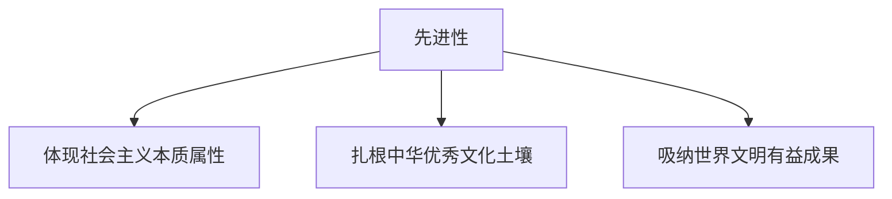
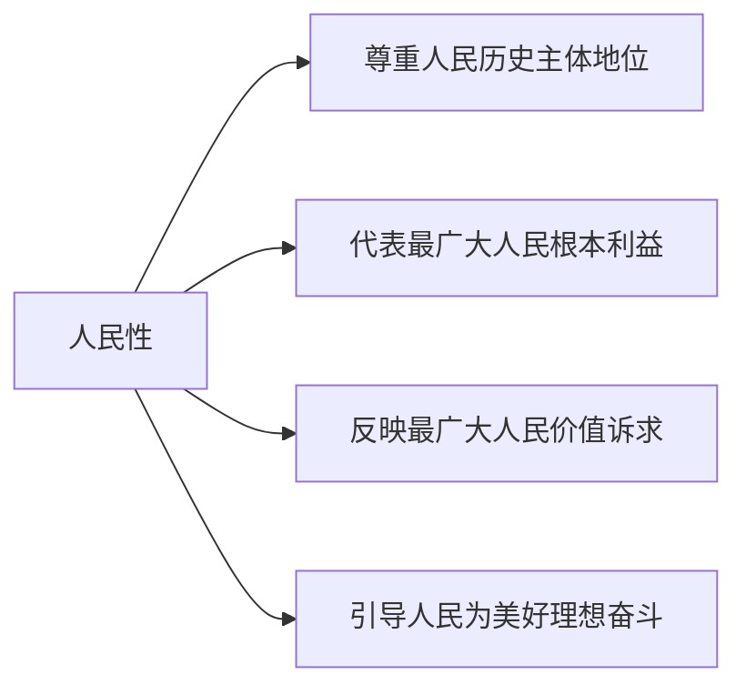

# 社会主义核心价值观的显著特征（反映人类社会发展进步、彰显人民至上、真实可信的道义力量）

## 从哪里理解“显著特征”？

一个问题先放在前面：社会主义核心价值观只有 24 个字，为什么教材要专门讲它的“显著特征”？

因为同样说“自由”“平等”“公正”，不同社会制度下的解释并不相同。讲特征，就是要回答：==社会主义核心价值观凭什么站在道义制高点上？== 教材给出的答案是三个关键词：**先进性、人民性、真实性**。

---

## 先进性：反映人类社会发展进步的价值理念

先进性回答的是“它是否符合历史前进方向”。

社会主义核心价值观不是凭空设计的，它生成于中国特色社会主义建设实践，同当今中国最鲜明的时代主题相适应。可以从三个层次理解：

| 层次 | 核心含义 | 易混点 |
|------|----------|--------|
| 社会主义本质属性 | 它反映社会主义制度的内在要求，是制度的精神之魂 | 不是抽象的“好词堆砌” |
| 中华文化土壤 | 与中华优秀传统文化一脉相承 | 不是照搬西方话语 |
| 世界文明成果 | 吸收人类文明中的进步理念 | 不等于“普世价值” |

> [!IMPORTANT]
> 社会主义核心价值观是==我国社会主义制度的内在精神之魂==，反映社会主义基本制度的本质要求。

---

## 人民性：彰显人民至上的价值立场

> [!IMPORTANT]
> ==人民性是社会主义核心价值观的根本特性。==

为什么“人民性”是根本？因为立场决定解释方向。同样一个“公正”，站在少数人立场和站在最广大人民立场，制度设计完全不同。

边远地区绿皮火车多年不涨价，从纯经济逻辑看“不划算”，但从人民立场看，它保障的是基本出行权利——这就是教材材料题对应的考点：==彰显人民至上的价值立场==。

---

## 真实性：因真实可信而具有强大道义力量

> [!IMPORTANT]
> 社会主义核心价值观以其==先进性、人民性和真实性==而居于人类社会价值制高点，具有强大的道义力量。

真实性要解决一个关键质疑：“说的和做的是否一致？”

社会主义核心价值观的真实性，在于它不只是口号，而是有制度保障、实践支撑、政策落实的价值承诺。它同国家治理、法律规范、日常生活相贯通。

> [!WARNING]
> 常见坑：把“真实性”理解为“客观正确”。教材里的“真实可信”指的是==价值观与制度实践相一致==，不是抽象的真理判断。

---

## 一个“算对了”的例子

考试如果出简答题“简述社会主义核心价值观的道义力量”，完整的作答逻辑链是：

1. **定性**：社会主义核心价值观居于人类社会价值制高点，具有强大道义力量。
2. **来源一**：先进性——反映人类社会发展进步的价值理念，体现社会主义本质、扎根中华文化、吸纳世界文明成果。
3. **来源二**：人民性——==根本特性==，彰显人民至上的价值立场。
4. **来源三**：真实性——真实可信，与制度实践一致，而非空洞口号。
5. **对比收尾**：由此认清西方“普世价值”的实质——以抽象普遍性掩盖特殊利益，缺乏真实性与人民性。

> [!TIP]
> 记忆口诀：**“三人行”——先、人、真**。先进性、人民性、真实性，三者缺一不可，人民性是根本。

> [!CAUTION]
> 辨析题高危区：题目若说“社会主义核心价值观的根本特性是先进性”，这是错的——==根本特性是人民性==；若说“道义力量来源于先进性、人民性、真实性三者的统一”，则正确。
