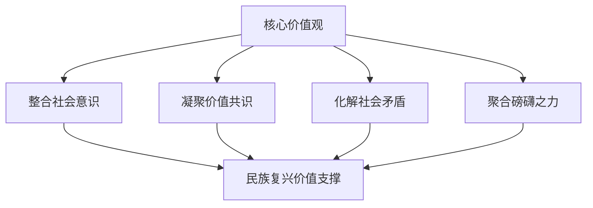

# 培育和践行社会主义核心价值观的重大意义

## 它是什么：先想清楚"为什么需要共同价值观"

想象一个班 30 个人，对"什么是对的"有 30 套完全不同的标准——有人觉得考试作弊无伤大雅，有人觉得占座天经地义。这样的班级会怎样？推到一个 14 亿人口、56 个民族的国家呢？

> [!IMPORTANT]
> 培育和践行社会主义核心价值观，是有效整合我国社会意识、凝聚社会价值共识、防范和化解社会矛盾、聚合磅礴之力的重大举措，是保证我国经济社会沿着正确方向发展、实现中华民族伟大复兴的价值支撑。

拆开看，重大意义落在三个层面：

| 层面 | 回答的问题 | 关键词 |
|------|-----------|--------|
| 国家 | 建设什么样的国家 | 富强、民主、文明、和谐 |
| 社会 | 建设什么样的社会 | 自由、平等、公正、法治 |
| 公民 | 培育什么样的公民 | 爱国、敬业、诚信、友善 |

## 为什么意义重大

**从"最大公约数"切入**：一个社会如果没有共同认可的价值观，就会各说各话、各行其是，社会整合无从谈起。社会主义核心价值观就是全体人民的"最大公约数"——它关乎国家前途命运和人民幸福安康。

**从"制度之魂"切入**：核心价值观反映着我国社会主义基本制度的本质要求，是我国社会主义制度的内在精神之魂。制度是骨架，价值观是灵魂，没有灵魂，制度就失去方向。

**从"四个自信"切入**：道路自信、理论自信、制度自信、文化自信，最终都要落到价值观自信上。价值观不自信，其他自信就是空中楼阁。

## 和相近概念的区别

- **社会主义核心价值观 vs 核心价值体系**：体系是"总框架"（包括马克思主义指导思想、共同理想、民族精神等），核心价值观是体系的内核，更凝练、更便于践行。
- **写入宪法 ≠ 只是一句口号**：十三届全国人大一次会议通过宪法修正案，把"国家倡导社会主义核心价值观"正式写入宪法，凸显了其国家根本法层面的地位。

## 常见误区

> [!WARNING]
> 不要把三个层面张冠李戴：富强民主文明和谐是**国家层面**，不是公民层面；爱国敬业诚信友善是**公民层面**，不是社会层面。考试常在这里设陷阱。

> [!CAUTION]
> 不要把"自由平等公正法治"说成"建设什么样的国家"——它回答的是**社会**层面的问题。

## 一个标准答法

**简答：培育和践行社会主义核心价值观的重大意义是什么？**

答：①是有效整合我国社会意识、凝聚社会价值共识、防范和化解社会矛盾、聚合磅礴之力的重大举措；②是保证我国经济社会沿着正确方向发展、实现中华民族伟大复兴的价值支撑；③是坚持和发展中国特色社会主义的价值遵循，也是增进社会团结和谐的最大公约数。意义==重大而深远==。
