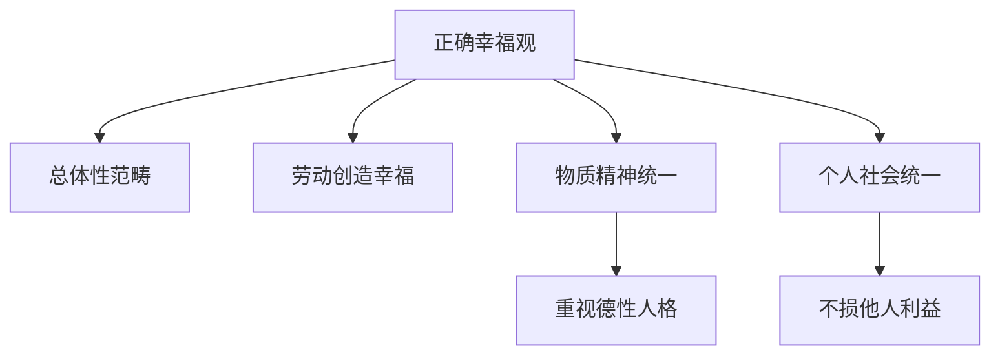

# 树立正确的幸福观

## 幸福是什么

**幸福是一个总体性范畴**，意味着人总体上生活得美好，涉及家庭、职业、行为、人格等多个方面，不是某一次成功或短暂快乐。

树立正确的幸福观，是因为幸福观会影响人生目的、价值判断和行为选择。若把幸福简单等同于金钱、享受或个人满足，就容易滑向拜金主义、享乐主义和极端个人主义。

> [!IMPORTANT]
> 答题总纲：==幸福靠劳动创造，物质与精神相统一，个人幸福与社会幸福相统一。==

## 怎样树立正确的幸福观

- **幸福是相对的**：幸福不是尽善尽美，不同的人有不同的幸福标准，不能把某种生活模板当作唯一标准。
- **幸福靠劳动创造**：人世间的一切幸福都要靠辛勤劳动来创造，要把个人奋斗融入社会发展，不能寄望于不劳而获。
- **物质与精神相统一**：实现幸福离不开一定的物质条件，但在提高物质生活水平时，更要注重德性和人格高尚，追求健康向上的精神生活。
- **个人与社会相统一**：个人幸福不能建立在损害社会整体和他人利益的基础上，应在服务社会、奉献他人中拓展幸福。

## 相近概念辨析

| 概念 | 合理认识 | 常见偏差 |
|---|---|---|
| 幸福 | 总体上生活得美好 | 等同于一时快乐 |
| 物质条件 | 实现幸福的必要条件之一 | 有钱就必然幸福 |
| 精神生活 | 提升幸福层次与质量 | 完全否定物质需要 |
| 个人幸福 | 与社会幸福辩证统一 | 只求个人、不顾他人 |
| 享乐主义 | 不是正确幸福观 | 把感官享受当人生目的 |

> [!WARNING]
> “幸福离不开物质条件”不等于“物质越多越幸福”；“幸福具有相对性”也不等于幸福毫无客观标准。损害社会和他人利益，不能成为个人幸福的代价。

## 简答题示例

**题目：简述如何树立正确的幸福观。**

**参考答案：**  
①幸福是一个总体性范畴，意味着人总体上生活得美好，幸福总是相对的，不是尽善尽美的。  
②实现幸福既需要一定的物质条件，也需要精神条件，要更加注重德性、人格和健康向上的精神生活。  
③人世间的一切幸福都要靠辛勤劳动来创造，要通过劳动和奋斗获得幸福。  
④个人幸福与社会幸福辩证统一，不能把自己的幸福建立在损害社会整体和他人利益的基础上。

> [!TIP]
> 记忆线索：**“总体看、劳动干、两条件、不损人”**。四点分别对应定义、途径、条件、个人与社会的关系。
