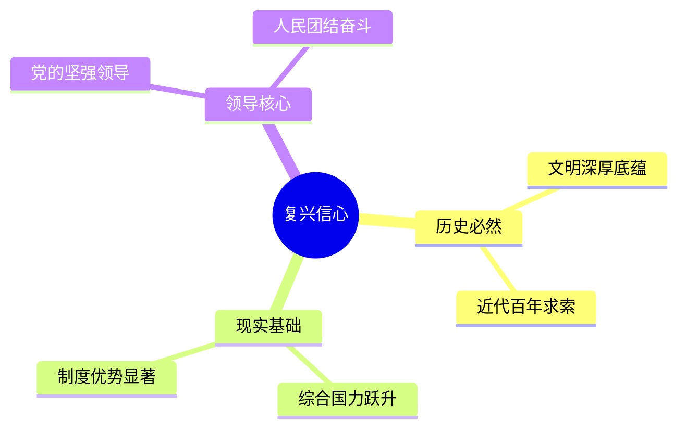

# 增强对实现中华民族伟大复兴的信心

## 它是什么：信心从哪里来

增强对实现中华民族伟大复兴的信心，不是空喊口号，而是建立在对==历史规律、现实基础、领导力量==三重依据的理性认识上。这一知识点属于理想信念教育，回答的是“凭什么相信中国梦能实现”。

> [!IMPORTANT]
> 中国梦的核心内涵：国家富强、民族振兴、人民幸福。实现路径是走中国道路、弘扬中国精神、凝聚中国力量。

## 为什么需要这份信心

先想一个问题：如果目标遥不可及，人还会为之奋斗吗？信心解决的是理想信念的“持久力”问题。缺乏信心，理想就会动摇；有了信心，才能把个人理想融入社会理想，在漫长征程中保持定力。

## 三重依据

| 依据 | 关键事实 | 对应考点 |
|------|----------|----------|
| 历史规律 | 中华民族伟大复兴进入不可逆转的历史进程 | 历史必然性 |
| 现实条件 | 经济总量、科技实力、国防实力显著提升 | 现实可行性 |
| 领导力量 | ==中国共产党领导是中国特色社会主义最本质的特征== | 根本保证 |

## 怎么做：在实践中放飞青春梦想

> [!TIP]
> 答题口诀：==树信心、强本领、勇担当==。先信，再能，最后干。

- **立志高远**：把个人理想同祖国前途、民族命运紧密联系。
- **练就本领**：刻苦学习，增强服务国家的能力。
- **躬身实践**：到祖国需要的地方去，在实现中国梦的生动实践中书写人生。

## 相近概念辨析与常见坑

> [!WARNING]
> 远大理想 ≠ 共同理想。==共产主义的远大理想==是最高纲领，==中国特色社会主义共同理想==是现阶段目标，==中国梦==是共同理想的具体表达。三者层次不同，不可混为一谈。

| 概念 | 层次 | 主体 |
|------|------|------|
| 共产主义远大理想 | 最高、最终 | 共产党员和先进分子 |
| 中国特色社会主义共同理想 | 现阶段 | 全体人民 |
| 中华民族伟大复兴 | 共同理想的具体化 | 全体中华儿女 |

## 例题验证

**题目**：大学生中的共产党员和先进分子应树立的远大理想是（ ）

**解析**：题干关键词“远大理想”限定最高层次。实现中华民族伟大复兴是共同理想层面的目标，建设中国特色社会主义是共同理想本身，提高国际地位只是具体任务。==只有共产主义才属于“远大理想”==。答案选 A。

> [!CAUTION]
> 看到“远大理想”四个字，立刻锁定“共产主义”；看到“共同理想”，才选“中国特色社会主义”或“中华民族伟大复兴”。这是选择题的高频陷阱。
