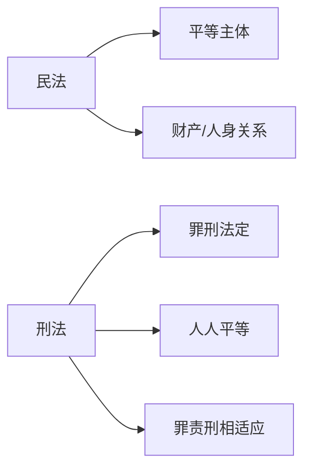

# 我国民法和刑法规定的基本原则

## 它是什么

先想一个问题：两个人签合同借钱，和一个人抢别人手机，为什么处理规则完全不同？因为一个归民法管，一个可能归刑法规，二者==调整对象不同，基本原则也不同==。

我国民法调整平等主体的自然人、法人、非法人组织之间的财产关系和人身关系，其基本原则体现自愿、公平、诚信等精神。我国刑法规定罪刑法定、法律面前人人平等、罪责刑相适应等基本原则。其中，==罪刑法定==是指法律明文规定为犯罪行为的，依照法律定罪处刑；法律没有明文规定为犯罪行为的，不得定罪处刑。

## 为什么需要

基本原则不是装饰，而是==立法和司法的总开关==。民法基本原则保障市场交易和日常生活有序；刑法基本原则防止司法机关随意抓人、随意判刑，守住“法无明文不为罪”的底线。

## 常见的坑

> [!WARNING]
> 别把“公民之间、法人之间、公民和法人之间”的老提法，和现在“平等主体的自然人、法人、非法人组织之间”的新表述混成一模一样；考试按教材 P155 的新写。

> [!CAUTION]
> 罪刑法定≠“有社会危害就能定罪”。必须是法律明文规定为犯罪行为的，才定罪处刑；没明文规定，就不得定罪处刑。

## 一个考对了的例子

题：我国刑法罪刑法定原则是指什么？
答：法律明文规定为犯罪行为的，依照法律定罪处刑；法律没有明文规定为犯罪行为的，不得定罪处刑。这就踩中了==“明文”与“不得”==两个给分词。

> [!TIP]
> 记忆：民法看“平等关系”，刑法看“三条原则”，罪刑法定看“明文/不得”。
