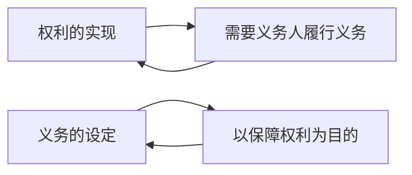

# 法律义务的特点与设定

## 法律义务是什么

法律义务是反映一定社会物质生活条件所制约的**社会责任**，是保障法律所规定的义务人按照权利人要求**从事一定行为或不行为**，以满足权利人利益的法律手段。

> [!IMPORTANT]
> 法律义务的四个特点：==法律义务是历史的、源于现实需要、必须依法设定、可能发生变化==。

## 为什么必须"依法设定"

先想一个问题：如果义务可以由任何人随意设定，会发生什么？

- 行政机关今天要求你办 A 证，明天要求你办 B 证；
- 学校、公司、物业都能"立法"给你加义务；
- 公民无法预知自己该做什么，权利随时被架空。

所以法治社会确立了一条铁律：**义务法定**。

> [!IMPORTANT]
> 义务法定是指==法律义务必须由法律明确规定，不能随意设定或扩大==。只有法律明文规定的义务，公民才必须履行。

这一原则的意义：

| 层面 | 作用 |
|------|------|
| 对公权力 | 防止权力滥用，法无授权不可为 |
| 对公民 | 提供行为预期，保护合法权益 |
| 对社会 | 维护法律权威与秩序稳定 |

## 义务与权利的关系

权利和义务是==密不可分、相互依存、互利共赢==的：

- **没有权利**，义务的设定就失去了目的和根据；
- **没有义务**，权利的实现也就成为空话。

## 法律义务怎么履行

法律义务的履行表现为两种方式：

| 方式 | 含义 | 举例 |
|------|------|------|
| **作为** | 积极作出一定行为 | 纳税人依法缴纳税款；父母抚养未成年子女 |
| **不作为** | 消极地不作出一定行为 | 不得侵犯他人隐私；不得偷税漏税 |

> [!TIP]
> 判断口诀：=="该做的去做"是作为，"不该做的别做"是不作为==。看行为方向，不看结果好坏。

## 常见的坑

> [!WARNING]
> 1. **"义务都是作为"**——错。不作为义务大量存在，如不得泄露国家秘密。
> 2. **"道德义务=法律义务"**——错。道德义务靠自觉和舆论约束，法律义务才有国家强制力保障。
> 3. **"义务一旦设定永不变"**——错。法律义务是历史的、可能发生变化，随社会物质生活条件调整。
> 4. **"下位文件也能设定义务"**——错。义务必须由法律（广义）明确规定，规章以下文件不得随意创设公民义务。

> [!CAUTION]
> 答题时若问"义务法定的涵义"，务必答出三层：==法律明确规定 + 不得随意设定扩大 + 体现法治原则、防止权力滥用、保护公民权利==，缺一层扣分。
