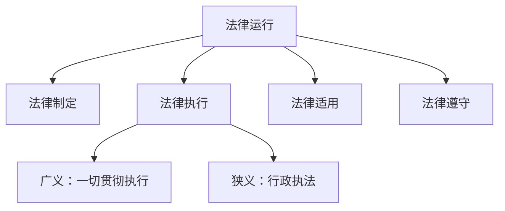
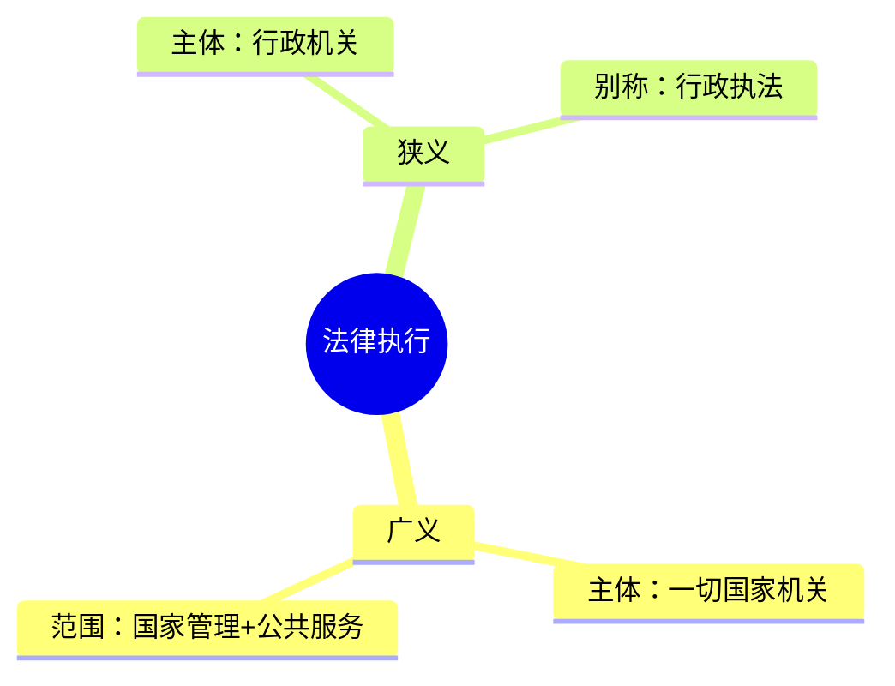

# 法律的含义（广义与狭义）

## 法律的含义：从“法”到“法律执行”

先看一个容易混淆的场景：老师说“我们要遵守法律”，同学说“我在学生会执行法律”——这里的“法律”是一回事吗？其实，前者指的是作为规范体系的法律整体，后者说的是法律运行中的某个具体环节。要分清这两个层次，就需要理解法律的广义与狭义。

### 一、法律是什么

> [!IMPORTANT]
> 法律是由国家制定或认可并依靠国家强制力保证实施的，反映由特定社会物质生活条件决定的==统治阶级意志==的规范体系。

这句话包含四个关键要素：**国家创制**（制定或认可）、**国家强制力**（保证实施）、**物质生活条件**（决定内容）、**统治阶级意志**（本质属性）。考试中常以选择题形式考查“法律区别于道德的根本标志”——答案指向国家强制力。

### 二、广义与狭义的法律执行

法律运行包含法律制定、法律执行、法律适用、法律遵守四个环节。其中“法律执行”是承上启下的关键环节，它本身又分广义和狭义两种理解。

**广义的法律执行**：指==国家机关及其公职人员==，在国家管理和公共事务管理中依照法定职权和程序，贯彻和实施法律的活动。这里的执行主体不限于行政机关，也包括司法机关、立法机关在各自职权范围内实施法律的行为。

**狭义的法律执行**：专指==国家行政机关及其公职人员==执行法律的活动，也称为**行政执法**。

> [!WARNING]
> 考试中问“狭义的法律执行是什么”，标准答案是“国家行政机关及其公职人员执行法律的活动”，不要写成“所有国家机关”。

### 三、为什么需要区分广义与狭义

区分的关键在于**主体范围不同**。广义的法律执行覆盖所有国家机关，而狭义的只限定于行政机关。如果混为一谈，就无法理解为什么“人民法院依法审判”属于法律适用而不是狭义执法，也无法解释“行政执法”这一专门概念的存在。

### 四、一个典型的例子

某市市场监督管理局对一家销售过期食品的超市作出罚款5万元的行政处罚决定。这里“市场监督管理局执行《食品安全法》”属于**狭义的法律执行**（行政执法），因为主体是行政机关。而如果全国人大常委会通过立法程序修订《食品安全法》，那是**法律制定**；如果人民法院审理超市不服处罚的行政诉讼案件，那是**法律适用**。

> [!TIP]
> 记忆口诀：**“广覆盖，狭行政”**——广义看全体国家机关，狭义只看行政机关。做题时先找主体，再定概念。

### 五、常见的坑

| 混淆点 | 正确理解 |
|---|---|
| 把“法律适用”当“狭义执法” | 法律适用=司法机关（法院、检察院）适用法律处理案件；狭义执法=行政机关执法 |
| 把“法律制定”当“法律执行” | 制定是起始性关键环节，执行是实施环节，两者在运行链条中分列前后 |
| 认为狭义执法主体包括“公职人员个人” | 公职人员是代表机关行使职权，执法主体仍是**国家行政机关** |

> [!CAUTION]
> 判断题“在狭义上，法律执行是指国家行政机关及其公职人员执行法律的活动”是**正确**的。注意题干问的是“狭义”，不要因为看到“及其公职人员”就误判为错误——公职人员是行政机关的组成人员，并非独立于机关之外的执法主体。
