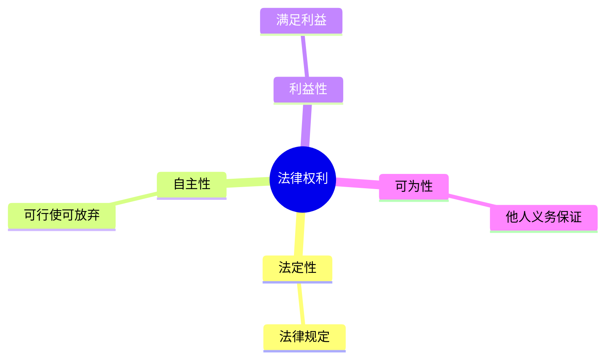
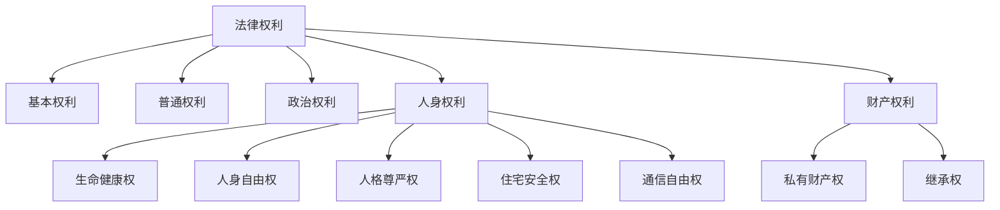

# 法律权利的定义、特征与分类（基本权利与普通权利、政治权利、人身权利、财产权利等）

> [!IMPORTANT]
> ==法律权利是指反映一定的社会物质生活条件所制约的行为自由，是法律所允许的权利人为了满足自己的利益而采取的、由其他人的法律义务所保证的法律手段。==

拆开来看，法律权利包含三重含义：一是行为自由（"我可以做什么"），二是利益驱动（"这么做是为了满足我的利益"），三是他人义务做后盾（"别人必须配合，否则要担责"）。例如，你享有债权，本质上是因为债务人负有清偿的法律义务来"保证"你这笔权利得以实现。若只有行为自由、没有义务保障，那只是道德上的"可以"，不是法律上的权利。

## 法律权利的特征

法律权利有四大特征，可简记为"**法定性、自主性、利益性、可为性**"：由法律规定、由权利人自主决定是否行使、指向特定利益、可以行使也可以放弃。注意：==权利可以放弃，义务不能放弃==，这是权利与义务最醒目的差别。

## 法律权利的分类

按不同标准有不同分类，考试中最重要的是两条：按==效力层级==分为基本权利与普通权利；按==内容领域==分为政治权利、人身权利、财产权利、社会经济权利、宗教信仰及文化权利等。

- **基本权利与普通权利**：基本权利是宪法规定的最根本、最重要的权利，如人身权利；普通权利由普通法律规定。
- **政治权利**：选举权与被选举权、言论出版集会结社游行示威的自由等。
- **人身权利**：公民的人身不受非法侵犯的权利，是参加国家政治、经济与社会生活的基础，主要包括==生命健康权、人身自由权、人格尊严权、住宅安全权、通信自由权==。
- **财产权利**：主要包括==私有财产权和继承权==。

| 分类标准 | 类别 | 例子 |
|---|---|---|
| 效力层级 | 基本权利 / 普通权利 | 人身权利 / 合同权利 |
| 内容领域 | 政治、人身、财产、社会经济、宗教文化 | 选举权、生命健康权、继承权 |

> [!TIP]
> 记忆口诀：人身权利五字诀——"**生、自、人、住、信**"；财产权利两字诀——"**财、继**"。

> [!WARNING]
> 常见坑：把"隐私权"混入人身权利五项。教材列举的是生命健康权、人身自由权、人格尊严权、住宅安全权、通信自由权五项，答简答题时按教材原文列，不要自加。

> [!NOTE]
> 辨析：法律权利 ≠ 法律权力。权利的主体是公民、法人等平等主体；权力（公权力）的主体是国家机关，二者不可混用。

## 一个例子

小明购买的手机被他人摔坏，他可以依据私有财产权要求对方赔偿。这说明：小明享有"请求赔偿"的行为自由（行为自由），目的是弥补自己的损失（利益性），而对方负有赔偿义务来保证这项权利（义务保障）。若对方拒不履行，小明还可通过调解、仲裁或诉讼等途径解决——这正是法律权利的"可为性"与"法定性"的体现。
