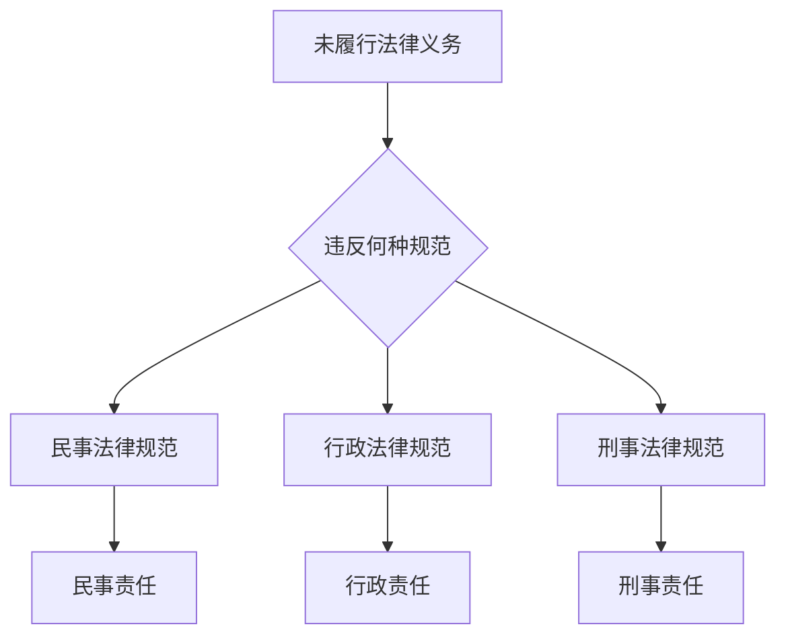

# 违反法定义务应当承担的法律责任（含兵役法等具体法律责任）

违反法定义务应当承担的法律责任，是理解“法律义务具有法定的强制性”的关键。法律义务要求义务人依法实施一定行为，或者不实施某种行为；如果没有履行义务，就要根据行为性质和情节轻重承担相应后果。

## 法律责任是什么

法律责任是因违反法律义务、侵犯他人合法权益等行为而依法承担的不利后果。它不是一般的道德批评，也不是“道歉了就一定没事”，而是由国家法律明确规定、可能依靠国家强制力保证实现的责任。

> [!IMPORTANT]
> 公民未能履行法律义务，根据情节轻重，应当承担相应的法律责任。具体的法律责任主要包括==民事责任、行政责任和刑事责任==。

可以用下面的思路判断责任类型：

## 三种责任怎么区分

| 责任类型 | 主要适用情形 | 常见承担方式或后果 | 判断重点 |
|---|---|---|---|
| 民事责任 | 违反民事法律义务，侵害他人民事权益 | 停止侵害、赔偿损失、支付违约金等 | 重点在处理平等主体之间的权利义务关系 |
| 行政责任 | 违反行政管理方面的法律规定 | 行政处罚、行政处分等 | 重点看是否违反行政法律规范 |
| 刑事责任 | 行为构成犯罪 | 管制、拘役、有期徒刑等刑罚 | 责任最严厉，必须以构成犯罪为前提 |

其中，**行政处罚**是由国家行政机关对违反行政法律规定的行政相对人所实施的法律制裁。行政责任与行政处罚不能简单画等号：行政处罚是行政责任的一种重要承担方式，而不是全部。

> [!WARNING]
> 不要按“后果看起来严重不严重”随意判断责任类型。民事赔偿数额可能很大，但不等于刑事责任；受到罚款，也不能只凭“罚款”二字就认定为刑罚。

## 兵役义务中的具体理解

依法服兵役是公民的法律义务。按照课件所列兵役法规定，每年 $12$ 月 $31$ 日以前年满 $18$ 周岁的男性公民，应当被征集服现役；普通高等学校毕业生的征集年龄可以放宽至 $24$ 岁。

如果公民拒绝、逃避履行兵役义务，不能仅理解为“个人选择不当”，而应结合兵役法等规定判断其法律后果。答题时要区分两层：

- **义务层面**：公民负有依法服兵役等法律义务。
- **责任层面**：违反义务后，根据具体行为、法律规定和情节轻重，承担相应法律责任，不能笼统地说一律构成犯罪。

## 一个答对了的例子

**题目：公民未履行法律义务应承担什么责任？**

规范答案是：公民未能履行法律义务，根据情节轻重，应当承担相应的法律责任，主要包括民事责任、行政责任和刑事责任。

如果题目进一步给出“某行政机关依法对违反行政法律规定的行政相对人实施法律制裁”，则应判断为**行政处罚**，不能答成民事赔偿或刑罚。

> [!TIP]
> 简答题先写总句“根据情节轻重承担相应法律责任”，再列“民事、行政、刑事”三类；遇到具体案例，再依据违反的法律规范和行为性质判断，避免只背分类、不看条件。
