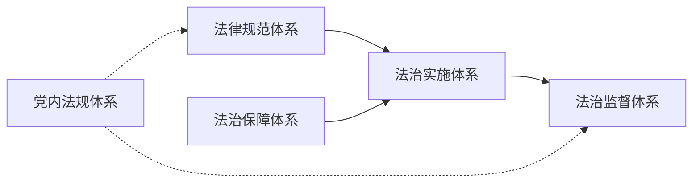

# 建设中国特色社会主义法治体系的主要内容

## 建设中国特色社会主义法治体系的主要内容

先看一个问题：我们常说“依法治国”，但“法”从哪里来、谁来执行、谁来监督、靠什么保障？如果这些环节缺一个，法治还能运转起来吗？显然不能。正因如此，教材把全面依法治国的“总抓手”概括为一句话——==建设中国特色社会主义法治体系==。

> [!IMPORTANT]
> 建设中国特色社会主义法治体系，就是形成**完备的法律规范体系、高效的法治实施体系、严密的法治监督体系、有力的法治保障体系，形成完善的党内法规体系**。这“五大体系”是标准表述，简答题必须完整写出。

这五大体系不是并列摆设，而是一条“从纸面到行动”的完整链条。下面逐一拆解，并配上关系图。

### 法律规范体系：前提

==完备的法律规范体系==解决的是“有法可依”的问题。它以宪法为核心，由宪法相关法、民法商法、行政法、经济法、社会法、刑法等法律部门组成。注意两个常考细节：

- **立法机关**：行使国家立法权的机关是==全国人民代表大会及其常务委员会==。
- **科学立法**是全面依法治国的==前提==。

没有这个体系，后面一切都是空中楼阁。

### 法治实施体系：关键

法律制定出来不执行，等于一纸空文。==高效的法治实施体系==要解决“有法必依、执法必严”的问题，其核心是**严格执法**和**公正司法**。

> [!TIP]
> 记忆口诀：**“科执公司”**——科学立法（前提）、严格执法（关键）、公正司法（重点）、全民守法（基础）。考试常以选择题挖空“前提/关键/重点/基础”来考对应关系。

这里容易混淆的是执法与司法的区别：**执法**在狭义上指国家行政机关及其公职人员执行法律的活动；**司法**（法律适用）指国家司法机关及其公职人员依照法定职权和程序处理案件的专门活动。人民法院行使审判权，人民检察院行使法律监督权。

> [!WARNING]
> “严格执法”对应行政机关，“公正司法”对应司法机关，两者主体不能互换。选择题常把“严格执法”安在法院头上作干扰项。

### 法治监督体系：保障权力不越界

==严密的法治监督体系==回答“谁来监督执法者”的问题。权力制约有四条要求：==权力由法定、有权必有责、用权受监督、违法受追究==。公正司法之所以重要，是因为它是维护社会公平正义的==最后一道防线==。

### 法治保障体系：支撑运转

==有力的法治保障体系==提供政治、组织、队伍、人才、科技等方面的支撑。没有保障，前三个体系都无法持续运转。这也是“全面依法治国需要什么保障”这一问题的答案。

### 党内法规体系：中国特色社会主义法治体系的鲜明特色

==完善的党内法规体系==是其他国家法治体系中没有的独特组成部分。党领导全面依法治国，党内法规与国家法律衔接协调，共同构成完整的规范依据。注意：党内法规**不是**国家法律，但属于法治体系的组成部分。

### 一个“算对了”的例子

**简答题**：简述建设中国特色社会主义法治体系的主要内容。

**参考答案**：建设中国特色社会主义法治体系，就是要形成：

1. **完备的法律规范体系**——以宪法为核心的中国特色社会主义法律体系，做到科学立法；
2. **高效的法治实施体系**——坚持严格执法、公正司法、全民守法；
3. **严密的法治监督体系**——保证权力在阳光下运行；
4. **有力的法治保障体系**——为法治建设提供政治、组织、人才等保障；
5. **完善的党内法规体系**——坚持依法治国与依规治党有机统一。

> [!CAUTION]
> 五大体系必须写全，少写“党内法规体系”是高频失分点。有的同学只写前四个，以为党内法规不属于“法治体系”，恰恰相反，它是中国特色社会主义法治体系的**鲜明特色和重要组成部分**。

最后，把“法治国家—法治政府—法治社会”的关系与五大体系对照记忆：==法治国家是目标，法治政府是重点，法治社会是基础==，而建设中国特色社会主义法治体系正是实现法治国家的**总抓手**。
