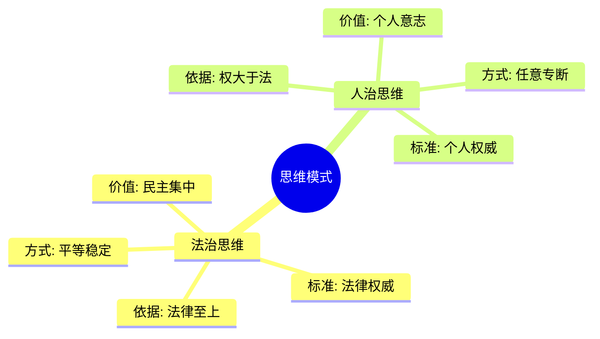

# 法治思维与人治思维的区别

## 法治思维与人治思维的本质分野

在面对社会纠纷或公共决策时，你是首先想到“找关系、看领导脸色”，还是“查法条、走程序”？这不仅是行为习惯的差异，更是**法治思维**与**人治思维**的根本对立。

> [!IMPORTANT]
> **核心定义**：法治思维是将法律作为判断是非、处理事务的准绳，将==法律至上==、权力制约、公平正义等理念融入思考过程的思维模式。

### 四大维度的深度辨析

法治与人治并非简单的“有法”与“无法”之分，其区别体现在依据、方式、价值和标准四个维度：

| 比较维度 | 法治思维 (Rule of Law) | 人治思维 (Rule by Man) |
| :--- | :--- | :--- |
| **依据** | 法律是治国理政基本依据 | 主张==人高于法==或权大于法 |
| **方式** | 普遍性、平等性、稳定性 | 任意性、非理性、个人意志 |
| **价值** | 集中大众意志（多数人之治） | 个人专断（一人说了算） |
| **标准** | ==法律具有最高权威== | 个人拥有最高权威 |

### 为什么必须确立法治思维？

人治思维依赖统治者的个人品德与能力，具有极大的**不确定性**。一旦领导者更替或情绪波动，政策可能朝令夕改。而法治思维通过==规则意识==和==价值取向==的双重约束，确保社会运行的可预测性。

> [!TIP]
> **分水岭判断**：当法律权威与个人权威发生冲突时，服从谁？若服从法律，即为法治；若服从个人，即为人治。这是两者的==根本分水岭==。

### 常见误区与避坑指南

- **误区一**：“有法律制度就是法治”。
  - **辨析**：如果有法不依、执法不严，或者法律沦为个人工具，本质上仍是人治。法治不仅要求“有法”，更要求“良法善治”。
- **误区二**：“法治限制自由”。
  - **辨析**：法治划定的是权力的边界，保障的是权利的底线。只有在法治框架下，公民的自由才免受他人任意侵犯。

### 实战案例解析

**场景**：某公司老板因员工小李顶撞自己，直接口头通知开除，且拒绝支付赔偿金。

- **人治思维视角**：老板认为“我是出资人，我说了算”，依据个人好恶行事，忽视劳动合同。
- **法治思维视角**：
  1.  **依据**：查阅《劳动合同法》，确认开除需符合法定情形。
  2.  **程序**：即便员工有过错，也需经过调查、告知、听取申辩等==正当程序==。
  3.  **结果**：若违法解除，需承担法律责任（支付赔偿金）。

在此例中，坚持法治思维意味着不被情绪左右，而是严格遵循==法律至上==和==正当程序==，既保障了企业的管理权，也维护了劳动者的合法权益。
