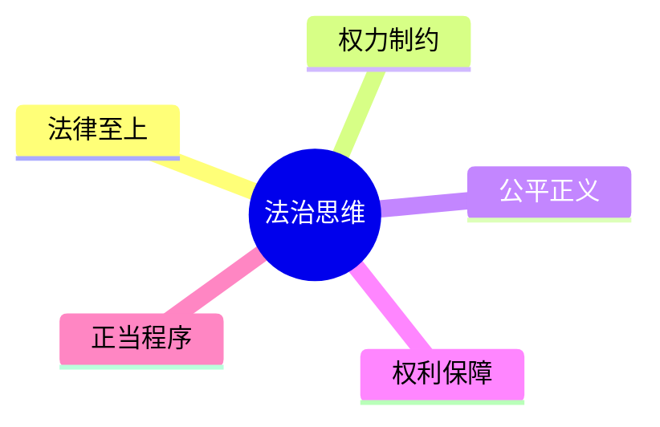
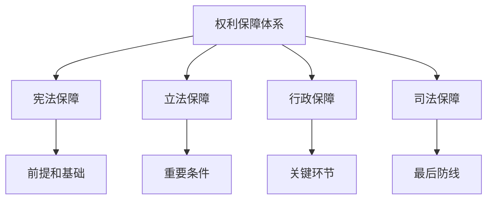

# 法治思维的基本内容（法律至上、权力制约、公平正义、权利保障、正当程序）

## 它是什么

法治思维是以法治价值和法治精神为导向，运用法律原则、法律规则、法律方法思考和处理问题的思维模式，主要表现为**价值取向**和**规则意识**两个方面。其基本内容可归纳为五个方面：

> [!IMPORTANT]
> 法治思维的基本内容是：**法律至上、权力制约、公平正义、权利保障、正当程序**。其中权利保障在部分教材中也表述为"人权保障"，含义一致。

## 为什么需要

法治思维与人治思维相对立。人治思维把个人意志凌驾于法律之上，而法治思维强调**宪法法律至上、法律面前人人平等、权由法定、权依法使**。养成法治思维，是提升法治素养的核心要求。

## 五个方面逐一拆解

### 法律至上

法律在国家和社会治理中具有最高权威，任何组织和个人都必须遵守法律，不得有超越法律的特权。这是法治思维的首要内容。

### 权力制约

> [!IMPORTANT]
> 权力制约是指国家机关的权力必须受到法律的规制和约束，即"把权力关进制度的笼子里"。

权力制约包括**四项要求**：

| 要求 | 含义 |
|------|------|
| 权力由法定 | 权力的来源和行使必须有法律依据 |
| 有权必有责 | 行使权力必须承担相应责任 |
| 用权受监督 | 权力行使过程必须接受监督 |
| 违法受追究 | 违法行使权力必须依法追究 |

### 公平正义

> [!IMPORTANT]
> 公平正义主要包括**权利公平、机会公平、规则公平和救济公平**。

- **权利公平**：每个公民依法享有平等的权利
- **机会公平**：每个公民都有平等参与社会竞争的机会
- **规则公平**：规则对所有人一视同仁，不偏袒任何一方
- **救济公平**：当权利受到侵害时，所有人都能获得平等的救济

> [!NOTE]
> 公正是法治的生命线，是司法活动最高的价值追求。公正司法是维护社会公平正义的最后一道防线。

### 权利保障

公民权利的实现需要多重保障机制：

> [!WARNING]
> 易混淆：**宪法保障**是权利保障的**前提和基础**，**司法保障**是权利保障的**最后防线**。二者定位不同，切勿颠倒。

### 正当程序

正当程序要求权力行使必须遵循法定程序。程序正当表现在程序的**合法性、中立性、参与性、公开性和时限性**等方面。

## 常见的坑

> [!CAUTION]
> 1. "权力制约"误写为"权利制约"——权力（power）针对国家机关，权利（right）针对公民。
> 2. 权利保障的四项内容排序混淆——宪法保障是前提和基础，司法保障是最后防线。
> 3. 公平正义的四项内容遗漏"救济公平"——救济公平是保障前三者的最后环节。

## 一个例子

> [!TIP]
> 某行政机关越权处罚某企业。分析：该机关违反"权力由法定"（越权）和"有权必有责"（须承担违法责任），企业可通过司法途径获得救济（司法保障是最后防线）。这体现了法治思维中权力制约、权利保障和正当程序的统一。
