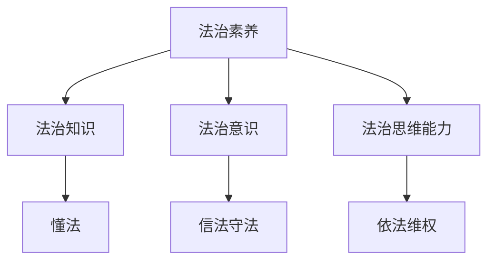

# 法治素养的内涵与构成

## 什么是法治素养

法治素养是指人们==通过学习法律知识、理解法律本质、运用法治思维、依法维护权利与依法履行义务的素质、修养和能力==，是思想政治素养、道德素养、文化素养和心理素养等在法律层面的综合体现。对于南京邮电大学的学生来说，法治素养既是"担当复兴大任、成就时代新人"的必然要求，也是未来在信息通信、网络治理等岗位上守住底线的基本功。

> [!IMPORTANT]
> 法治素养不是"背法条"，而是三件事的统一：**懂法（知识）→ 信法（意识）→ 用法（能力）**。

## 法治素养的构成

可以问自己一个问题：看到一条社会新闻，你能不能判断它合不合法、能用哪种途径维权、该承担什么责任？能做到，就说明你的法治素养是"活"的。具体来说，它由三部分构成：

| 构成 | 含义 | 学生常见表现 |
| --- | --- | --- |
| 法治知识 | 法律概念、制度、条文等客观知识 | 知道"完全刑事责任年龄 18 岁"、"犯罪构成四要件" |
| 法治意识 | 尊法、信法、守法、用法的主观态度 | ==尊重社会主义法律权威==、不轻信"网上免责条款" |
| 法治思维与能力 | 用法治方式分析、解决问题 | 遇到合同纠纷先看权利义务，而非"找关系" |

## 与相近概念的区别

法治素养和"法律知识""法治思维""法律权威"这几个概念容易混淆：

- **法律知识**只是法治素养的知识基础，不等于素养；
- **法治思维**是法治素养在思维方式上的表现，主要表现为==价值取向和规则意识==两个方面；
- **法律权威**是法治素养追求的外在目标，保障个人平安幸福的底线和红线就是全体社会成员尊重社会主义法律权威。

> [!NOTE]
> 法律素养与法律知识的关系，类似于"会游泳"与"背熟浮力公式"：前者是能力与态度，后者只是材料。

## 为什么要培养法治素养

"科学立法、严格执法、公正司法、全民守法"这十六字方针，第四个环节正是"全民守法"。法治和德治相辅相成：法治为德治提供保障，德治为法治提供价值基础。每个社会成员的法治素养越高，执法成本越低，社会越稳定。

## 常见的坑

> [!WARNING]
> - 把"背过几条法条"当成"法治素养高"——素养还包含意识和能力。
> - 认为"不违法就行"——法治素养还要求**依法履行义务、依法行使权利**，不能只守底线。
> - 混淆"德治"与"法治"的约束方式：法治靠国家强制力，德治靠社会舆论和内心信念。

## 一个看对了的例子

某同学在网上看到"转发抽奖需提供身份证号"的活动。具备法治素养的同学会这样判断：①**懂法**——收集身份证号可能侵犯个人信息权，违反《个人信息保护法》；②**信法**——不轻信"平台免责"的霸王条款；③**用法**——留存截图向平台投诉或向网信部门举报。三步齐备，才是合格的法治素养。
