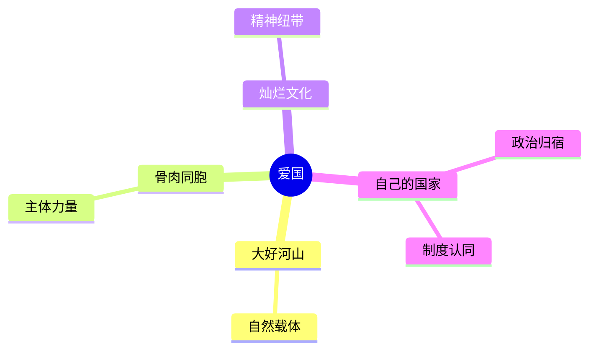

# 爱国主义的基本内涵（四个方面：爱祖国大好河山、爱骨肉同胞、爱灿烂文化、爱自己的国家）

## 爱自己的国家：爱国主义的政治归宿

当我们谈论爱国时，除了对山河、同胞与文化的深情，是否思考过：在当代中国，这份情感最终应当落脚于何处？如果剥离了具体的国家制度与政治实体，抽象的“爱国”是否会沦为无根之木？这正是理解“爱自己的国家”这一内涵的关键切入点。

> [!IMPORTANT]
> 在当代中国，==爱国主义首先体现在对社会主义中国的热爱上==。这是爱国主义基本内涵中最具现实性、政治性的维度，也是区别于其他三个层面的核心落脚点。

### 为什么必须爱“社会主义中国”

爱国不是空洞的口号，而是具体的、历史的。教材明确指出，历史和现实充分证明，只有社会主义才能救中国，只有中国特色社会主义才能发展中国。因此，爱自己的国家，本质上就是拥护国家的根本制度与发展道路。

从逻辑上看，前三者是爱国主义的情感基础与文化根基，而“爱自己的国家”则是前者的==政治升华与现实保障==。没有对国家制度和政权的维护，山河可能破碎、同胞可能离散、文化可能断层。

### 怎么做：三位一体的高度统一

在具体实践中，“爱自己的国家”并非孤立存在，它要求我们将爱国情感转化为明确的政治认同与行动自觉。

| 维度 | 核心要求 | 错误倾向 |
| :--- | :--- | :--- |
| 爱国 | 维护国家主权与领土完整 | 割裂国家与制度的联系 |
| 爱党 | 拥护中国共产党的领导 | 将党与国家对立起来 |
| 爱社会主义 | 坚持中国特色社会主义制度 | 抽象谈爱国、否定制度 |

> [!TIP]
> 记忆口诀：**国是载体党领航，社制为基不可忘；三者统一方为真，割裂对立必迷航。**

简答题中常考的“当代中国爱国主义本质”，标准表述即为：==坚持爱国和爱党、爱社会主义高度统一==。维护国家统一和民族团结，拥护社会主义制度，是当代爱国主义的基本要求。

### 易错辨析与答题规范

> [!WARNING]
> 切勿将“爱自己的国家”等同于狭隘民族主义或盲目排外。它强调的是对**本国社会制度和发展道路**的理性认同，而非对他国的敌视。

在应对相关考题时，最常见的失分点是只答“热爱祖国”而忽略“社会主义”这一限定词。例如，若题目问“如何理解当代中国的爱国主义”，仅回答“爱山河、爱人民、爱文化”是不完整的，必须点明“首先体现在对社会主义中国的热爱上”这一得分点。

以课件中的简答题为例，当被问及该知识点时，规范的作答逻辑应包含三层：第一，阐明历史必然性（只有社会主义才能发展中国）；第二，点明本质属性（爱国、爱党、爱社会主义高度统一）；第三，列出基本要求（维护统一、拥护制度）。这三层递进关系，正是将抽象情感落地为具体政治素养的完整链条，也是阅卷时的核心采分依据。
