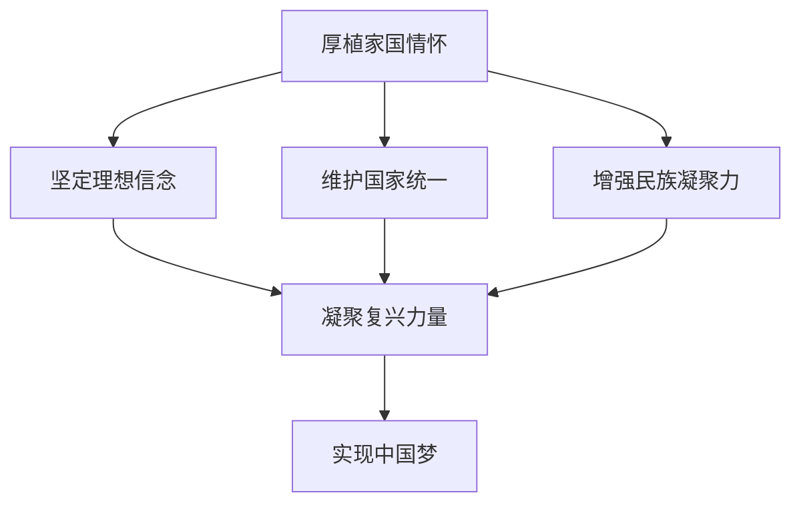

# 爱国主义的时代价值与弘扬时代精神

爱国主义是中华民族精神的核心，体现着个人对祖国的深厚感情以及对祖国统一、领土完整、国家安全、荣誉和利益的支持，是人们对自己祖国的一种最深最朴素的感情。爱国主义不是抽象的口号，而是具体表现为爱党、爱国、爱社会主义高度统一。

## 爱国的基本要求

当代中国爱国主义主要包括四个方面：

1. **坚持爱国和爱党、爱社会主义高度统一**：中国共产党是中国特色社会主义事业的领导核心，社会主义道路是实现国家富强、民族振兴、人民幸福必由之路。
2. **维护祖国统一和民族团结**：反对分裂祖国，珍惜民族团结，维护国家主权、安全和发展利益。
3. **尊重和传承中华民族优秀传统文化**：坚定文化自信，增强民族自尊心、自信心和自豪感。
4. **坚持立足民族又面向世界**：既不妄自菲薄，也不盲目排外，在交流互鉴中吸收优秀文明成果。

> [!IMPORTANT]
> 爱国主义的核心是维护祖国统一和民族团结，体现为爱国与爱党、爱社会主义相统一。

## 爱国的时代价值

弘扬爱国主义有利于坚持党的领导和中国特色社会主义道路，有利于维护国家主权、安全、发展利益和民族团结，有利于弘扬中国精神、凝聚社会力量，为实现中华民族伟大复兴的中国梦提供精神动力。

可以把其作用概括为：

### 时代精神的内涵

时代精神是一个国家和民族在新的历史条件下形成和发展的，体现民族特质、顺应时代潮流的思想观念、价值取向、精神风貌和社会风尚的总和，是一种对社会发展具有积极影响和推动作用的集体意识。

我国新时代爱国主义的本质是坚持爱国和爱党、爱社会主义高度统一，弘扬伟大民族精神和伟大时代精神。其价值在于：

- 为实现中国梦提供精神力量；
- 为推进中华民族伟大复兴提供重要法宝；
- 激励全党全国各族人民为实现国家富强、民族振兴、人民幸福而奋斗；
- 增强全国各族人民的获得感、幸福感、安全感。

## 弘扬时代精神的实践要求

弘扬时代精神，要把个人理想融入党和国家事业之中，把爱国之情转化为报国之行，在服务人民、奉献社会中实现人生价值。可以通过以下步骤落实：

1. **坚定信念**：增强对伟大祖国、中国共产党和中国特色社会主义的信心。
2. **厚植情怀**：热爱祖国、热爱人民，形成正确的是非观、国家观、民族观、宗教观、文化观。
3. **勇于担当**：把个人成长同国家发展、民族复兴联系起来。
4. **实干奋斗**：在专业学习、科技创新、乡村振兴、卫国戍边等实践中贡献力量。
5. **维护统一**：抵制损害国家主权、安全、荣誉和利益的言行。

> [!TIP]
> 记忆框架：爱国“是什么”——本质与基本要求；为什么重要——时代价值；怎样做——把爱国情感转化为担当作为。

## 与相关概念的区别

| 概念 | 主要含义 | 关键表述 |
|---|---|---|
| 爱国主义 | 对祖国和民族的深厚感情及责任担当 | 民族精神的核心 |
| 时代精神 | 顺应时代潮流、推动社会发展的集体意识 | 改革创新是核心 |
| 中国精神 | 以爱国主义为核心的民族精神和时代精神 | 兴国强国之魂 |
| 民族精神 | 贯穿历史始终的稳定精神内涵 | 爱国主义是核心 |
| 时代价值 | 爱国主义对国家发展、民族复兴的作用 | 凝聚力量、提供动力 |

## 常见误区

> [!WARNING]
> 不能把爱国主义简单理解为口头上“爱国”，也不能把个人利益与国家利益机械对立起来。真正爱国既包含情感认同，更包含理性判断、原则立场和实际担当。

> [!CAUTION]
> “中国精神是兴国强国之魂”并非仅指中国精神的内容。答题时应完整说明其三重作用：中国精神凝聚中国力量、鼓舞斗志、彰显中国形象。

## 算对了的例子

**问：为什么说实现中国梦必须弘扬中国精神？**

**答：**中国精神是兴国强国之魂。第一，中国精神凝聚中国力量，伟大的梦想孕育伟大的精神，伟大的精神推进伟大的事业；第二，中国精神鼓舞斗志，是激励中华儿女为实现中国梦而奋斗的不竭精神动力；第三，中国精神彰显中国形象，是综合国力的重要组成部分，有利于提升国家文化软实力。因此，实现中国梦必须弘扬中国精神。
