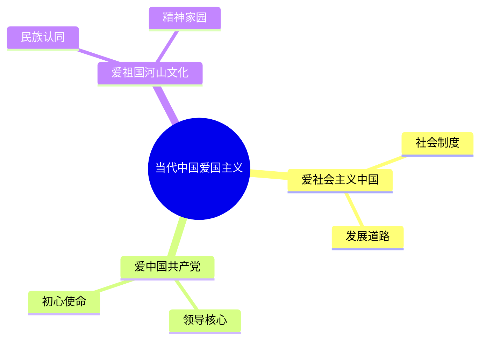

# 坚持爱国爱党爱社会主义相统一

## 爱国、爱党、爱社会主义为什么是一体的

先想一个问题：在当代中国，说“我爱中国”，爱的到底是什么？

如果有人说“我爱祖国的山河文化，但不认同现在的社会制度”，这算不算完整意义上的爱国主义？把“国”抽空成一个地理概念或文化符号，恰恰会漏掉当代中国最核心的内容——这个国家是由中国共产党领导的社会主义国家。==在当代中国，爱国主义的本质就是坚持爱国和爱党、爱社会主义高度统一。==

三者不是并列拼凑，而是内在统一的：党的领导是中国特色社会主义最本质的特征，社会主义是中国发展的根本方向，祖国则是这一切的承载主体。抽掉任何一环，“爱国”就会变成抽象的、悬空的情感。

[!IMPORTANT]
> 当代中国爱国主义的本质是==爱国和爱党、爱社会主义高度统一==，不是三选一，也不是三者简单相加。

## 为什么要统一：从历史逻辑看必然性

这一结论不是口号，而是由历史和现实反复证明的。

- **只有社会主义才能救中国**：近代中国尝试过各种方案，最终是社会主义道路让中国摆脱了半殖民地半封建的命运，实现了民族独立。
- **只有中国特色社会主义才能发展中国**：改革开放以来的成就，是在社会主义制度框架内取得的，不是改旗易帜的结果。
- **党的领导是根本保证**：走社会主义道路、推进现代化建设，都离不开党总揽全局、协调各方。

把这三条连起来看：爱国要落到让国家好，而让国家好的路就是社会主义，走通这条路的关键就是党的领导。

[!WARNING]
> 易错点：爱国主义“首先体现在对社会主义中国的热爱上”，这里的“首先”不是排序上的偏好，而是==逻辑上的题眼==——当代中国之“国”，其现实形态就是社会主义中国。

## 与相近说法的辨析

| 表述 | 是否准确 | 说明 |
|---|---|---|
| 爱国 = 爱社会主义中国 | 不完整 | 漏掉了爱党这个领导核心维度 |
| 爱国是抽象的，和政治无关 | 错误 | 抽离制度与政党，“国”就没有现实载体 |
| 爱国、爱党、爱社会主义高度统一 | 准确 | 新时代爱国主义的本质规定 |
| 首先要热爱山河文化 | 不全面 | 文化认同是基础，但制度认同是核心指向 |

## 一个“算对了”的例子

**题目**：当代中国爱国主义的本质是（ ）

**选项**：A. 坚持中国特色社会主义道路；B. 坚持爱国主义和社会主义的一致性；C. 坚持党的领导和人民当家作主；D. 坚持爱国和爱党、爱社会主义高度统一。

**正确思路**：

- A 只讲了道路，B 只讲了“爱国—社会主义”这一对关系，都缺了“爱党”这一环。
- C 讲的是党的领导与民主政治，不是对“爱国主义本质”的直接回答。
- D 完整覆盖三者“高度统一”，且“本质”对应的教材原句就是它。

**答案**：D。

[!TIP]
> 记忆抓手：看到“本质”，直接锁定“==高度统一==”四个字，对应的是“爱国 + 爱党 + 爱社会主义”三者，缺一不可。

## 常见失分点

1. 把“爱国和爱社会主义的统一”当成完整答案，漏掉“爱党”——这是最典型的“答一半”。
2. 认为“只要维护国家统一和民族团结就够了”，忽略制度认同这个当代爱国主义的基本要求之一。
3. 在简答题中只写口号式论断，不写“只有社会主义才能救中国，只有中国特色社会主义才能发展中国”这一历史论据链。
