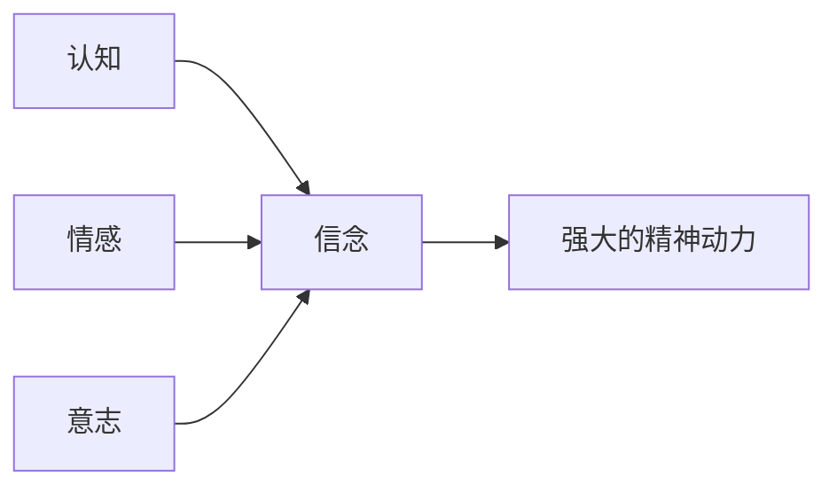

# 什么是理想信念（理想与信念的含义及特征）

## 什么是理想

想象一个问题：你现在闭上眼睛，想象一下十年后的自己——住在什么样的城市？做着什么样的工作？和什么样的人在一起？过着什么样的生活？

那些浮现出来的画面，不是白日梦，而是你对未来的一种向往。当这种向往不只是想想而已，而是经过认真思考、觉得“这件事我真的有可能实现”，并且愿意为之付出行动时，它就变成了**理想**。

> [!IMPORTANT]
> **理想**，是人们在实践中形成的、有实现可能性的、对未来社会和自身发展目标的向往和追求，是人们的世界观、人生观和价值观在奋斗目标上的集中体现。

这句话拆开来看，有三个关键点：

| 关键要素 | 含义 | 它在告诉你什么 |
| :--- | :--- | :--- |
| **在实践中形成** | 理想不是凭空想象的，它来自你对生活、对社会的观察和体验。 | 理想有现实根基，不是空想。 |
| **有实现可能性** | 理想是经过努力可以达成的目标，不是虚无缥缈的幻想。 | 理想区别于幻想、空想的核心特征。 |
| **三观在奋斗目标上的集中体现** | 你认为什么最重要（价值观）、世界应该是什么样（世界观）、人为什么活着（人生观），全都凝聚在你的理想里。 | 理想是一个人的精神世界的“缩影”。 |

### 理想的两大特征

教材告诉我们，理想之所以有力量，有一个深刻的原因：

> **理想之所以能够成为一种推动人们创造美好生活的巨大力量，就在于它不仅源于生活，而且超越生活。**

这揭示了理想的两个核心特征：

- **源于生活（现实性）**：一棵树要长高，根必须扎在土里。理想扎根于当下的现实条件——你学的专业、身处的时代、国家的需要。脱离了这些，理想就成了无源之水。比如，南邮的同学把成为通信行业的顶尖工程师作为理想，正是因为学校有深厚的电子信息学科底蕴，这个理想是“长”在这个土壤上的。

- **超越生活（超越性）**：理想又必须高于现实。如果完全等同于现实，那就不叫理想，叫“现状”。理想是对更美好未来的构想，它能拉着你往前走。==正是这种“超越性”，让理想成为推动人们创造美好生活的巨大力量==——它像一盏灯，照亮比当前更远的地方。

### 信念是什么

一个人有了理想，但遇到挫折时，为什么有的人坚持，有的人放弃？这就涉及另一个核心概念——**信念**。

信念不是对某件事简单的认同，它是认知、情感和意志的**有机统一体**。这句话的深意在于：

- **认知**：你“知道”它是对的，基于理性判断和学识。
- **情感**：你“热爱”它，在心理上有认同感和归属感。
- **意志**：你“坚持”它，遇到困难不退缩，愿意持续付出。

光有认知，只是了解；加上情感，会产生热爱；再注入意志，才能成为**坚定的信念**。==信念是认知、情感和意志的有机统一体，为人们追求理想提供了强大的精神动力。==

> [!NOTE]
> **理想与信念的关系**
> 理想是“你想去哪里”，是奋斗目标；信念是“你为什么相信能到达”，是支撑你走下去的精神力量。二者在实践中经常结合成一个词——**理想信念**，它既是思想的灯塔，也是行动的内驱力。

### 常见的坑：不要把幻想当理想

很多同学在谈及未来时，容易把**幻想**误认为理想。

- **幻想**：我想当宇航员，但物理从未及格，也从未锻炼身体，甚至不了解任何航天知识。
- **理想**：我想成为航天通信领域的工程师，我正在认真学习通信原理、努力考研深造、关注航天事业的行业动态。

二者最本质的区别在于：**理想具有“实现可能性”**，它连接着你的当下行动和未来目标；而幻想则漂浮在现实之上，它与行动之间是断裂的。理想必然呼唤实践，这也是为什么说“理想信念是一个思想认识问题，更是一个实践问题”——==只有实践才是通往理想彼岸的桥梁。==

### 个人理想与社会理想

理清了“什么是理想”之后，还有一个我们无法回避的问题：**个人的追求与国家和社会的需要之间是什么关系？**

==**个人理想是指处于一定历史条件和社会关系中的个体，对于自己未来的物质生活和精神生活所产生的种种向往和追求。**== 比如，你希望未来有一份能发挥专业特长、收入体面且有意义的工作，这属于个人理想。

而社会理想，是全社会占主导地位的共同奋斗目标。当下中国人民的共同理想，是建设中国特色社会主义、实现中华民族伟大复兴。

二者的关系不是“对立”的，而是有机统一的：

1.  **社会理想规定、指引着个人理想。** 人是社会的人，任何个人的追求都离不开时代的底色。国家需要什么样的人才、社会处在什么发展阶段，就像一条大河的主航道，为个体航船提供了方向。
2.  **社会理想是个人理想的凝练和升华。** 没有千万个体对美好生活的向往和奋斗，社会理想就是一句空洞的口号。社会理想汇聚了无数人的共同追求，又升华为更高的奋斗目标。

> [!TIP]
> **“得其大者可以兼其小”**
> 这句古语道出了处理二者关系的精髓。只有把个人理想融入国家和民族的事业中，把个人的向往和追求与社会的需要和人民的利益相结合，个人的价值才有了最广阔的舞台，理想也最有可能变为现实。

将个人的职业规划与国家发展需要结合起来，将“小我”融入“大我”，这样的理想才有最坚实的根基和最强大的生命力。当代大学生应当以此为目标，立志高远，让青春在为祖国和人民的奋斗中焕发光彩。
