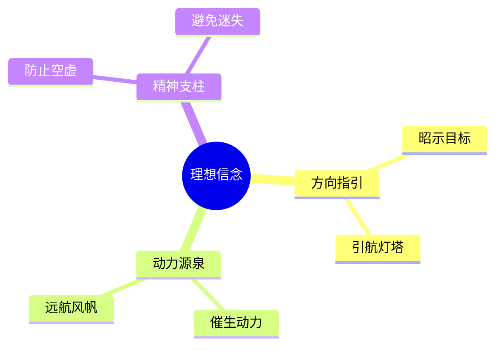

# 理想信念是精神之“钙”（理想信念对大学生成长成才的重要意义）

## 理想信念是精神之“钙”

如果把人的精神世界比作骨骼，那么理想信念就是其中的==钙质==。缺钙会导致骨质疏松，而缺乏理想信念或信念不坚定，精神上就会得“软骨病”，表现为迷茫、空虚甚至行为失范。对于南邮学子而言，理解这一隐喻是确立人生坐标的第一步。

> [!IMPORTANT]
> **核心定义**：理想决定方向，信念决定成败。二者共同构成精神支柱，防止精神空虚和行为迷失。

### 为什么需要“补钙”？

试想一下，如果一艘船没有灯塔指引，也没有风帆动力，它能在茫茫大海中抵达彼岸吗？理想信念正是那盏==引航的灯塔==和那面==远航的风帆==。其重要性主要体现在三个维度：

1.  **昭示奋斗目标**：解决“去哪里”的问题，提供清晰的人生方向。
2.  **提供前进动力**：解决“怎么走”的问题，激发持久的内在驱动力。
3.  **提高精神境界**：解决“成为谁”的问题，支撑个体超越平庸，追求崇高。

### “理想”与“信念”的区别与联系

很多同学在答题时容易混淆这两个概念。简单来说，理想侧重于==未来图景==，信念侧重于==确信态度==。

| 维度 | 理想 (Ideal) | 信念 (Belief) |
| :--- | :--- | :--- |
| **核心指向** | 奋斗目标（What） | 心理状态（How firmly） |
| **功能作用** | 指引方向 | 支撑意志 |
| **形象比喻** | 灯塔 | 压舱石/风帆 |

> [!TIP]
> **记忆口诀**：理想指路灯，信念定心针；无理想则盲，无信念则软。

### 常见的认知误区

在复习和实践中，需警惕以下两个“坑”：

*   **误区一：理想等同于空想。**
    > [!WARNING]
    > 理想建立在现实基础之上，具有实现可能性；空想脱离实际，无法实现。只有经过==艰苦奋斗==的理想才能转化为现实。

*   **误区二：信念是一成不变的。**
    科学的信念需要随着实践发展而深化。对于大学生而言，只有确立==马克思主义的科学信仰==，才能真正确立崇高的理想信念，避免陷入盲目或迷信。

### 典型例题解析

**题目**：简述为什么说理想信念是精神之“钙”？

**参考思路**：
首先点明比喻义（缺钙得软骨病），然后分三点论述其功能。

1.  **比喻切入**：理想信念是精神上的“钙”，缺失会导致精神“缺钙”，引发“软骨病”。
2.  **功能展开**：
    *   它昭示奋斗目标，为人生提供==前进方向==。
    *   它催生前进动力，提升个人的==精神境界==。
    *   它是精神支柱，能有效防止==精神空虚==和行为迷失。

> [!NOTE]
> **延伸思考**：有了“钙”还不够，还需要“行动”。只有==实践==才是通往理想彼岸的桥梁。南邮学子应将个人理想融入中国梦，在代码与电路中践行艰苦奋斗精神。
