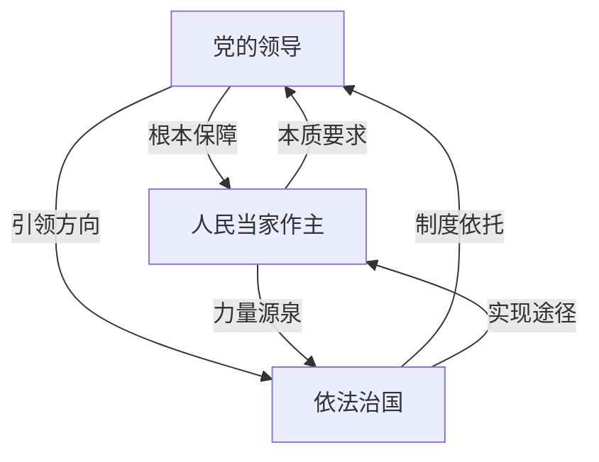

# 我国社会主义法律的本质特征（党的领导与人民当家作主相统一）

我国社会主义法律不是凭空产生的，它首先回答了一个根本问题：这部法律究竟“听谁的”又“为了谁”？答案就藏在它的本质特征中——==党的领导与人民当家作主相统一==。

## 是什么

这一特征是指，在我国法治体系中，中国共产党的领导、人民当家作主与依法治国三者是不可分割的有机整体。具体而言：

- **党的领导原则**：中国共产党是中国特色社会主义事业的领导核心，是中国特色社会主义最本质的特征。
- **人民主体地位**：法律必须体现人民意志、保障人民权益。

> [!IMPORTANT]
> ==党的领导是人民当家作主和依法治国的根本保障，人民当家作主是党的领导和依法治国的本质要求。==二者相互依存，缺一不可。

## 为什么需要

试想一下：如果只有“人民当家作主”而没有坚强的领导核心，十四亿人的多元诉求如何凝聚成统一的法律意志？反之，如果脱离了人民，法律又会变成什么？

在中国特色社会主义新时代，爱国主义主要表现为在党的领导下全面建成小康社会，开启全面建设社会主义现代化国家新征程，为实现中华民族强起来而奋斗。这说明，无论是爱国实践还是法治建设，本质上都是==爱国爱党爱社会主义的高度统一==。坚持这一特征，才能确保走中国特色社会主义法治道路不偏向、不变质。

## 怎么做

在全面推进依法治国（总目标是建设中国特色社会主义法治体系，建设社会主义法治国家）的过程中，落实这一特征需遵循五项原则：

1. 坚持中国共产党的领导
2. 坚持人民主体地位
3. 坚持法律面前人人平等
4. 坚持依法治国和以德治国相结合
5. 坚持从中国实际出发

同时，这一特征直接体现在我国宪法的基本原则中：党的领导原则、尊重和保障人权原则、社会主义法治原则和民主集中制原则。

> [!TIP]
> 记忆口诀：“一领二主三平等，德法结合从实际”。其中“一领”即党的领导，是贯穿始终的主线。

## 相近概念辨析

许多同学容易将“党的领导”与“国体/政体”混淆。请看下表区分：

| 概念 | 内涵 | 在本知识点中的角色 |
| :--- | :--- | :--- |
| **国体** | 人民民主专政制度 | 规定了“谁是主人”（人民） |
| **政体** | 人民代表大会制度 | 规定了“如何当家作主”的制度载体 |
| **党的领导** | 事业领导核心 | 为人民当家作主提供==根本保证== |

> [!NOTE]
> 国体和政体解决的是国家权力的归属与组织形式问题，而“党的领导与人民当家作主相统一”解决的是社会主义法律的阶级本质与政治方向问题。

## 常见坑与真题演练

> [!WARNING]
> 易错坑：认为“党领导一切”就意味着“党代替人民当家作主”，或者把“党的领导”与“依法治国”对立起来。实际上，党领导人民制定宪法法律，党自身也必须在宪法法律范围内活动。

> [!CAUTION]
> 高危误区：做多选题时，漏掉“人民当家作主是党的领导的本质要求”这一反向逻辑，只记住了“党的领导是根本保障”。

**【真题示例】**
**问**：为什么要坚持党的领导、人民当家作主与依法治国相统一？
**答**：
① 党的领导是人民当家作主和依法治国的根本保障；
② 人民当家作主是党的领导和依法治国的本质要求；
③ 依法治国是党领导人民当家作主的治国方略。

这三句话构成了完整的逻辑闭环，答题时务必写全，切勿遗漏第②点。
