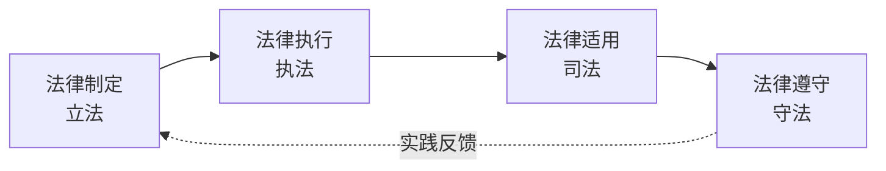

# 我国社会主义法律的运行机制（法律制定、法律执行、法律适用、法律遵守）

法律不是写在纸上就自动生效的，它要经过从“立出来”到“用起来”、再到“人人遵守”的运行过程。我国社会主义法律的运行主要包括==法律制定、法律执行、法律适用、法律遵守==四个环节，可分别对应立法、执法、司法、守法。

> [!IMPORTANT]
> ==法律制定是法律运行的起始性和关键性环节==。四个环节相互衔接，但不能把它们理解成每个案件都必须依次经历的固定流程。

## 四个环节分别做什么

| 环节 | 基本含义 | 主体与关键词 | 典型表现 |
|---|---|---|---|
| 法律制定（立法） | 有立法权的国家机关依照法定职权和程序，制定规范性法律文件的活动 | 有立法权的国家机关；制定规则 | 全国人民代表大会及其常务委员会行使国家立法权 |
| 法律执行（执法） | 国家机关及其公职人员在国家和公共事务管理中，依照法定职权和程序贯彻、实施法律的活动 | 广义主体较宽；狭义指国家行政机关及其公职人员 | 行政机关依法监管、检查、处罚 |
| 法律适用（司法） | 国家司法机关及其公职人员依照法定职权和程序，适用法律处理案件的专门活动 | 司法机关；处理案件 | 法院依法审理、裁判案件 |
| 法律遵守（守法） | 国家机关、社会组织和公民个人依照法律规定，行使权利（权力）和履行义务（职责）的活动 | 全体守法主体；权利义务统一 | 公民依法维权、纳税，国家机关依法履职 |

其中，狭义的法律执行也叫行政执法，是法律实施的重要环节；法律适用则突出“司法机关”“法定程序”“处理案件”三个特征。守法并不只是普通公民“不违法”，国家机关依法行使职权、社会组织依法履行义务，同样属于守法。==守法是法律实施和实现的基本途径==。

## 为什么四个环节都需要

没有法律制定，执法、司法和守法就缺乏明确依据；只有立法而没有执行，法律可能停留在文本上；发生案件时，需要司法机关依法适用法律，定分止争、纠正违法；而法律最终还要转化为社会成员的日常行为。因此，四个环节共同保证法律从规范走向现实，并与“科学立法、严格执法、公正司法、全民守法”的基本格局相呼应。

## 相近概念与常见误区

> [!WARNING]
> “法律执行”和“法律适用”不能混用：前者狭义上对应行政机关的执法活动，后者对应司法机关处理案件。看到“法院审理案件”，应选法律适用，而不是法律执行。

还要避免三个坑：一是把法律制定误答成法律执行，忽略其“起始性和关键性”地位；二是把守法主体只写成公民个人，漏掉国家机关和社会组织；三是把守法理解成单纯履行义务，实际上它还包括依法行使权利（权力）。

## 例题示范

**题目：法律运行的起始性和关键性环节是什么？**

答：**法律制定**。因为先有有立法权的国家机关依照法定职权和程序制定规范性法律文件，才能为后续执法、司法和守法提供规范依据。

若题干改为“国家司法机关及其公职人员依照法定职权和程序适用法律处理案件”，则应答**法律适用**。解题时抓住主体和行为：==定规则看立法，行政管理看执法，司法办案看司法，依法行权履责看守法==。
