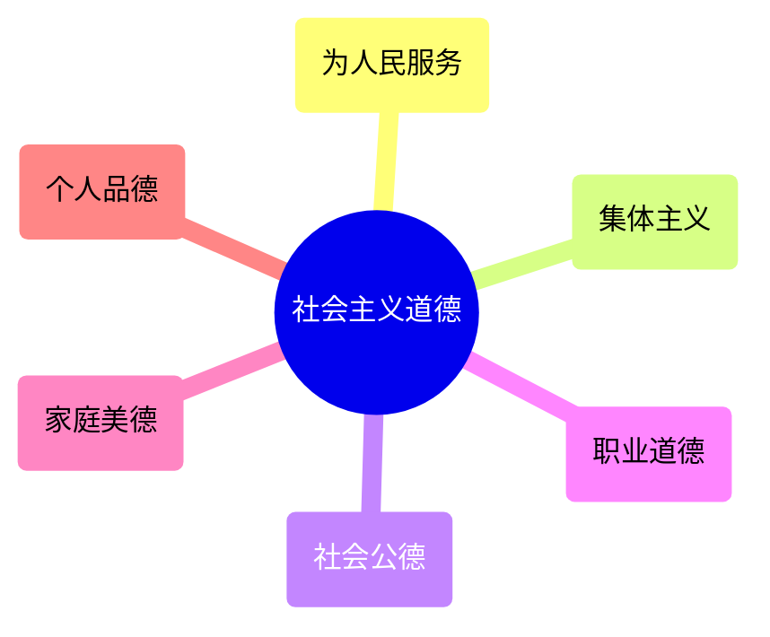

# 社会主义道德是崭新类型的道德

## “崭新类型”是什么意思

社会主义道德是建立在==人民当家作主的社会主义社会制度==基础上，以马克思主义为指导，以为人民服务为核心、以集体主义为原则的道德体系。它继承了人类优秀道德成果，又体现了社会主义制度的经济、政治和价值理念，因而是一种==崭新的道德类型==。

这里的“崭新”不是说社会主义道德与此前所有道德毫无关系，而是说它改变了旧社会主要为维护少数统治者利益服务的根本立场，形成了以人民利益为价值目标的新型道德。

## 为什么需要这种新型道德

社会主义社会仍然需要道德。法律主要依靠国家强制力约束行为，道德则通过社会舆论、传统习俗和内心信念发挥潜移默化的作用。只有法律与道德相结合，才能覆盖社会生活的各个领域。

社会主义道德之所以是新的，根本在于它体现了社会主义制度的本质要求：

| 比较维度 | 旧社会占主导地位的道德 | 社会主义道德 |
|---|---|---|
| 主要维护对象 | 少数统治阶级利益 | 广大人民群众利益 |
| 价值立场 | 等级秩序与特权 | 平等、公正与人民主体地位 |
| 核心价值 | 因时代和阶级而异 | 为人民服务 |
| 基本原则 | 维护等级和私有利益 | 集体主义 |
| 重要目标 | 维护既有统治秩序 | 促进人的全面发展与社会进步 |

> [!IMPORTANT]
> 社会主义道德区别并优越于其他社会形态道德的显著标志，是==为人民服务==。

## 它的核心结构是什么

社会主义道德不是单一规范，而是由不同层次的要求构成：

其中，**为人民服务**回答“道德为谁服务”，**集体主义**回答“如何正确处理个人利益与集体利益、国家利益的关系”。社会公德、职业道德、家庭美德和个人品德，则是社会主义道德在具体生活领域中的具体落实。

> [!TIP]
> 记忆结构：==一核一原则四规范==——核心是为人民服务，原则是集体主义，规范包括社会公德、职业道德、家庭美德和个人品德。

## 怎样理解集体主义

集体主义要求把国家利益和集体利益放在首位，同时充分尊重个人的正当利益。它既反对只顾个人利益，也反对以抽象的“集体”为名损害个人合理权益。

判断利益冲突时，可以依次思考：

1. 该利益是否符合社会主义社会和人民群众的根本利益；
2. 个人利益能否通过合法正当的途径得到满足；
3. 当个人利益与集体利益发生矛盾时，是否愿意作出必要让步。

> [!WARNING]
> 不能把集体主义理解为“一切服从集体”。==维护人民整体利益==与保障个人正当利益并不矛盾。

## 与相近概念的区别

- **社会主义道德与法律**：二者都调整社会关系，但法律具有国家强制力，社会主义道德主要依靠舆论、习俗和信念发挥作用；二者相辅相成，不能相互替代。
- **社会主义道德与中华优秀传统道德**：前者是建立在社会主义制度基础上的新型道德，后者是社会主义道德的重要文化来源。
- **为人民服务与集体主义**：前者是社会主义道德的核心，后者是基本原则，二者不能并列替换。

## 一道例题

某快递企业员工发现，一批客户包裹存在错分风险。若按时分拣可以完成当日考核，但可能损害客户权益。该员工主动停下工作、核对信息并重新分拣，避免客户损失。

这一行为体现了社会主义职业道德中==诚实守信、忠于职守==的要求；其深层价值立场，是维护人民群众利益。作答时应写明具体道德规范，再联系“社会主义道德的核心是为人民服务”，不能只写“该员工很有道德”。

> [!CAUTION]
> 常见失分点：只背“为人民服务”，却不知道它如何表现为诚实守信、奉献社会、服务人民等具体行为。
