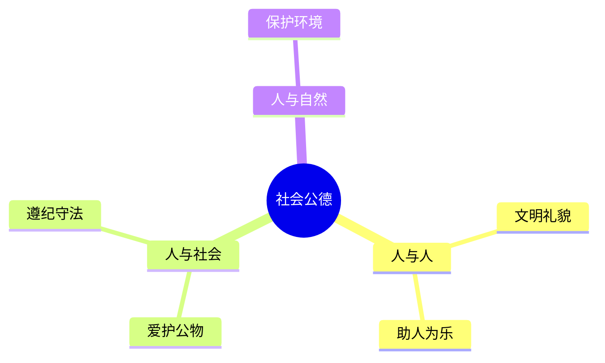

# 公共生活中的道德规范（文明礼貌、助人为乐、爱护公物、保护环境、遵纪守法）

## 公共生活中的道德规范

现代社会是“陌生人社会”，我们大量时间都身处公共空间。在这些公共领域里该怎么做，就是社会公德要回答的问题。

先看一个熟悉的场景：你在图书馆自习，隔壁同学接电话声音很大，你会觉得不舒服。这其实反映出：==公共生活需要一套大家共同遵守的行为准则。==

### 它是什么

公共生活中的道德规范，即**社会公德**，是指人们在社会交往和公共生活中应该遵守的行为准则，是==维护公共利益、公共秩序、社会和谐稳定的起码的道德要求==。

社会公德涵盖了三个维度的关系：

五项主要内容在考试中各有定位，记住这几个对应关系很重要：

| 内容 | 在考试中的定位 | 内涵要点 |
|------|----------------|----------|
| **文明礼貌** | 人际交往的基本规范 | 仪表整洁、举止得体、谦让友善 |
| **助人为乐** | 社会主义人道主义的基本要求 | 主动关心帮助他人，见义勇为 |
| **爱护公物** | 集体主义在公共财物上的体现 | 珍惜公共资源，反对损坏浪费 |
| **保护环境** | 调整人与自然关系 | 低碳生活，守护生态 |
| **遵纪守法** | ==社会公德最基本的要求== | 遵守公共秩序和法律法规 |

>[!IMPORTANT]
> 遵纪守法有两个考试高频定位：既是“社会公德最基本的要求”，又是“维护公共生活秩序的重要条件”。答题时看题目问的是“社会公德”还是“公共秩序维护”，对号入座。

### 为什么需要

>[!NOTE]
> 公共秩序的重要性（简答题高频考点）
> 
> ① 有序的公共生活是社会生产活动的重要基础
> 
> ② 良好的公共秩序为提高生活质量提供基本保证
> 
> ③ 有序的公共生活是国家现代化与文明程度的重要标志

换个角度想，如果没有这些规范，会发生什么？插队、喧哗、破坏公物——一个人的“自由”变成了对他人的伤害。所以公共道德本质上是**保护每个人的合理自由**。

### 和集体主义三层要求的关系

这道线容易考选择。公共生活中的道德规范不是孤立的，它是集体主义原则在公共领域的具体展开。把两者对照来看：

| 集体主义层次 | 道德要求 | 适用群体 |
|--------------|----------|----------|
| 最高层次 | 无私奉献、一心为公 | 优秀共产党员、先进分子 |
| 中间层次 | 先公后私、先人后己 | 具有较高觉悟的人 |
| ==最基本要求== | 顾全大局、遵纪守法、热爱祖国、诚实劳动 | 全体公民 |

>[!TIP]
> 答题口诀：社会公德“最基”是遵纪守法，集体主义“最基”是顾全大局＋遵纪守法＋热爱祖国＋诚实劳动。两个“最基本”别搞混。

### 常见易错辨析

**坑1：把助人为乐等同于无私奉献**
助人为乐是社会主义人道主义的基本要求，而无私奉献是集体主义最高层次的要求，二者层次不同。考试时看到“基本要求”和“最高层次”要警觉。

**坑2：混淆社会公德和职业道德**
社会公德面向公共生活，职业道德面向职业领域。乘车排队、不闯红灯、图书馆不喧哗——这些属于==社会公德==，不是职业道德也不是环境道德。

>[!WARNING]
> 选择题常见陷阱：把公共场所的行为规范标为“职业道德”或“环境道德”。记住关键判断标准——只要发生在公共生活领域、人人均应遵守的，就是社会公德。

**坑3：网络道德独立于社会公德**
网络道德不是独立体系。教材明确表述：网络生活中的道德要求，是==社会公德在网络空间的运用和扩展==。网络空间也要遵守文明礼貌、遵纪守法等要求。

### 一个算对了的例子

回看那道选择真题：

> 乘车、登机、坐船时主动购票，自觉排队；出行时自觉遵守交通规则，不闯红灯；在图书馆、影剧院不抽烟，不喧哗吵闹。这是人们在社会生活中应当遵循的（  ）
> 
> A. 社会公德　　B. 职业道德　　C. 环境道德　　D. 公共法律

**解题思路**：题干描述的行为发生在公共交通、公共文化场所，面向所有人普遍适用，既不是特定职业的要求，也不仅限于环境保护，更不是法律条文本身的表述（题目问的是“道德规范”）。因此答案是 **A. 社会公德**。逐一对应五项内容：主动购票排队的实质是==遵纪守法==，不喧哗吵闹是==文明礼貌==，不闯红灯兼具遵纪守法和爱护公共秩序两层含义。一道题串起了社会公德的多项核心内容。
