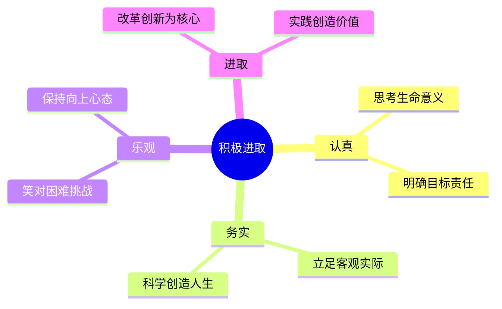

# 树立积极进取的人生态度

## 什么是积极进取的人生态度

在背诵“怎么做”之前，不妨先思考：为什么同样面对学业压力或就业迷茫，有人选择“躺平”抱怨，有人却能在南邮的实验室里越挫越勇？这种差异的根源，正是人生态度的不同。

> [!IMPORTANT]
> 人生态度是指人们通过生活实践形成的对人生问题的一种==稳定的心理倾向和精神状态==。它不是暂时的情绪波动，而是长期实践中固化的行为模式。

积极进取的人生态度，本质上是将“服务人民、奉献社会”的人生追求转化为具体的行动自觉。它要求大学生在面对顺境与逆境时，始终保持向上的精神状态，而非被动应付。

## 四个维度的实践路径

如何将抽象的态度落地？教材明确给出了四个关键词，这也是简答题的高频得分点：

-   **人生须认真**：严肃思考人的生命应有的意义，明确生活目标和肩负的责任，反对游戏人生、玩世不恭。
-   **人生当务实**：从人生的实际出发，以科学的态度看待人生，以务实的精神创造人生，避免好高骛远。
-   **人生应乐观**：保持乐观向上的心态，笑对人生中的困难和挑战，不因一时挫折而消沉。
-   **人生要进取**：以==改革创新为核心==，在实践中不断开拓，创造有价值的人生，拒绝安于现状。

> [!TIP]
> 记忆口诀：“认实乐进”。答题时务必展开为完整句子，仅写四字短语会被扣分。

## 易混概念辨析与避坑指南

复习本章时，最容易混淆的是“人生态度”与“人生观”“情绪”的关系。

| 对比维度 | 人生态度 | 人生目的 | 临时情绪 |
| :--- | :--- | :--- | :--- |
| 内涵定位 | 心理倾向与精神状态 | 人生根本追求与方向 | 短暂的心理体验 |
| 稳定性 | ==稳定==（实践形成） | 最核心、最根本 | 不稳定、易变 |
| 作用层面 | 决定“怎样对待人生” | 决定“为何而活” | 影响当下感受 |

> [!WARNING]
> 答题常见误区：将“乐观”等同于“盲目自信”或“无视困难”。教材强调的乐观是“笑对困难和挑战”，前提是承认困难的客观存在，并以务实精神去解决，绝非阿Q式的精神胜利法。

## 真题示例与规范作答

**题目**：简述大学生如何树立积极进取的人生态度。

> [!NOTE]
> 此题为P16/P24高频简答题，阅卷按要点给分。以下为标准得分结构：

1.  **人生须认真**。要严肃思考人的生命应有的意义，明确生活目标和肩负的责任。
2.  **人生当务实**。要从人生的实际出发，以科学的态度看待人生，以务实的精神创造人生。
3.  **人生应乐观**。要保持乐观向上的心态，笑对人生中的困难和挑战。
4.  **人生要进取**。要以改革创新为核心，在实践中创造有价值的人生。

> [!CAUTION]
> 切勿遗漏“以改革创新为核心”这一限定语。在南邮《思想道德与法治》评分标准中，缺少该核心表述，“进取”要点可能被判不完整。四个要点缺一不可，顺序建议按教材原文排列。
