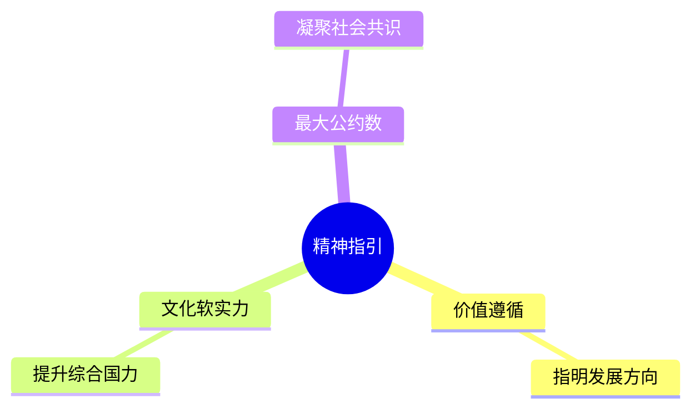

# 当代中国发展进步的精神指引（价值遵循、文化软实力、最大公约数）

一个拥有14亿多人口、56个民族的大国，靠什么凝聚共识、指引方向？如果每个人追求的价值南辕北辙，国家还能稳步前行吗？

这正是“当代中国发展进步的精神指引”要回答的核心问题。它指的是==社会主义核心价值观的重大意义==，具体展开为三个维度：价值遵循、文化软实力、最大公约数。

## 三大维度的内涵与逻辑

这三个方面不是并列的散点，而是从“道路方向”到“国际竞争”再到“内部团结”的层层递进。

> [!IMPORTANT]
> 核心结论：社会主义核心价值观是坚持和发展中国特色社会主义的==价值遵循==，是提高国家文化软实力的==迫切要求==，是推进社会团结奋进的==“最大公约数”==。

- **价值遵循**：回答了中国特色社会主义“往哪走”的问题。核心价值观反映着我国社会主义基本制度的本质要求，是我国社会主义制度的内在精神之魂。
- **文化软实力**：回答了在国际竞争中“凭什么赢”的问题。中国精神彰显中国形象，是综合国力的重要组成部分。
- **最大公约数**：回答了多元社会中“怎么聚”的问题。“最大公约数”指社会主义核心价值观，它反映了全体人民的共同价值追求。确立这一价值观关乎国家前途命运和人民幸福安康。

## 核心价值观与文化软实力的深度绑定

复习时最容易丢分的，是没搞清“文化软实力”和“核心价值观”到底谁决定谁。请问自己：两个国家比拼文化影响力，最终拼的是什么？是电影票房还是背后的价值观？

> [!NOTE]
> ==文化软实力的灵魂、文化软实力建设的重点是核心价值观==。文化软实力的竞争，本质上是不同文化所代表的核心价值观的竞争。同时，坚定的核心价值观自信也是中国特色社会主义道路自信、理论自信、制度自信和文化自信的==价值内核==。

| 比较维度 | 文化软实力 | 核心价值观 |
| :--- | :--- | :--- |
| **概念定位** | 综合国力的重要组成部分 | 文化软实力的灵魂与建设重点 |
| **竞争实质** | 外在的文化影响力较量 | 内在的不同价值观较量 |
| **相互关系** | 载体与表现 | 内核与主导 |

## 常见易错坑与辨析

> [!WARNING]
> 易错坑：把“最大公约数”等同于“妥协退让”或“少数服从多数”。数学中的最大公约数是提取公因数；政治语境下的“最大公约数”是指全国各族人民==共同认可==的价值观，是求同存异中那个最核心的“同”，绝不是放弃原则的平均值。

> [!CAUTION]
> 高危误区：写论述题时只答“提高文化软实力”，漏掉“核心价值观是其灵魂”。记住课件原话：文化软实力的竞争，==本质上==是核心价值观的竞争。

## 真题实战演练

**题目**：十三届全国人大一次会议通过宪法修正案，把国家倡导社会主义核心价值观正式写入宪法，理解其凸显了社会主义核心价值观的重大意义。

**满分作答思路（踩分点拆解）**：

1. **定性**：入宪以根本法形式确认了其作为==当代中国发展进步的精神指引==的地位。
2. **析理（对应三大维度）**：
   - 彰显了其作为坚持和发展中国特色社会主义的==价值遵循==，为法治建设提供道德底蕴。
   - 凸显了其作为提高国家文化软实力的==迫切要求==，将价值观建设上升为国家意志。
   - 确立了其作为推进社会团结奋进的==“最大公约数”==，用最高法律效力保障全体人民共同价值追求的实现。
3. **落脚**：这深刻说明，确立反映全国各民族人民共同认可的价值观“最大公约数”，关乎着==国家前途命运和人民幸福安康==。

> [!TIP]
> 记忆口诀：“一遵循（价值遵循）、一要求（软实力）、一公约（最大公约数）”。答题时先默写这三句骨架，再往里填“灵魂”“重点”“本质”等关键词，大题绝不会漏点。
