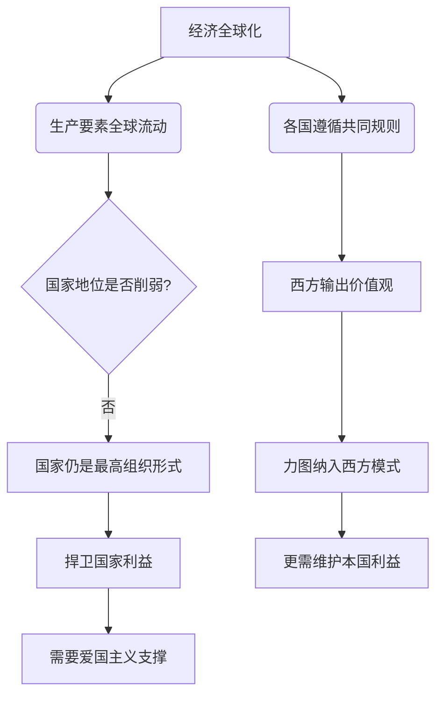

# 爱国主义与经济全球化的关系

## 经济全球化与爱国主义的关系

在经济全球化深入发展的今天，一个常见的疑问是：世界都“地球村”了，还需要强调爱国主义吗？答案是肯定的。理解这一关系，关键在于厘清**全球化**与**国家主权**的辩证统一。

> [!IMPORTANT]
> ==核心结论==：在经济全球化条件下，**国家仍然是民族存在的最高组织形式**，是国际社会活动中的独立主体。只要国家存在，爱国主义就有其坚实的基础。

### 为什么全球化下更要弘扬爱国主义？

经济全球化表现为商品、资本、技术和信息的跨国界流动，但这并不意味着政治、文化和价值观的一体化。

西方发达国家往往借全球化之机，输出其政治观、价值观和生活方式，试图将发展中国家纳入其发展轨道。在这种情况下，如果丧失爱国主义精神，就会在激烈的国际竞争中迷失方向，损害本民族的根本利益。因此，参与全球化过程必须坚定捍卫国家利益，这恰恰更需要爱国主义的支撑。

### 当代大学生如何把握二者关系？

面对全球化浪潮，我们需要树立以下三个关键观念，避免陷入误区：

| 常见误区 | 正确观念 | 解析 |
| :--- | :--- | :--- |
| 科学无国界，所以科学家也无国界 | **科学没有国界，但科学家有祖国** | 科技成果可共享，但科研服务于国家利益 |
| 全球化等于政治/文化一体化 | **人有地域信仰不同，报国之心无差别** | 尊重差异，但忠诚于自己的国家和民族 |
| 融入世界就要放弃主权 | **始终维护国家的主权和尊严** | 全球化不等于放弃国家独立性 |

> [!WARNING]
> **易错坑**：不要混淆“经济全球化”与“政治一体化”。经济全球化是趋势，但政治上各国依然是独立主体。选择题中若出现“政治一体化”或“文化一体化”作为全球化的含义，均为错误选项。

### 典型例题解析

**题目**：在经济全球化条件下，（ ）是本民族整体利益的最具权威的代表者。
A. 人民  B. 中央政府  C. 政党  D. 国家

**解析**：
根据课件知识点，在经济全球化背景下，虽然跨国公司和非政府组织作用增强，但**国家**依然是民族存在的最高组织形式，是国际社会中的独立主体，也是本民族整体利益最具权威的代表者。
*   A项“人民”是国家的构成主体，但在国际法理关系中，代表主体是国家。
*   B、C项属于国家内部的政治架构。
*   **正确答案：D**。

> [!TIP]
> **记忆口诀**：全球化，流要素；国家在，主心骨；护利益，爱祖国；辨是非，守尊严。
