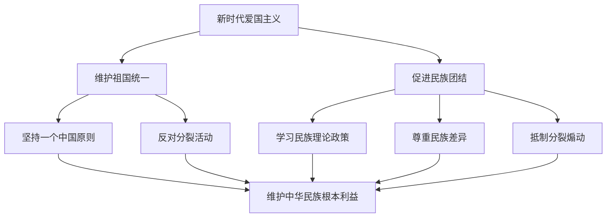

# 维护祖国统一和民族团结

维护祖国统一和民族团结，是新时代爱国主义的基本要求之一。国家统一和民族团结是中华民族根本利益所在，也是实现中华民族伟大复兴的重要保证。在新的历史条件下，弘扬爱国主义精神，必须把维护祖国统一和民族团结作为重要着力点和落脚点。

## 为什么必须维护祖国统一和民族团结

中国是一个统一的多民族国家，各民族共同开拓了祖国的辽阔疆域，共同创造了灿烂的中华文化。国家统一，能够为经济发展、社会进步和人民生活改善提供稳定环境；民族团结，能够凝聚各民族的智慧和力量，形成共同奋斗的强大合力。

如果国家分裂、民族失和，不仅损害各民族的根本利益，也会破坏社会稳定和发展大局。因此，维护祖国统一和民族团结，不是抽象口号，而是关系国家前途、民族命运和人民幸福的现实要求。

> [!IMPORTANT]
> ==国家统一和民族团结是中华民族根本利益所在==。答题时要先写出这一根本判断，再说明青年学生的具体行动。

## 怎样维护祖国统一

维护祖国统一，首先要坚持一个中国原则，认识到台湾是中国领土不可分割的一部分。解决台湾问题、实现祖国完全统一，是全体中华儿女的共同愿望。

青年学生应自觉维护国家主权、安全和发展利益，反对任何形式的分裂活动，不传播、不附和分裂国家的错误言论。同时，要正确认识香港、澳门实行“一国两制”与维护国家统一的关系：“一国”是实行“两制”的前提和基础，不能把“两制”理解为可以脱离国家统一。

## 怎样促进民族团结

促进民族团结，需要深化对党的民族理论和民族政策的认识，尊重各民族的风俗习惯、语言文字和宗教信仰，平等对待不同民族的同学，在学习、生活中相互理解、相互帮助。

还要认清“藏独”“疆独”等各种分裂势力的险恶居心和反动煽动，增强辨别能力，不被网络谣言和极端言论误导，自觉做民族团结进步事业的==建设者、维护者和促进者==。

## 与相近要求的区别

| 要求 | 主要回答的问题 | 本知识点的答题重点 |
|---|---|---|
| 坚持爱国主义和社会主义相统一 | 爱什么样的中国 | 爱国、爱党、爱社会主义高度统一 |
| 维护祖国统一和民族团结 | 如何维护国家整体利益 | 反对分裂、促进团结 |
| 尊重和传承中华民族历史和文化 | 如何延续精神命脉 | 增强文化认同，反对历史虚无主义 |
| 坚持立足民族又面向世界 | 如何处理民族与世界的关系 | 立足中国，同时尊重各国文明 |

维护祖国统一和民族团结也不同于一般意义上的“维护国家安全”。前者突出国家统一和各民族团结，后者还包括政治安全、经济安全、网络安全等更广泛内容；二者相互联系，但不能在答题时完全混写。

> [!WARNING]
> 常见失分点有两个：一是只写“反对分裂”，漏掉“促进民族团结”；二是把民族团结写成“消除民族差异”。正确做法是尊重差异、增进共同性，而不是否认各民族文化特点。

## 例题示范

**题目：新时代爱国主义的基本要求。**

参考答案：第一，坚持爱国主义和社会主义相统一；第二，维护祖国统一和民族团结；第三，尊重和传承中华民族历史和文化；第四，坚持立足民族又面向世界。其中，国家统一和民族团结是中华民族根本利益所在。青年学生要反对分裂活动，深化对党的民族理论和民族政策的认识，自觉做民族团结进步事业的建设者、维护者和促进者。

> [!TIP]
> 简答题可采用“总述地位—维护统一—促进团结—青年行动”的结构。若题目只问本知识点，不必把新时代爱国主义的四项要求全部展开。
