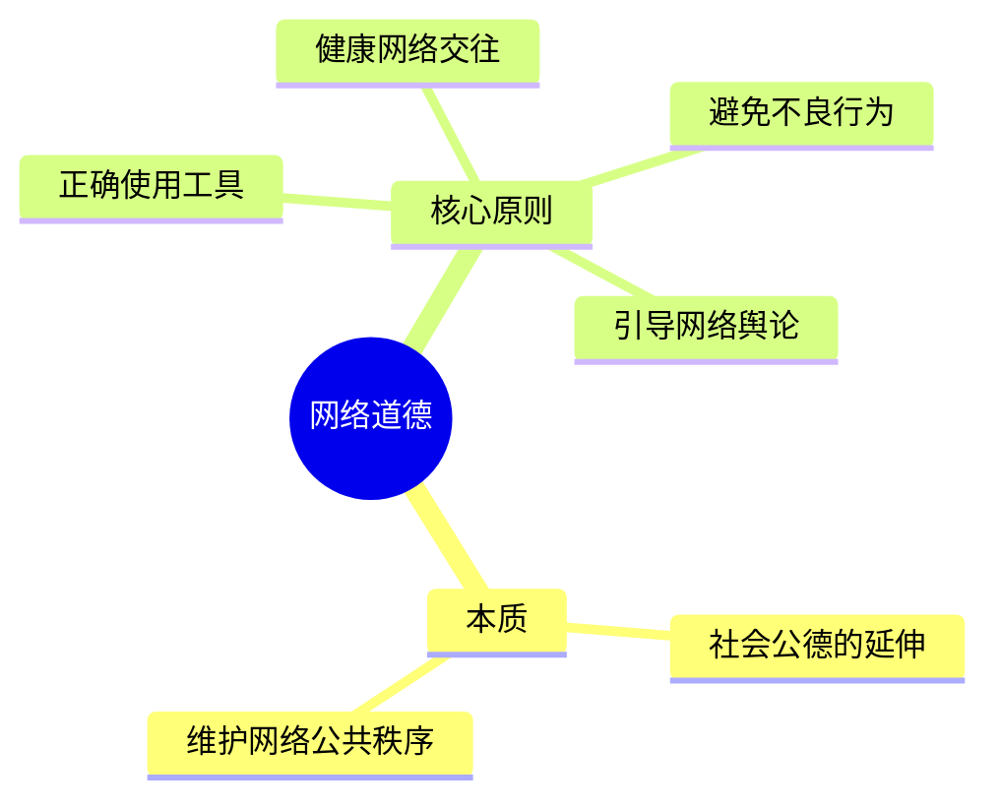

# 网络生活中的道德要求（网络空间不是法外之地）

# 网络生活中的道德要求

> [!IMPORTANT]
> **核心定义**：网络生活中的道德要求，是人们在网络生活中为了维护正常的==网络公共秩序==需要共同遵守的基本道德准则，是==社会公德在网络空间的运用和扩展==。（P168）

网络空间并非“法外之地”，也不是道德真空。随着数字化生存成为常态，现实社会的道德规范必然延伸至虚拟空间。理解这一知识点，关键在于把握其作为**社会公德延伸**的本质，以及如何在虚拟交互中践行具体的道德规范。

## 为什么需要网络道德？

现实中的公共秩序依靠法律和道德共同维持，网络空间同样如此。虽然网络具有匿名性和开放性，但主体依然是人。
*   **秩序需求**：若无道德约束，谣言、暴力、诈骗将摧毁网络信任基石。
*   **公德延伸**：网络交往本质上是人与人的交往，现实中的尊重、诚信、责任等公德原则同样适用。

## 具体怎么做？（四大要求）

根据教材（P168-170）及复习提纲，网络生活中的道德要求主要包含以下四个方面：

| 维度 | 具体要求 | 关键行为指引 |
| :--- | :--- | :--- |
| **工具使用** | ==正确使用网络工具== | 避免沉迷；利用网络获取知识、提升自我；不利用技术作恶。 |
| **人际交往** | ==健康进行网络交往== | 尊重他人人格；文明交流；不传播谣言、色情或有害信息。 |
| **行为自律** | ==自觉避免网络不良行为== | 遵守法律法规；抵制网络暴力；不参与“人肉搜索”或网络欺凌。 |
| **舆论环境** | ==积极引导网络舆论== | 传播正能量；理性发声；维护清朗、健康的网络空间。 |

> [!TIP]
> **记忆口诀**：**用**具要正确，**交**往需健康，**避**免坏行为，**引**导正舆论。（取首字联想：**用交避引** -> “用心避免引导”）

## 常见误区与辨析

> [!WARNING]
> **高危误区**：认为“网络是虚拟的，所以说话可以不负责任”。
> **纠正**：网络行为的后果是现实的。键盘侠的言语暴力可能对受害者造成真实的精神伤害，甚至触犯法律。

**Q：网络道德与法律有什么区别？**
*   **法律**是底线，强制性强，惩处违法行为（如网络诈骗）。
*   **道德**是高线，依靠内心信念和社会舆论，调节更广泛的行为（如不文明用语、恶意刷屏）。
*   **关系**：网络空间不是法外之地，道德是法律的基础，法律是道德的保障。二者相辅相成。

## 典型例题解析

**【简答题】简述网络生活中的道德要求。**

**参考解答逻辑：**
1.  **定性**：首先指出其定义，即社会公德在网络空间的运用和扩展。
2.  **展开**：分点阐述四个具体要求。
    *   一是**正确使用网络工具**，避免沉迷，善用资源。
    *   二是**健康进行网络交往**，尊重他人，文明互动。
    *   三是**自觉避免网络不良行为**，守法自律，抵制低俗。
    *   四是**积极引导网络舆论**，弘扬正气，净化环境。

> [!NOTE]
> 答题时若能结合“网络空间不是法外之地”这一背景进行简要升华，更能体现对知识点深层逻辑的理解。
