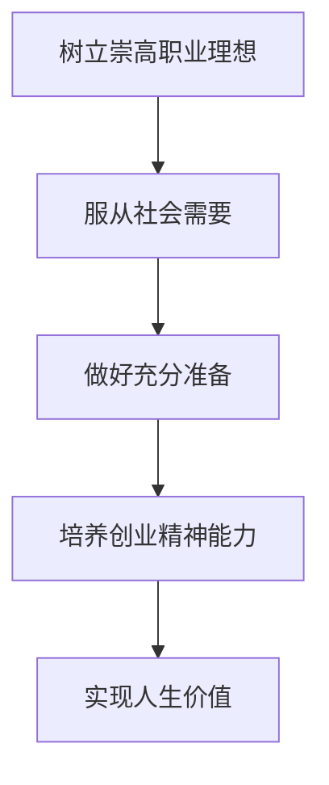

# 恪守职业道德与树立正确的择业观、创业观

## 什么是职业道德

职业道德，是指从事一定职业的人在职业生活中应当遵循的具有职业特征的道德要求和行为准则。职业生活顺利、是否成功，既取决于个人的专业知识和技能，更取决于个人的职业道德素养。其中，**奉献社会**是社会主义职业道德中最高层次的要求，体现了最高目标指向；**诚实守信**则是从业者步入职业殿堂的通行证，是立足行业的基础。

> [!IMPORTANT]
> 职业生活中的基本道德规范：**爱岗敬业、诚实守信、办事公道、服务群众、奉献社会**。其中奉献社会是最高层次要求，诚实守信是立身之本。

| 规范 | 核心要求 | 常见误区 |
|---|---|---|
| 爱岗敬业 | 忠于职守，勤勉尽责 | 误以为"跳槽"就是不敬业 |
| 诚实守信 | 诚实劳动，信守承诺 | 只在重大事情上守信 |
| 办事公道 | 公平正直，不徇私情 | 对熟人讲"灵活变通" |
| 服务群众 | 热情周到，方便群众 | 把服务当作额外负担 |
| 奉献社会 | 不计个人得失做贡献 | 认为奉献与个人利益完全对立 |

## 为什么要树立正确择业观

先想一个问题：找工作时，是"我想干什么"更重要，还是"社会需要什么"更重要？

其实两者并不矛盾。职业不仅是个人谋生的手段，更是实现人生价值、服务社会的舞台。如果只盯着个人待遇，容易陷入"高不成低不就"的困境；如果完全忽视个人理想，又难以长久坚持。正确的择业观，就是把个人理想与社会需要统一起来。

## 如何树立正确择业观

> [!TIP]
> 择业观记忆口诀：**理想崇高、服务社会、准备充分、敢于创业**。

- **树立崇高职业理想，重视人生价值实现**：职业选择不应只看薪酬待遇，更要看能否发挥自身才能、实现人生价值。把个人追求融入社会进步之中，职业才有持久的动力。
- **服从社会发展的需要**：择业时要考虑国家发展战略和社会实际需求，把个人意愿与社会需要结合起来。国家鼓励大学生到基层、到西部、到祖国最需要的地方建功立业，这正是实现人生价值的重要途径。
- **做好充分的择业准备**：就业竞争归根到底是素质的竞争。要主动学习专业知识，提升综合能力，培养良好职业道德素养，才能适应职业岗位的要求。

## 如何树立正确创业观

创业不仅是创办企业，更是一种敢为人先、勇于创新的精神品质。大学生要培养**创业精神和创业能力**，敢于创新、勇于实践，在创新创业中展现才华、服务社会。

## 常见误区

> [!WARNING]
> 易错点：奉献社会是**最高层次**要求，不是"最基本"要求；诚实守信是**通行证/基础**，不要与"最高层次"混淆。

> [!CAUTION]
> 高危误区：认为"服从社会需要"就是放弃个人理想。正确理解是——个人理想只有与社会需要相结合，才能获得更广阔的发展空间，二者是统一的而非对立的。

## 例题示范

**简答题：如何树立正确的择业观和创业观？**

**参考答案：**

1. 树立崇高职业理想，重视人生价值实现；
2. 服从社会发展的需要，把个人择业与国家需求相结合；
3. 做好充分的择业准备，提升综合素质以适应职业要求；
4. 培养创业精神和能力，敢于创新、勇于实践。

> [!NOTE]
> 答题要点齐全即可得分，注意"崇高理想"与"服从需要"的逻辑顺序：先谈个人价值追求，再谈与社会需要的结合，最后落到能力提升与创业实践。
