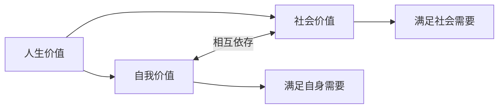
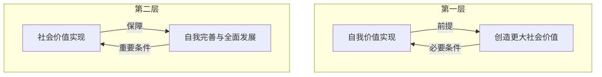

# 人生的自我价值与社会价值的辩证统一（社会价值是基础）

## 人生的自我价值与社会价值：一对拆不开的矛盾统一体

先从一个问题开始：一个人“为自己而活”和“为社会而活”，真的能完全分开吗？

试想一个通信工程专业的学生，花了四年时间学信号与系统、通信原理，最终进入企业做 5G 研发。他拿到薪水满足了自己的物质需要，同时也在为千万用户提供更快的网络服务。**他满足自己需要的过程，本身就是在创造社会价值。** 这就是这对概念的起点。

---

### 两个概念分别指什么

> [!IMPORTANT]
> **人生的自我价值**：个体的人生活动对自己的生存和发展所具有的价值，主要表现为对自身物质和精神需要的满足程度。
> **人生的社会价值**：个体的实践活动对社会、他人所具有的价值。

人生价值内在地包含这两个方面。用南邮的语境说：你在实验室调通一个电路，既提升了自己的工程能力（自我价值），也为团队项目推进做出了贡献（社会价值）。

---

### 二者的辩证关系：谁是谁的前提

教材反复考的核心就是这一句：==人生的自我价值和社会价值，既相互区别，又密切联系、相互依存，共同构成人生价值的矛盾统一体。==

拆成两层来理解：

**第一层：自我价值是实现社会价值的前提。**

个体首先要能生存、能发展，才谈得上为社会创造价值。一个连基本生活都无法保障的人，很难持续输出高质量的社会贡献。但注意——这绝不是说“先纯粹利己、等发达了再利他”。个体通过满足自我需要的过程（比如学习、工作），本身就包含满足社会需要的价值属性。

**第二层：社会价值是自我完善的保障。**

==没有社会价值，人生的自我价值就无法存在。== 人的本质是社会关系的总和，个体的自我完善必须在社会实践中完成。你不可能脱离社会关系来“实现自我”——一个人孤岛上没有“自我价值”可言，因为“价值”这个概念本身就预设了社会参照。

> [!TIP]
> 记忆口诀：**“自我是前提，社会是保障；相互给条件，谁也离不开谁。”** 答题时两句话都写全，不要只答一半。

---

### 常见的坑

> [!WARNING]
> **坑一：把“自我价值是社会价值的前提”理解为“利己优先于利他”。**
> 教材强调的是逻辑上的必要条件，不是时间上的先后顺序，更不是价值上的优先级。两者是**同时生成**的。

> [!CAUTION]
> **坑二：把“社会价值是基础”理解为“自我价值不重要”。**
> 题干若问“社会价值是基础（或更根本）”，是指社会价值为自我价值提供了方向和归属，而不是要否定个体正当需要的满足。

---

### 一个算对了的例子（简答题框架）

**题目**：什么是人生的自我价值和社会价值？简述二者关系。

**答案要点**：

| 要点 | 内容 |
|---|---|
| 自我价值定义 | 个体活动对自身生存发展的意义，满足自身物质和精神需要 |
| 社会价值定义 | 个体活动对社会、他人的意义 |
| 关系总述 | 既相互区别，又密切联系、相互依存，构成矛盾统一体 |
| 关系① | 自我价值是个体生存发展的**必要条件**，其实现是创造更大社会价值的**前提** |
| 关系② | 社会价值是社会存在发展的**重要条件**，其实现是自我完善、全面发展的**保障** |

最后可加一句收束：==个体通过努力满足自我需要的过程，同时就是创造社会价值的过程。==

---

### 一个延伸辨析：与“人生价值评价”的关系

人生价值内在地包含自我价值和社会价值，但**评价人生价值的根本尺度**只看一个方向：==看一个人的人生活动是否符合社会发展的客观规律，是否通过实践促进了历史的进步。== 这恰恰印证了社会价值在价值评价中的基础地位——不是看你得到了多少，而是看你贡献了什么。
