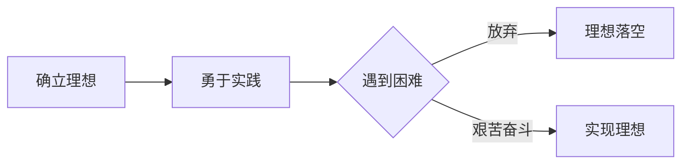

# 艰苦奋斗是实现理想的重要条件

> [!IMPORTANT]
> 核心结论：==艰苦奋斗是实现理想的重要条件==。理想信念不仅是思想认识问题，更是一个实践问题；而艰苦奋斗正是连接理想与现实的关键精神力量。

## 它是什么

先思考一个问题：如果一个人确立了远大理想，也找到了通往理想的桥梁（实践），他是否就一定能到达彼岸？

答案显然是否定的。因为实现理想具有长期性、艰巨性和曲折性。在这个过程中，必须有一种持续的精神动力来支撑行动，这就是艰苦奋斗。

- **主旨**：在于“奋斗”。
- **价值**：在于为事业而奉献。
- **本质**：一种精神状态，是成就任何事业都必不可少的精神力量和崇高美德。

## 为什么需要

理想的实现不是直线运动，而是一个螺旋上升的过程。

1. **客观规律的要求**：正确认识理想与现实的关系是实现理想的思想基础。现实与理想之间存在矛盾，化解这种对立统一关系，不能仅凭空想，必须依靠锲而不舍、驰而不息的奋斗。
2. **实践的内在要求**：只有实践才是通往理想彼岸的桥梁，而践行艰苦奋斗精神，是大学生实现理想的根本途径。没有奋斗的实践是软弱无力的。
3. **时代使命的呼唤**：当代青年要在实现中国梦的实践中放飞青春梦想，实现发展目标，离不开广大青年的艰苦奋斗。

> [!NOTE]
> 在新时代，艰苦奋斗的内涵有所变化（不再单纯指物质上的节衣缩食），但其==精神实质不变==，仍需大力发扬。

## 怎么做

对南邮学子而言，将艰苦奋斗落到实处需要做到以下几点：

- **认知层面**：把理想信念从思想认识转化为实践行动，拒绝“躺平”心态。
- **意志层面**：面对学业瓶颈或科研挫折时，保持锲而不舍的韧劲。
- **价值层面**：将个人理想与社会理想相统一，在为国家和通信信息事业奉献中体现奋斗的价值。

## 与相近概念的区别

许多同学容易将“艰苦奋斗”与“实践”混淆，或者将其等同于“吃苦”。

| 比较维度 | 艰苦奋斗 | 实践 | 单纯的“吃苦” |
| :--- | :--- | :--- | :--- |
| **属性** | 精神状态、重要条件 | 客观物质活动、根本途径 | 被动承受的身体感受 |
| **作用** | 提供克服困难的持久动力 | 通往理想彼岸的唯一桥梁 | 无明确目标导向 |
| **核心词** | 奋斗、奉献 | 行动、改造 | 忍受、受罪 |

> [!WARNING]
> 常见误区：认为现在生活条件好了，就不需要艰苦奋斗了。这是把艰苦奋斗等同于“过苦日子”。艰苦奋斗强调的是精神上的不懈怠和行动上的不畏难。

## 典型考题解析

以历年考过的简答题为例：“简述为什么说艰苦奋斗是实现理想的重要条件？”

**解题思路与标准示范：**

> [!TIP]
> 记忆口诀：“一状态、二途径、三时代”。答题时必须分点作答，踩准得分词。

**参考解答：**

1. **定性（是什么）**：艰苦奋斗是一种精神状态，是成就事业必不可少的精神力量和崇高美德。
2. **定位（为什么）**：艰苦奋斗是实现理想的重要途径（重要条件），任何理想的实现都需要经过艰苦奋斗。
3. **定调（怎么做/新时代）**：在新时代，艰苦奋斗的内涵有所变化，但精神实质不变，当代青年仍需发扬艰苦奋斗精神。

> [!CAUTION]
> 重点论述题中，若题目问及“如何实现理想”，切忌只答“艰苦奋斗”。必须写全逻辑链：==正确认识理想与现实的关系（思想基础） $\to$ 勇于实践（根本途径/桥梁） $\to$ 艰苦奋斗（重要条件）==。漏掉“实践”会严重失分。
