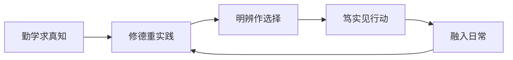

# 把社会主义核心价值观落细落小落实（大学生自觉践行的途径）

## 是什么：把价值观变成日常行动

“落细落小落实”，就是把富强、民主、文明、和谐，自由、平等、公正、法治，爱国、敬业、诚信、友善这些价值要求，转化为大学生可观察、可坚持、可检验的日常行为。

- **落细**：把原则分解为具体要求，如把“敬业”落实为认真听课、诚信完成实验。
- **落小**：从身边小事做起，如遵守校纪、尊敬师长、团结同学。
- **落实**：做到知行合一，不只记住表述，更在学习、交往和公共生活中持续践行。

> [!IMPORTANT]
> 大学生自觉践行的基本路径是：==勤学、修德、明辨、笃实==。这是简答题必须完整写出的四点。

## 为什么需要：青年价值选择影响社会未来

青年的价值取向既关系个人成长，也影响未来整个社会的价值取向。社会主义核心价值观只有进入日常生活，才能从“国家倡导”转化为社会成员的共同追求和自觉行动。

对大学生而言，践行核心价值观不是专业学习之外的附加任务，而是回答“为何学习、怎样做人、如何选择、如何担当”的价值指引。它既体现在平时的小事中，也体现在面对利益冲突、网络争议和公共责任时的选择中。

## 怎么做：勤学修德，明辨笃实

| 路径 | 核心要求 | 大学生可做的行动 |
|---|---|---|
| **勤学** | 下得苦功夫，求得真学问 | 刻苦学习、求真问学，不抄袭、不弄虚作假 |
| **修德** | 加强道德修养，注重道德实践 | 明大德、守公德、严私德，诚信友善 |
| **明辨** | 善于明辨是非，善于决断选择 | 面对网络信息和利益诱惑，辨清善恶美丑 |
| **笃实** | 扎扎实实干事，踏踏实实做人 | 从小事做起、持之以恒，做到知行合一 |

这四方面相互贯通：勤学提供知识和本领，修德明确做人方向，明辨解决价值判断与选择问题，笃实把认识和品德转化为持久行动。在此基础上，还应主动服务集体、承担社会责任，并以自身行动带动同学共同践行。

> [!TIP]
> 简答题先写“勤学、修德、明辨、笃实”，再分别接一句教材表述。论述题可补充“融入日常、勇于担当、带动他人”，但不能用这些补充内容替代四个基本点。

## 相近概念与常见误区

| 相近表述 | 与本知识点的关系 |
|---|---|
| 三个层面的价值要求 | 回答国家、社会、公民分别倡导什么，是践行内容 |
| 做核心价值观的践行者 | 强调主体和行动，基本路径是勤学、修德、明辨、笃实 |
| 核心价值观写入宪法 | 体现国家倡导及其重大意义，不等于个人已经自觉践行 |

> [!WARNING]
> 不要把“落小”理解成只做琐碎小事，也不要把“落实”理解成偶尔参加一次活动。它要求==从小处着手、在关键处担当，并长期坚持==。只背二十四字、只喊口号或只写个人成绩，都没有完整回答“践行”。

## 例题示范：论述题怎样答完整

**题目：** 作为当代大学生，应如何把社会主义核心价值观落细落小落实？

**合格作答思路：**

青年的价值取向关系未来社会的价值取向。大学生应坚持勤学、修德、明辨、笃实：刻苦学习、求得真学问；加强道德修养、注重道德实践；善于明辨是非、作出正确选择；扎实干事、踏实做人。同时，把核心价值观融入日常学习生活，从遵守校纪、诚信学习、尊敬师长、团结同学等小事做起；在网络言论和利益选择中守住价值准则，在集体需要和社会实践中勇于担当，并带动周围同学共同践行，实现由价值认同到行为习惯的转化。

这一答案先用四点搭起教材框架，再补充日常行动、关键选择和社会担当，既有基本得分点，也体现了“落细、落小、落实”。
