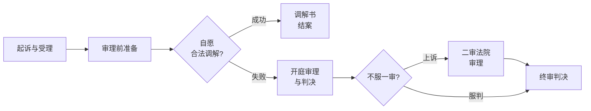
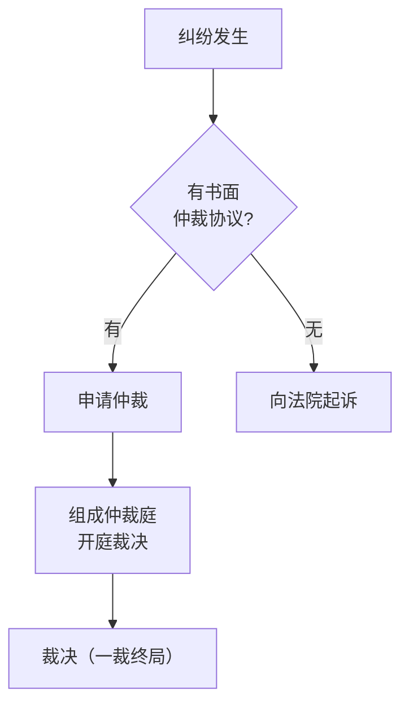

# 诉讼法概述及我国的民事和刑事诉讼制度（含仲裁基本原则）

## 诉讼与仲裁：权利救济的“最后防线”

我们先从一个很贴身的设问开始：

> 你和别人签了一份借款合同，对方到期不还，协商了几次都没结果。这时候你能怎么办？

你可能想到“告他”“找警察”“找人调解”。但法律上，这些选项分属两条路：**非诉讼途径**（如人民调解、仲裁）和**诉讼途径**（打官司）。而整个民事争议的强制性终局解决，最后靠的就是**诉讼法律制度**。

>[!IMPORTANT]
> ==司法保障是公民权利保障的最后防线==。它既是解决个人之间权利纠纷的有效渠道，也是纠正和遏制行政机关侵犯公民权利的有力机制。

---

### 诉讼法的本质：把“私力救济”关进规则的笼子

**诉讼法**就是规范国家司法活动、解决社会纠纷的法律规范总称。它的对立面是什么？——古代那种“以牙还牙”的私力报复，或是谁更强谁有理。诉讼法用一套透明的程序，==让国家强制力在规则的轨道上运行==。

我国的**民事诉讼制度**，主要由《民事诉讼法》确立，核心原则如下表：

| 原则 | 为什么重要 |
| :--- | :--- |
| **当事人诉讼权利平等** | 不论原告被告、国企民企，程序面前一律平等 |
| **调解自愿与合法** | 能调则调，但绝不“压着调” |
| **公开审判** | 把司法权放在阳光下，防止暗箱操作 |
| **两审终审** | 一个案子最多经过两级法院审理即告终结 |

这些原则组合起来，构成一条典型的诉讼流程：

>[!TIP]
> 记忆口诀：**“公（公开审判）、平（平等）、两（两审终审）、自（自愿调解）”**。

---

### 仲裁：绕不开的“一裁终局”

很多时候，合同里会写一句：“因本合同引起的争议，双方提交某仲裁委员会仲裁。”这走的就是**非诉讼程序法**中的**仲裁**。

>[!IMPORTANT]
> **三大基本原则**
> *   **自愿原则**：没有双方的书面仲裁协议，仲裁委无权管。诉讼则不需要双方协议，一方起诉即可。
> *   **仲裁独立原则**：仲裁委独立于行政机关，依法独立裁决。
> *   **一裁终局原则**：裁决一经作出，立刻生效，没有上诉机会。这与诉讼的“两审终审”完全不同，也是仲裁最大的特点。

---

### 解题实操：一个算对了的例子

**原题重现：**  
债权人向债务人要债，债务人到期未清偿，协商无效，债权人可以通过什么途径解决？

**分析步骤：**

1.  **定性**：这是平等主体之间的民事债权纠纷，绝非刑事案件，公权力机关不会主动介入“讨债”。
2.  **穷举与排序**：纠纷解决途径在法治框架下分为非诉讼与诉讼两大类。
    *   **第一层：协商（自力救济）**。题干已说“协商无效”，此路不通。
    *   **第二层：调解（社会救济）**。可寻求人民调解委员会进行调解，成本低，速度快。
    *   **第三层：仲裁（准司法救济）**。看双方有无书面仲裁协议或合同中有无仲裁条款。==注意：**没有仲裁协议，不能单方提起仲裁**==。
    *   **第四层：诉讼（公力救济）**。协商无效，且无仲裁协议（或无需仲裁）时，债权人可直接向有管辖权的法院提起诉讼。这是最后的强制保障。
3.  **结论表述**：途径为**调解、仲裁、诉讼**。

>[!WARNING]
> **常见易错坑**：很多同学答题会直接写“去法院告他”，而漏掉了**调解**和**仲裁**两项法定途径。题目问的是“可以通过哪些途径”，要穷尽所有合法的可能。

---

### 仲裁 vs. 诉讼：一张表搞定所有区别

| 对比项 | 仲裁 | 诉讼 |
| :--- | :--- | :--- |
| **启动前提** | 必须有双方 ==书面仲裁协议== | 无需对方同意，单方即可起诉 |
| **审理原则** | 原则上 ==不公开== | 以公开审判为原则 |
| **审判层级** | ==一裁终局==，没有上诉 | 两审终审，可上诉 |
| **性质** | 非诉讼程序 | 诉讼程序 |
| **管辖权来源** | 双方协议选择 | 法律强制规定 |

当你再遇到那个借款纠纷的设问时，脑子里就不只是一个“告”字，而是清晰的四大步：协商、调解、仲裁、诉讼。法治素养，正体现在这种从感性冲动到理性循法的思维转换里。
