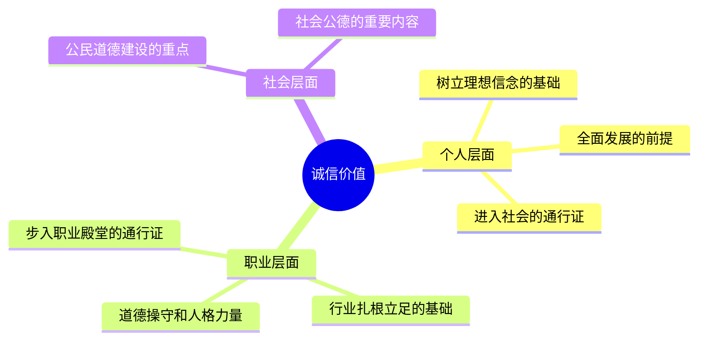

# 诚信（诚实守信）的道德要求与实践

## 是什么

**诚信**，即**诚实守信**，是个体在社会交往中应当遵循的基本道德准则。它包含相互联系的两个层面：

- **诚实**：真实无欺，既不自欺，也不欺人。强调内心与言行的一致性，即"心口如一"。
- **守信**：重诺言、讲信誉、守信用。强调对他人承诺的兑现，即"言行一致"。

在社会主义核心价值观中，诚信与爱国、敬业、友善共同构成公民个人层面的价值追求，回答了"培育什么样的公民"的重大问题。作为中华民族的传统美德，诚信也是我国公民道德建设的重点。

## 为什么需要

诚信绝非可有可无的个人私德，而是具有基础性、通行证功能的社会公德。

> [!IMPORTANT]
> **核心定位**：诚实守信是公民道德建设的重点，是从业者步入职业殿堂的**通行证**，体现着从业者的道德操守和人格力量，是在行业中扎根立足的**基础**。

## 怎么做

践行诚信要求"知"与"行"的统一，需在不同生活领域具体落实：

| 生活领域 | 具体要求 | 反面警示 |
|---------|---------|---------|
| **网络生活** | 诚实劳动，信守承诺，不造谣、不传谣、不信谣 | 网络欺诈、虚假宣传、人肉搜索 |
| **职业生活** | 爱岗敬业、诚实守信、办事公道、热情服务、奉献社会 | 弄虚作假、见利忘义、背信弃义 |
| **人际交往** | 促进个人与他人和谐，坚持诚信原则，言行一致 | 口是心非、阳奉阴违、轻诺寡信 |
| **个人修养** | 诚心做事、诚实做人、表里如一 | 自欺、欺人、双重人格 |

> [!TIP]
> **记忆口诀**：诚信为本，操守为重；言必信，行必果；表里如一，知行合一。

## 和相近概念的区别

**诚信 vs 友善**：友善侧重对他人的**善意与友好**，是一种情感态度；诚信侧重**真实与守信**，是一种行为准则。友善可能表现为"善意的谎言"，但诚信要求"心口如一"，二者在特定情境下需要道德智慧的平衡。

**诚信 vs 守法**：诚信是**道德要求**，依靠内心信念、传统习俗和社会舆论维系；守法是**法律义务**，依靠国家强制力保障。但二者相辅相成——诚信是守法的精神基础，守法是诚信的制度保障。

**诚信 vs 集体主义**：集体主义强调公私关系（如"顾全大局、诚实劳动"），是处理个人与集体利益的**原则**；诚信是处理个人与他人、个人与社会关系的**规范**。诚实劳动是集体主义对公民最基本的要求之一，也是诚信在职业领域的体现。

## 常见的坑

> [!WARNING]
> **易混淆点**：诚信不仅是"不说谎"，更是"重承诺"。 
> - 误区一：认为诚信仅指诚实（不说假话），忽视守信（兑现承诺）。考试常考查"诚实劳动"作为集体主义的基本要求，与诚信的关联。
> - 误区二：将诚信仅视为个人私德，忽视其作为**公民道德建设重点**和**社会公德**的属性。诚信不仅是自我修养，更是维护公共秩序、促进社会和谐的基础。

**考试陷阱**：区分"诚信是大学生进入社会的通行证"（对个人发展的意义）与"诚信是从业者步入职业殿堂的通行证"（对职业发展的意义）。两者都强调"通行证"功能，但适用语境不同，前者侧重个人成长，后者侧重职业生涯。

## 一个算对了的例子

**题目**：如何理解"诚实守信是从业者步入职业殿堂的通行证"？

**解析**：此题考查诚信在职业道德中的基础性地位。

**正确思路**：
1. **定位知识点**：本题涉及"职业道德的基础"（P117）及"公民道德建设的重点"（P109）。
2. **关键区分**：注意区分"通行证"的双重含义——既是进入职业的**资格凭证**（无信不立），也是在行业中**长期发展的根基**（人格力量）。
3. **结合材料**：引用复习提纲中"体现着从业者的道德操守和人格力量，是在行业中扎根立足的基础"进行阐释。

**答案要点**：
- 诚实守信是中华民族传统道德，是公民道德建设的**重点**。
- 在职业领域，诚信是**基本道德规范**（爱岗敬业、诚实守信、办事公道、热情服务、奉献社会）的核心要素。
- 它不仅是进入职场的**准入资格**（通行证），更是立足行业、赢得信任的**道德根基**（人格力量）。
- 对大学生而言，诚信是树立理想信念的**基础**、全面发展的**前提**、进入社会的**通行证**。

> [!NOTE]
> **答题技巧**：遇到诚信类题目，优先联想"公民道德建设重点""通行证""基础"这三个关键词，并结合具体领域（职业/网络/个人）展开。
