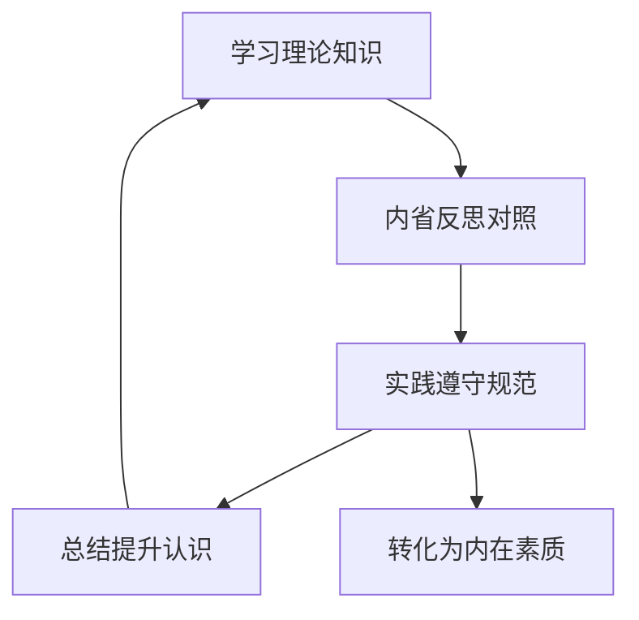

# 学习本课程的意义和方法（坚持学以致用、知行结合）

## 它是什么

“坚持学以致用、知行结合”是学习《思想道德与法治》的根本方法。它要求把课堂上学到的道德规范、法律知识与自己的实际行为结合起来，做到**学习规范和遵守规范相统一、知识学习和实践养成相统一**，最终把外在规范转化为内在素质。

> [!IMPORTANT]
> 知行结合不是“先学完理论再去实践”，而是**在学中做、在做中学**，二者相互促进、同步深化。

## 为什么需要

如果只背概念、不付诸行动，思想道德和法治知识就永远停留在书本上，无法真正塑造人的品格。反过来，如果只有零散经验、没有理论指导，实践也容易迷失方向。因此：

- **知是行的先导**：正确的道德认知、法治观念指引实践方向；
- **行是知的落实**：只有在实践中才能真正理解、内化规范；
- **知行统一是道德人格养成的必由之路**。

## 怎么做

具体路径可概括为四句话：**在学习中升华、在内省中完善、在自律中养成、在实践中锤炼**。同时，还要掌握应对心理问题的方法和知识，实现身心协调发展。

## 和相近概念的区别

| 概念 | 侧重点 | 误区 |
|------|--------|------|
| 学以致用 | 强调知识服务于实践 | 不等于“实用主义”，忽视理论深度 |
| 知行结合 | 强调认知与行为同步统一 | 不等于“边学边做”，忽视内省反思 |
| 道德修养 | 侧重个人品德养成 | 不等于闭门思过，必须结合社会实践 |

> [!WARNING]
> 常见误区：把“知行结合”理解为“理论考试高分＝素质高”。实际上，**知识只有转化为行为习惯和稳定品格**，才算真正学到。

## 一个算对了的例子

> [!TIP]
> 以考试简答题“学习本课程的意义”为例，答题时不仅要列出“三个有助于”，还应说明：**只有坚持知行结合，这些意义才能真正实现**。

**参考答案要点**：

1. 有助于大学生领悟人生真谛，坚定理想信念，践行社会主义核心价值观，做新时代的忠诚爱国者和改革创新的生力军；
2. 形成正确的道德认知，积极投身道德实践，做到明大德、守公德、严私德；
3. 全面把握社会主义法律的本质、运行和体系，增进法治意识，养成法治思维，做到尊法学法守法用法。

在论述时补充一句“坚持学以致用、知行结合，把学习成果转化为实际行动，才能真正具备优秀的思想道德素质与法治素养”，即可体现对这一方法的深刻理解，拿到高分。
